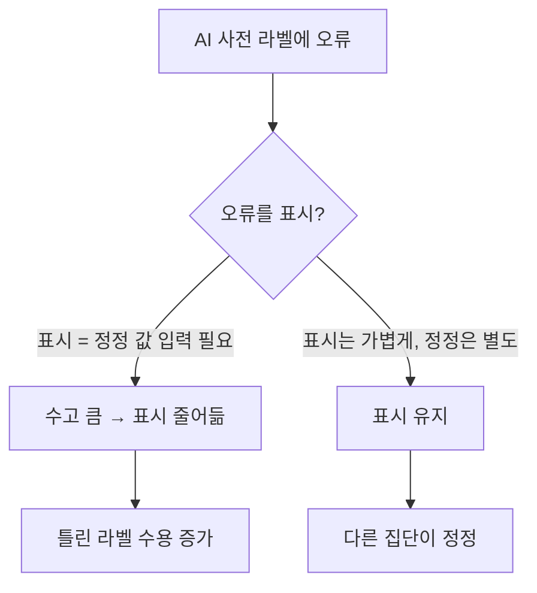
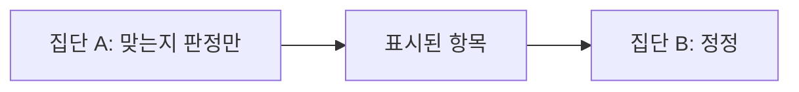

# 오류 수정 강제의 역효과

> 검수자가 AI 사전 라벨에 오류가 있다고 표시할 때 **정정 값을 직접 입력해야 하는 설계**를 두면, 검수자가 번거로움을 피하려고 오류 표시를 덜 하게 되어 틀린 라벨의 수용이 늘어난다는 현상이다.

## 쉽게 말하면
"문제가 있으면 신고하세요"가 아니라 "신고하려면 보고서를 3장 써야 합니다"라고 하면, 사람들은 작은 문제를 보고도 그냥 넘어가 버린다. 오류를 잡는 일 자체보다 **잡은 뒤의 수고**가 행동을 바꾼다.

## 자세히
(Beck 등 2025 arXiv 2509.08514와 Buçinca 등 arXiv 2102.09692의 초록을 직접 확인.)
- **가설과 실험(Beck 2025)**: 정정에 드는 작업량이 늘면 정정이 줄 것이라는 가설(H1)을 세우고, 오류로 표시한 사전 라벨에 **정정 값을 입력하게 하는 조건**과 그렇지 않은 조건을 비교했다(2,784명, 배출량 표 주석, 사전 라벨에 의도적 오류 포함). 이는 설문 연구에서 알려진 "수고를 피하려는 허위 응답"과 같은 원리라고 저자들은 설명한다.
- **결과**: 정정이 필수인 조건에서 **정정 횟수가 유의하게 줄고, 과소교정(틀린 걸 못 고침)이 늘고, 과교정(맞는 걸 고침)은 줄었다**. 전체 정확도는 정정 필수 조건이 68%, 아닌 조건이 66%로 오히려 약간 높았다(p=0.028). 저자들은 작업량을 줄이려 오류를 덜 보고하는 약한 경향을 지적한다. 초록은 이를 "참여 감소와 틀린 제안 수용 증가"로 요약한다. 정확도가 높아진 것은 과교정 감소의 효과가 더 컸기 때문으로 보이지만 저자가 직접 그렇게 분해해 보고했는지는 확인하지 못했다.
- **권고(논문)**: 이런 메커니즘이 바람직하지 않다면 작업을 **분리**한다 — 한 집단은 사전 라벨이 맞는지 **판정만** 하고, 다른 집단이 표시된 항목의 **정정**을 맡게 해 "오류 판정"이 곧 "내 일이 늘어남"이 되지 않게 한다.
- **대비되는 연구(Buçinca 등, 초록)**: AI 설명과 함께 **인지 강제 장치(cognitive forcing functions)**를 두면 N=199 실험에서 과신이 단순 설명 방식보다 유의하게 줄었다. 다만 과신을 가장 많이 줄인 설계가 주관 평가는 가장 낮았다. 즉 **검수자가 깊이 생각하게 만드는 강제**는 효과가 있을 수 있지만, 이 글의 "정정 값 입력 강제"는 정정을 피하게 하는 **수고 부담**이라 방향이 다르다. 두 연구는 과제와 방식이 달라 직접 비교는 못 한다.
- **설계 체크리스트(제안)**: ① 오류 표시는 한 번 클릭으로 가볍게 ② 정정 입력은 별도 단계나 별도 검수자 ③ 승인·거부 비율과 처리 시간 모니터링 ④ 거부를 불이익처럼 느끼게 하는 UI·성과 지표 피하기 ⑤ 검수 대기열에서 표시된 항목 수 자체를 지표로 삼지 않기.

## 그림으로 보기

## 예시
- 사전 라벨 검수 UI에서 "수정" 버튼을 누르면 새 값을 입력하는 창이 뜨고 "승인"은 한 번 클릭이면 → 승인율이 비정상적으로 높고 처리 시간이 짧은 검수자를 점검, 판정과 정정을 나눈 두 단계 UI로 변경.
- 교육 소재: "AI 결과를 고치기 어려운 업무 프로세스는 오류를 못 잡는다"를 사례로 설명(업무 자동화 승인 단계 설계).

## 헷갈리는 것과 비교
| 개념 | 차이 |
|---|---|
| 오류 수정 강제의 역효과 | 정정 수고가 오류 표시를 줄임 |
| [사전 라벨 자동화 편향](#automation-bias-prelabel) | 모델 제안에 끌려 승인 |
| [회의적 검수자 효과](#skeptical-reviewer-effect) | 검수자 태도가 정확도를 가름 |
| [정정 마찰과 UI 설계](#correction-friction-ui) | 이 현상을 UI 관점에서 다룸 |

## 더 읽을거리
- [Bias in the Loop (arXiv 2509.08514)](https://arxiv.org/abs/2509.08514) — 정정 필수 조건 실험과 분리 권고(PDF 직접 확인).
- [To Trust or to Think: Cognitive Forcing Functions Can Reduce Overreliance on AI (arXiv 2102.09692)](https://arxiv.org/abs/2102.09692) — 인지 강제 장치와 선호도 trade-off(초록 직접 확인).
