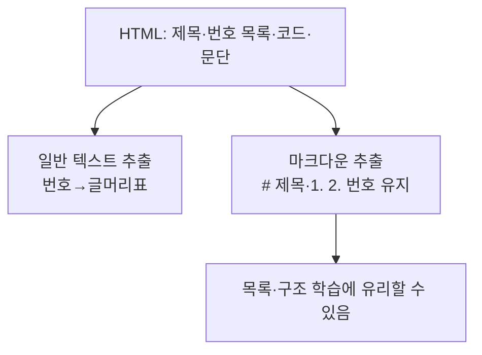

# 서식 보존 추출

> HTML에서 본문을 뽑을 때 **제목·목록·줄바꿈·들여쓰기 같은 서식을 최대한 유지**해 텍스트로 옮기는 방식. 서식이 남으면 모델이 목록·코드·구조화된 글쓰기를 학습하는 데 도움이 된다고 알려져 있다.

## 쉽게 말하면
요리책에서 "재료 목록"과 "1, 2, 3단계"의 번호를 지우고 한 줄로 이어 붙이면 읽기 어렵다. 서식을 남기면 글의 구조가 같이 전달된다.

## 자세히
- **Gopher의 접근(arXiv 2112.11446 부록 A.1, PDF 직접 읽음)**: MassiveWeb은 HTML 마크업의 **트리 구조**를 이용해, 같은 수준의 의미 태그 묶음에 있는 응집된 텍스트 블록을 찾아 일반 텍스트로 바꾸며 "들여쓰기·줄바꿈·글머리표 같은 의미 있는 서식을 보존"했다. 논문은 이렇게 얻은 서식의 다양성이 Gopher의 **생성 능력**에 효과적으로 반영된다고 설명한다(인과 검증 수치는 이번에 확인하지 못했다).
- **직접 실행(2026-11-28, trafilatura 2.4.0)**: 제목, 문단, 번호 목록(`ol`), 코드 블록(`pre`), 문단이 있는 HTML에서
  - 기본 `extract`: `Setup guide\nInstall the package first.\n- Run pip install\n- Import the module\nimport x\nx.run()\nThen restart.` — **번호가 사라지고 `-` 글머리표**로 바뀌었다. 제목과 문단 사이 빈 줄도 없다.
  - `output_format='markdown'`: `# Setup guide`, 빈 줄로 구분된 문단, **`1. … 2. …` 번호 목록**이 유지됐다. 코드 블록의 코드 줄은 유지됐지만 ``` 같은 코드 펜스 표시는 붙지 않았다.
  - `include_formatting=True`를 더해도 이 예제에서는 결과가 같았다.
- **선택 기준(제안)**: 목록·코드·표가 중요한 도메인(기술 문서, 레시피)에서는 마크다운 출력이 유리하고, 단순 문장 말뭉치는 일반 텍스트면 충분하다. 어느 쪽이 모델 품질에 더 도움이 되는지는 ablation으로 확인해야 한다([ablation 실험 설계](#ablation-experiment-design)).
- **주의**: 서식 기호(`#`, `-`)가 많으면 토큰이 늘고, 품질 필터(글머리표 줄 비율 90% 초과 제거 등)와 충돌할 수 있다([불용어 필터](#stop-word-filter), Gopher 규칙).
- 한계: 한 가지 작은 HTML에서의 시험이고 코드 펜스·표 처리 등 세부는 확인하지 못했다.

## 그림으로 보기



## 예시
| 출력 방식 | 번호 목록 결과 |
|---|---|
| 기본 | `- Run pip install` (번호 사라짐) |
| markdown | `1. Run pip install` (번호 유지) |
```python
trafilatura.extract(html, output_format="markdown")
```
- 업무 장면: 사내 기술 문서를 RAG용으로 쪼갤 때 마크다운으로 추출해 제목 계층을 청크 분할 기준으로 쓴다.

## 헷갈리는 것과 비교
| 개념 | 차이 |
|---|---|
| 서식 보존 추출 | 구조를 유지한 텍스트 변환 |
| [보일러플레이트 제거](#boilerplate-removal) | 본문이 아닌 요소 제거 |
| [trafilatura 본문 추출기](#trafilatura-extractor) | 서식 출력 옵션을 가진 도구 |
| [마크다운 추출 출력](#markdown-extraction-output) | 같은 주제의 세부 옵션 |

## 더 읽을거리
- [Gopher (arXiv 2112.11446)](https://arxiv.org/abs/2112.11446) — 서식 보존 텍스트 추출 설명(PDF 직접 읽음).
- [trafilatura 문서](https://trafilatura.readthedocs.io/) — 출력 형식 옵션(설치해 직접 실행 확인).
