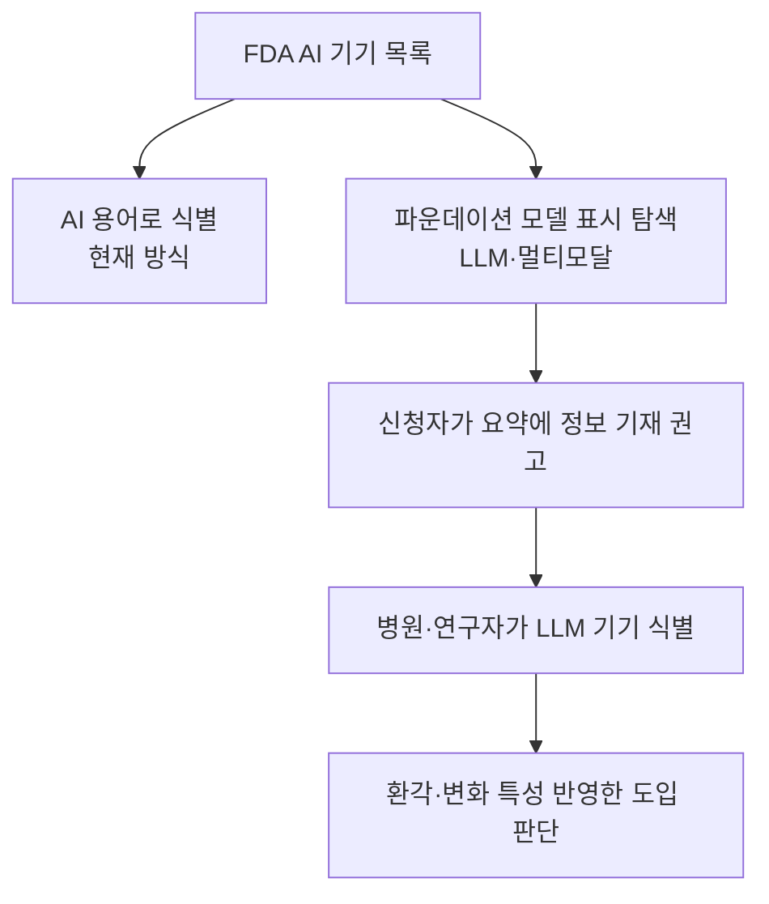

# 파운데이션 모델 기기 표시

> FDA가 AI 의료기기 목록에서 대규모 언어 모델(LLM)부터 멀티모달 시스템까지 **파운데이션 모델을 쓰는 기기를 식별·표시하는 방법을 탐색하겠다고 밝힌 계획**. 목적은 LLM 기능이 들어 있는지를 보이게 하는 것이다. (2026-11 시점 확인한 내용: 아직 시행 중이라는 근거 없음)

## 쉽게 말하면
식품에 알레르기 성분 표시가 있어야 먹을지 판단하듯, 의료기기에 "LLM 기반 기능이 있음" 표시가 있어야 병원이 그 특성(환각, 시간에 따른 변화)을 감안해 도입을 판단할 수 있다.

## 자세히
출처: FDA "List of AI-Enabled Medical Devices" 페이지(열어서 읽음, 앞 10만 자만 확인)와 Jones Day의 DHAC 회의 사전 안내(열어서 읽음).
- **FDA 문구(요지)**: 파운데이션 모델, 즉 LLM에서 멀티모달 시스템까지 사용하는 기기를 식별하고 **표시(tag)하는 방법을 탐색**하겠다. 기기에 LLM 기반 기능이 있는지 보여 주기 위함이며, 신청자에게 공개 요약에 관련 정보를 넣도록 권한다.
- **아직 없는 것**: 페이지는 표시가 이미 시행됐다거나 일정이 있다고 쓰지 않는다. 검색에서도 목록에 파운데이션 모델 태그가 생겼다는 근거는 찾지 못했다.
- **배경 — DHAC 첫 회의(2024-11-20~21, 메릴랜드 게이더스버그)**: 디지털 헬스 자문위원회가 생성형 AI 기기의 전 주기 고려사항을 논의. 주제는 시판 전 성능 평가(파운데이션 모델이 "시간에 따라 변하고" 학습 데이터 정보가 제한적일 수 있음), 위험 관리(거버넌스·교육·피드백·실사용 성능 평가), 시판 후 모니터링. 자료는 회의 전 로펌 안내라 실제 발언은 담지 않는다.
- **후속(검색 요약)**: 2025-11-06 DHAC 두 번째 회의는 생성형 AI 정신건강 기기를 다뤘고, FDA 요약에 따르면 허가된 AI 기기는 1,200개 이상이나 정신건강용 생성형 AI는 아직 없다고 했다(원문 미확인).
- **목록 한계**: 목록은 요약문의 AI 용어에 의존하는 비포괄적 자료라 LLM 기기를 지금은 확실히 가려내기 어렵다.

## 그림으로 보기

## 예시
- 병원 도입 점검: 후보 AI의 허가 요약에 "LLM 사용 여부"와 업데이트 방식이 적혀 있는지 확인하고, 없으면 제조사에 서면으로 묻는다.
- 연구: 목록 CSV에서 요약문에 "large language model" 같은 단어가 있는 기기를 직접 검색해 표를 만든다(목록이 포괄적이지 않다는 한계 명시).

## 헷갈리는 것과 비교
| 개념 | 차이 |
|---|---|
| [FDA AI 기기 목록](#fda-ai-enabled-device-list) | 상위 자료, 현재는 AI 용어 기반 식별 |
| 생성형 AI 기기 | 출력·기능에 생성형 AI가 핵심인 기기, DHAC가 논의 |
| [변경 관리 계획(PCCP)](#pccp) | 허가 후 AI 업데이트 관리, 표시와 별개 |
| [FDA 기기 데이터베이스](#fda-device-database) | 개별 허가 기록 조회 |

## 더 읽을거리
- [List of AI-Enabled Medical Devices (FDA)](http://www.fda.gov/medical-devices/artificial-intelligence-enabled-medical-devices/list-artificial-intelligence-enabled-medical-devices) — 식별 방식과 파운데이션 모델 표시 탐색 문구(열어서 확인)
- [Inaugural DHAC meeting (Jones Day, 2024-11)](https://www.jonesday.com/fr/insights/2024/11/inaugural-meeting-for-fdas-digital-health-advisory-committee-to-focus-on-genaienabled-medical-devices) — 생성형 AI 기기 논의 주제(열어서 확인)
