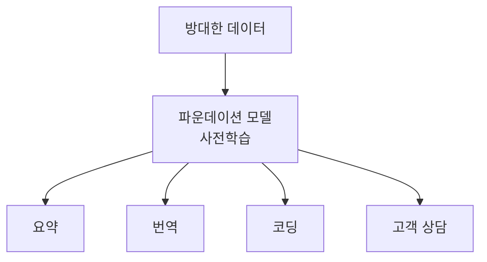

# 파운데이션 모델

> 방대한 데이터로 한 번 크게 학습한 뒤 미세조정·프롬프트로 여러 작업에 쓰는 범용 모델.

## 쉽게 말하면
기초 공사를 크게 해 둔 건물 토대다. 그 위에 상담소, 도서관, 사무실을 각각 올리듯, 하나의 거대한 모델 위에 번역·요약·코딩 같은 용도를 얹는다.

## 자세히
- 용어는 Stanford CRFM·HAI의 보고서 "On the Opportunities and Risks of Foundation Models"(Bommasani, Liang 외 114명, arXiv 2108.07258, 2021년 8월)에서 퍼졌다. 정의: "broad data at scale로 학습되어 광범위한 하위 작업에 적응 가능한 모델".
- **창발(emergence)**: 규모가 커지며 설계하지 않은 능력이 나타남.
- **동질화(homogenization)**: 많은 시스템이 같은 기반 모델에 기대므로 효율은 오르지만 기반 모델의 결함이 전부에 전파됨.
- 보고서가 꼽은 위험: 불평등, 오남용, 경제·환경 영향, 법·윤리 문제. 작동 원리에 대한 이해가 아직 부족하다고 지적.
- LLM은 텍스트용 파운데이션 모델의 대표 사례이고, 이미지·멀티모달 모델도 포함된다.

## 그림으로 보기

## 예시
같은 기반 LLM에 사내 문서를 검색해 붙이면 FAQ 봇이 되고, 코드 도구를 붙이면 코딩 에이전트가 된다. 모델 교체 시 모든 응용이 함께 영향을 받는다(동질화).

## 헷갈리는 것과 비교
| 개념 | 차이 |
| --- | --- |
| 파운데이션 모델 | 범용 기반 모델이라는 역할 |
| [생성형 AI](#generative-ai) | 새 콘텐츠를 만드는 능력 계열 |
| LLM | 텍스트 중심의 파운데이션 모델 |

## 더 읽을거리
- [On the Opportunities and Risks of Foundation Models](https://arxiv.org/abs/2108.07258) — 용어를 만든 Stanford 보고서
