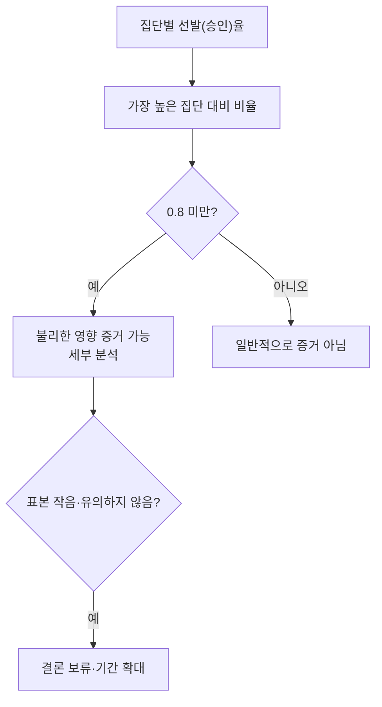

# 4/5 규칙

> 어떤 집단의 선발(승인)율이 가장 높은 집단의 80%(4/5) 미만이면 불리한 영향의 증거로 보는 미국 연방 기관의 경험칙. 고용 선발 지침(29 CFR 1607.4(D))에서 나왔다. 어디까지나 스크리닝 도구다.

## 쉽게 말하면
A 집단 합격률이 50%인데 B 집단이 38%라면 38/50 = 0.76으로 0.8 아래다. "차이가 우연이 아닐 수 있으니 자세히 보자"는 신호등이지 유죄 판결이 아니다.

## 자세히
출처: 29 CFR 1607.4 조문(Cornell LII, 2026-11-15 확인).
- **조문**: 인종·성별·민족 집단의 선발률이 가장 높은 집단 선발률의 4/5(80%) 미만이면 연방 집행기관이 일반적으로 불리한 영향의 증거로 본다. 4/5 이상이면 일반적으로 그렇지 않다.
- **예외(표본)**: 작은 숫자에 근거하고 통계적으로 유의하지 않은 큰 격차는 불리한 영향이 아닐 수 있다. 특별 모집으로 후보군이 이례적인 경우도 마찬가지. 숫자가 너무 작아 신뢰하기 어려우면 기관이 더 긴 기간이나 비슷한 상황의 결과를 고려할 수 있다.
- **반대 방향**: 4/5보다 작은 격차(즉 80% 이상)라도 통계적·실질적으로 모두 유의하면 불리한 영향이 될 수 있다. 지원자를 위축시키는 행위도 근거가 될 수 있다.
- **자료 미보존**: 필요한 영향 자료를 보존하지 않으면 기관이 불리한 영향을 추정할 수 있다.
- **신용 분야 적용**: 이 규칙은 고용 지침의 일부다. 신용·주택 분야에서 같은 기준이 법적 기준인 것은 아니며, 실무에서 승인율 비교 스크리닝에 참고로 쓰이는 정도다(이 부분은 일반 설명이며 출처 확인 안 함).

## 그림으로 보기

## 예시
- 대출 모델 승인율: 집단 A 60%, 집단 B 42% → 0.70 → 0.8 미만. 표본이 각 5,000건이면 통계 유의성과 변수 기여를 추가 점검.
- 파이썬: `ratio = min(rates)/max(rates)`로 집단별 비를 구한다.

## 헷갈리는 것과 비교
| 개념 | 차이 |
|---|---|
| 4/5 규칙 | 스크리닝 경험칙 |
| 통계 검정(카이제곱 등) | 우연 가능성 평가 |
| [차별 영향 분석](#disparate-impact-credit) | 전체 분석 틀 |

## 더 읽을거리
- [29 CFR 1607.4](https://www.law.cornell.edu/cfr/text/29/1607.4) — 조문 원문
