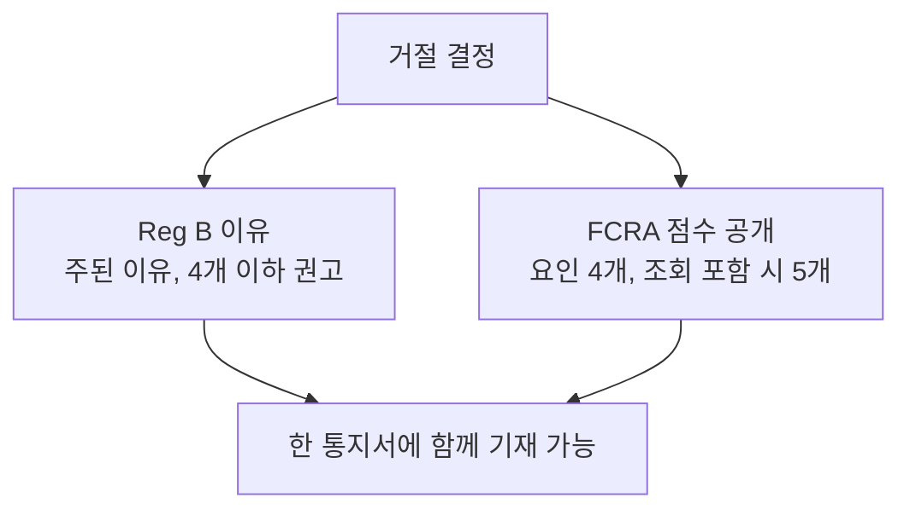
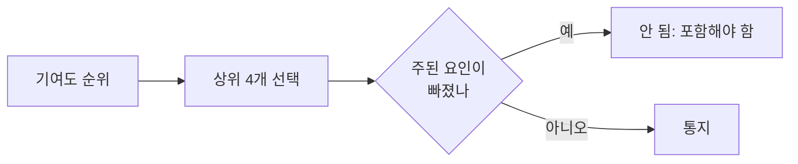

# 이유 4개 이내 권고

> 미국 Regulation B 공식 해설이 거절 이유를 "4개를 넘기면 신청자에게 도움이 되기 어렵다"고 한 권고(코멘트 9(b)(2)-1). 의무 상한이 아니다. 이와 별개로 FCRA는 신용점수 영향 요인(key factors)을 4개(조회 횟수가 포함되면 5개)까지로 정한다. (법률 자문 아님)

## 쉽게 말하면
의사가 "고쳐야 할 습관 열 가지"를 주는 것보다 "가장 중요한 네 가지"를 주는 편이 실제로 바뀌는 사람이 많다. 신용 거절 통지도 같다. 이유를 열 줄 나열하면 신청자는 무엇부터 고쳐야 할지 모른다. 규제는 "중요한 순서대로 몇 개만" 적도록 권한다. 다만 가장 중요한 요인을 빼서는 안 된다.

## 자세히
출처: CFPB Reg B 공식 해설 §1002.9(b)(2), 컴플라이언스 아웃룩 2013년 글(둘 다 직접 읽음, 2026-11-17).
- **Reg B 코멘트 9(b)(2)-1**: 주된 이유를 밝히되 **정확히 몇 개여야 하는지는 정하지 않는다**. 4개를 넘기면 도움이 안 될 가능성이 크다고 권고. 혼합 시스템(점수+판단)에서도 합쳐서 4개 이하가 도움이 된다.
- **FCRA의 key factors**: 신용점수를 불리한 조치에 썼으면 점수와 함께 점수에 불리했던 요인을 알려야 한다. 원칙적으로 **4개까지**, 조회 횟수(inquiries)가 요인이면 4개에 안 들어도 **5번째로** 넣는다(컴플라이언스 아웃룩 글).
- **둘은 대체 관계가 아니다**: 신용점수 요인을 나열했다고 ECOA 이유 요건이 충족되지 않는다. 소득·고용·거주처럼 점수와 무관한 이유로도 거절할 수 있기 때문이다. 두 목록은 겹칠 수 있지만 다를 수 있다.
- **합산 개수**: 한 검색 결과는 "최악의 경우 이유 코드 9개"라는 해설을 인용했지만, 컴플라이언스 아웃룩 글은 합산 상한을 말하지 않는다. 4+4+1=9는 산수일 뿐 규정이 아니다(미확인).
- **점수 공개 항목**: 사용한 점수 수치, 점수 범위, 핵심 요인, 점수 생성일, 점수 제공자 이름(점수가 쓰이지 않았다면 불필요). 같은 통지서에 실어야 한다.
- **모델 관점**: 4개로 자를 때 순위가 흔들리면 안 된다. 사후 설명 기법으로 기여도를 계산해 상위 4개를 고를 때 순위 안정성과 근사 정확도를 검증해야 한다(이 글의 의견).

## 그림으로 보기

## 예시
- 거절 이유 후보 7개 중 기여도 상위 4개(연체 이력, 한도 사용률, 거래 이력 짧음, 최근 조회 많음)만 통지에 넣는다.
- 신용점수 요인이 "조회 횟수 많음"을 포함하면 점수 요인 목록에서 조회 횟수는 5번째로 추가할 수 있다.

## 헷갈리는 것과 비교
| 개념 | 상한 | 성격 |
|---|---|---|
| Reg B 이유 | 4개 권고 | 의무 상한 아님, 주된 이유는 빠지면 안 됨 |
| FCRA key factors | 4개(+조회 1) | 점수 공개 의무의 일부 |
| [이유 코드](#reason-codes) | 해당 없음 | 이유를 표준화하는 도구 |
| [자동 거절 요인](#automatic-denial-factors) | 해당 없음 | 규칙으로 걸린 이유 명시 |

## 더 읽을거리
- [Reg B 공식 해설 §1002.9 (CFPB)](https://www.consumerfinance.gov/rules-policy/regulations/1002/interp-9/) — 코멘트 9(b)(2)-1
- [Adverse Action Notice Requirements Under the ECOA and the FCRA (Consumer Compliance Outlook, 2013)](https://www.consumercomplianceoutlook.org/articles/2013/second-issue-2013/adverse-action-notice-requirements-under-the-ecoa-and-the-fcra) — Reg B 이유와 FCRA 요인 비교(2013년 글이라 현행 조문 대조 필요)
