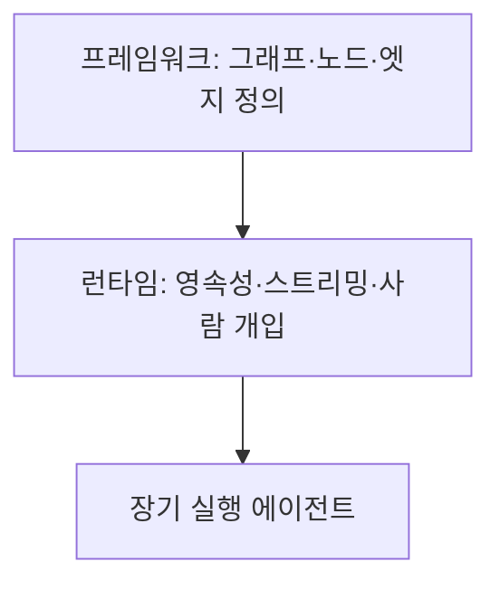
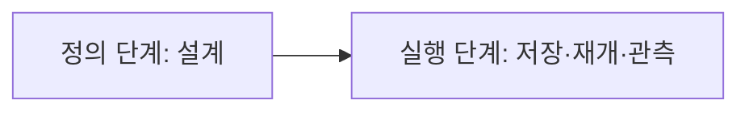

# 프레임워크 vs 런타임

> **프레임워크**는 에이전트를 어떻게 구성할지 **뼈대와 부품**을 주고, **런타임**은 그 에이전트를 **실제로 오래 안정적으로 실행**(상태 저장·재개·스트리밍)해 주는 실행 환경이다. LangGraph는 스스로를 둘 다로 소개한다.

## 쉽게 말하면
프레임워크는 레고 설계도와 블록, 런타임은 완성한 작품을 전시장에서 계속 켜 두고 전원이 나가도 이어서 돌리는 운영 시스템이다. 블록만 있어도 만들 수 있지만, 오래 돌리려면 운영 시스템이 필요하다.

## 자세히
(LangGraph 공식 overview 페이지 확인)
- 자기소개: "장기 실행·상태 유지 에이전트를 위한 **저수준 오케스트레이션 프레임워크이자 런타임**". 워크플로를 **공유 상태·노드·엣지의 그래프**로 정의하고, **결정론적 단계와 LLM 단계를 한 그래프에서 섞을 수 있다.**
- 프롬프트나 에이전트 아키텍처를 **강제하지 않으며** LangChain 없이도 쓸 수 있다.
- "LangGraph는 오케스트레이션 **런타임**: 내구성 있는 실행, 스트리밍, 사람 개입, 영속성"이라고 설명한다.
- 기능 목록: 결정론+에이전트 단계, **영속성**(상태 체크포인트 후 실패·중단에서 재개), **사람 개입**(실행을 멈추고 상태를 보고 고친 뒤 계속), **메모리**(스레드 단기 + 세션 간 장기), **스트리밍**. 관측·평가는 LangSmith가 맡는다고 따로 안내.
- 영속성의 세부(체크포인터·스토어)는 [체크포인터 저장소](#checkpointer-backends), [LangGraph 스토어](#langgraph-store) 참고. "내구성 있는 실행"의 세부 규칙은 이 글에서 확인하지 못했다.

## 그림으로 보기

## 예시
- 승인 대기가 하루 걸리는 구매 에이전트: 런타임이 상태를 저장해 두었다가 승인 후 이어서 실행.
- 단순 챗봇은 프레임워크 부품만 써도 충분할 수 있다.

## 헷갈리는 것과 비교
| 개념 | 차이 |
|---|---|
| 프레임워크 | 구성 방법과 부품 |
| 런타임 | 실행·상태·재개 |
| LangChain | 고수준 에이전트 구성(관계는 [LangChain vs LangGraph](#langchain-vs-langgraph)) |
| LangSmith | 추적·평가·모니터링 |

## 더 읽을거리
- [LangGraph overview](https://docs.langchain.com/oss/python/langgraph/overview)
