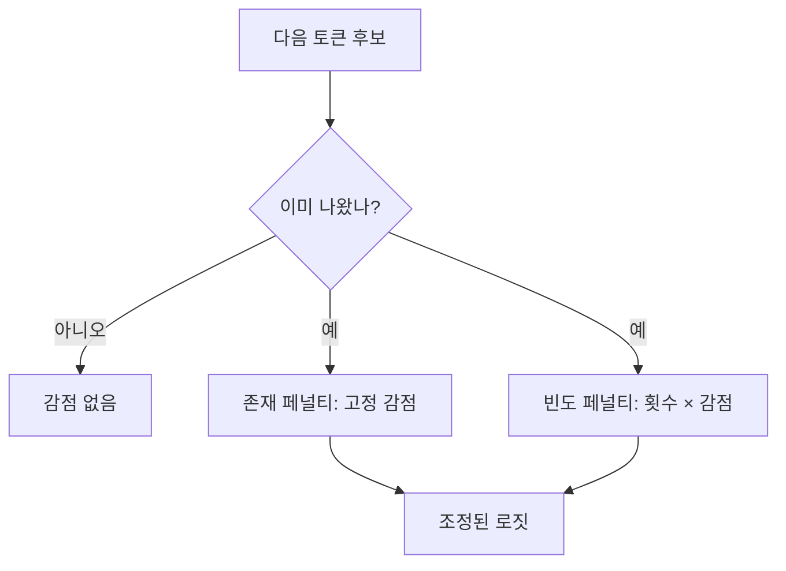

# 빈도·존재 페널티 (Frequency / Presence Penalty)

> API에서 같은 단어 반복을 줄이는 두 설정으로, 빈도 페널티는 많이 나온 만큼 계속 깎고, 존재 페널티는 한 번이라도 나왔으면 일정하게 깎는다.

## 쉽게 말하면
빈도 페널티는 "같은 말 할 때마다 벌금이 늘어나는" 규칙이고, 존재 페널티는 "한 번이라도 쓴 말이면 일률 벌금"이다. 전자는 반복 억제, 후자는 새 주제로 유도하는 쪽에 가깝다.

## 자세히
(OpenAI Chat Completions API의 `frequency_penalty`·`presence_penalty` 정의 — 공식 페이지를 이번에 열지 못해 일반적으로 알려진 설명 기준이며 확인 필요, confidence: medium)
- 범위는 보통 −2.0~2.0, 기본 0. 양수면 억제.
- 개념식: 토큰 j의 로짓 −= (등장 횟수 c[j] × 빈도 계수) + (c[j]>0 ? 존재 계수 : 0).
- 빈도: 횟수에 비례해 누적 감점. 존재: 등장 여부만 보고 고정 감점.
- 너무 크게 주면 정상적인 반복(이름·코드 변수)도 피해 어색한 문장이 나온다. 0.1~1 정도 작은 값에서 시작하는 것이 일반 관행.
- 모델·제공사마다 지원 여부가 다르다(최신 추론 모델은 샘플링 인자 일부를 막는 경우가 있으므로 문서 확인).

## 그림으로 보기

## 예시
- 브레인스토밍 문구가 계속 같은 단어로 시작 → `presence_penalty=0.6`.
- 요약이 같은 표현을 반복 → `frequency_penalty=0.3`부터 시도.

## 헷갈리는 것과 비교
| 개념 | 차이 |
|---|---|
| 빈도 페널티 | 횟수에 비례 |
| 존재 페널티 | 등장 여부만 |
| [반복 페널티(repetition penalty)](#repetition-penalty) | 오픈소스 계열의 곱셈식 변형 — 개념이 비슷 |
| [temperature](#sampling-temperature) | 분포 전체의 무작위성 조절 |

## 더 읽을거리
- [How to generate text (Hugging Face)](https://huggingface.co/blog/how-to-generate) — 반복 제어(no_repeat_ngram_size)와 샘플링 배경.
