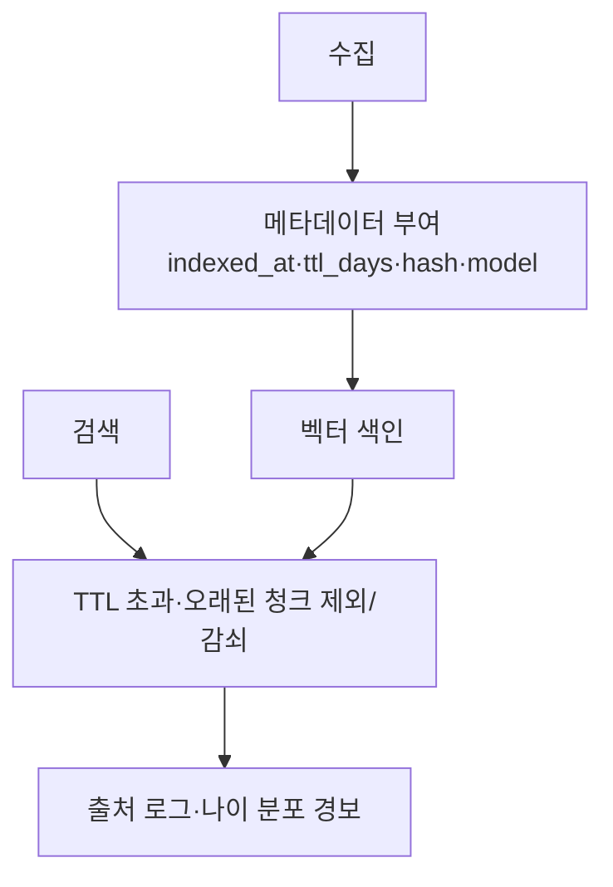

# 신선도 메타데이터

> RAG 색인의 각 청크에 **"언제 색인됐고 언제까지 유효한가"를 알려 주는 필드**(indexed_at, ttl_days, content_hash 등)를 붙여 두는 것이다. 임베딩은 의미만 담고 시간은 담지 않으므로, 낡은 정보를 가려내려면 이 메타데이터가 필수다.

## 쉽게 말하면
식품에 제조일자·유통기한을 찍어 두면 마트가 낡은 것을 골라낼 수 있다. 날짜가 없으면 먹어 보기 전엔 알 수 없다. 문서 청크에 날짜 라벨을 붙이는 일이 신선도 메타데이터다.

## 자세히
(tianpan.co 블로그 「Stale retrieval: RAG data quality」(2026-04-15)를 WebFetch로 직접 확인. 개인 블로그 글이며 아래 숫자는 글의 **예시값**이다.)
- **수집 시 설정하는 필드(글)**
  - `indexed_at`: 임베딩을 만든 시각(원본 작성일과 다름)
  - `source_last_modified`: 원본 시스템의 수정 시각
  - `ttl_days`: 문서가 유효하다고 예상되는 기간. 글은 **필수 필드**로 두라고 한다.
  - `content_hash`: 색인 시점 내용의 해시(변경 감지) → [청크 내용 해시](#chunk-content-hash)
  - `embedding_model_version`: 임베딩을 만든 모델 → [임베딩 모델 교체 위험](#embedding-model-churn)
- **유형별 TTL 예(글)**: 가격 정보 약 7일, API 레퍼런스 약 2주, 규정 정책 약 6개월, 보관용 콘텐츠는 만료 없음. TTL은 **제품 결정**이라고 한다. 글에 정식 SLA 정의는 없고 TTL 예와 재조정(reconciliation) 빈도가 가장 가깝다.
- **탐지·경보(글)**: 검색마다 출처(문서 ID·색인 시각·원본 수정 시각·임베딩 버전)를 로그로 남기고, **검색된 청크 나이의 25·50·75 백분위**를 추적한다. 경보 예: "180일보다 오래된 청크가 제공 결과의 20%를 넘으면". CI/CD 회귀 테스트에 **신선도 슬라이스**를 넣는다.
- **시간 감쇠 vs 사전 필터(글)**: 시간 감쇠는 유사도와 최신성을 섞는다(예 α≈0.7, 반감기 14일; 글은 신선도 민감 질의에서 큰 개선을 보고했다고 하나 원 실험은 확인하지 못함). 사전 필터는 시간 창 조건을 순위 전에 적용해 낡은 문서가 후보에 못 들어오게 한다. 최고 신선도 영역에는 사전 필터를 권한다.
- **재조정 작업(글)**: 변경 이벤트를 못 내는 소스는 주기적으로 원본을 다시 받아 해시를 비교하고 다르면 재임베딩·upsert. DB 기반은 Debezium 같은 CDC, CMS는 웹훅. → [CDC 동기화](#change-data-capture-sync)
- **GDPR(글)**: 원본에서 삭제된 문서가 벡터 저장소에 **수개월** 남을 수 있어, 삭제 API가 아니라 삭제가 색인까지 전파되는 파이프라인이 필요하다.

## 그림으로 보기

## 예시
- 청크 메타: `{"doc_id":"price-2026","indexed_at":"2026-11-20","ttl_days":7,"content_hash":"…","embedding_model_version":"v3"}` — 7일 지나면 재확인 대상.
- 교육 활동: 우리 회사 문서 5종의 TTL을 정하고 이유를 설명해 보기.

## 헷갈리는 것과 비교
| 개념 | 차이 |
|---|---|
| 신선도 메타데이터 | 청크에 시간·유효 기간 기록 |
| 임베딩 | 의미만 표현, 시간 정보 없음 |
| [RAG 신선도 SLA](#rag-freshness-sla) | 이 필드를 바탕으로 정한 허용 지연 목표 |
| [불일치 창](#inconsistency-window) | 원본 변경~색인 반영 간격 |

## 더 읽을거리
- [Stale retrieval and RAG data quality (tianpan.co)](https://tianpan.co/blog/2026/04/15/stale-retrieval-rag-data-quality) — 메타데이터 필드, TTL 예, 나이 분포 경보(직접 확인, 개인 블로그).
