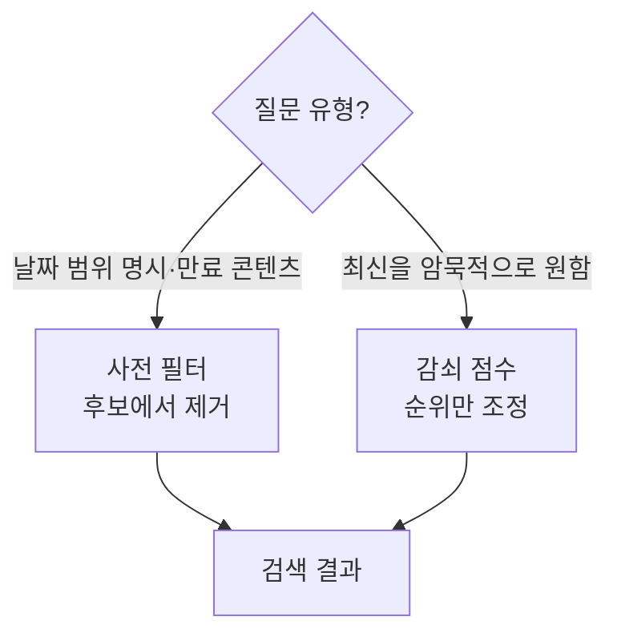
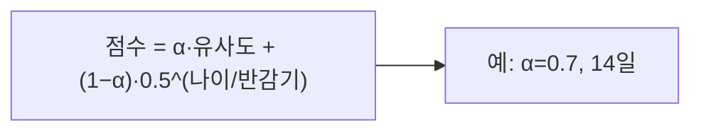

# 신선도 사전 필터 vs 감쇠

> 검색에서 오래된 문서를 다루는 두 방법이다. **사전 필터**는 조건에 안 맞는 문서를 후보에서 아예 빼고, **감쇠(recency prior)**는 오래될수록 점수를 깎아 순위만 낮춘다. 질문의 성격에 따라 구분해 쓴다.

## 쉽게 말하면
도서 추천에서 "2024년 이후 책만 보여 줘"는 필터이고, "최신 책을 우선 보여 주되 좋은 옛 책도 섞어 줘"는 감쇠다. 법적으로 만료된 서식은 필터로 빼야 하고, 최신 뉴스 질문은 감쇠로 앞에 세운다.

## 자세히
- **감쇠 점수(Grofsky, arXiv 2509.19376, 2025, html 직접 확인)**: 상위 K 의미 검색 후보를 score = α·cos(q,d) + (1−α)·0.5^(age_days/h)로 재정렬. 기본 α=0.7, 반감기 h=14일. **as-of 필터**는 날짜가 정해진 질의에서 그 날짜 이전 문서만 쓴다. 합성 사이버보안 로그(12주)와 CERT Insider Threat v6.2 logon.csv(849,579 이벤트, 71주)로 평가해 코사인 기준선 Latest@10 0.00이 1.00이 됐다고 보고한다. α 0.4~0.7에서 정확도 1.000, α 0.9·0.95에서 0.667. 저자 한 명의 좁은 데이터 연구이고 추세 라벨 F1은 0.08에 그쳐 한계를 인정한다. 일반 도메인에서는 기본값을 다시 맞춰야 한다고 논문이 말한다.
- **Azure AI Search 문서(learn.microsoft.com, 2026-11 갱신, 직접 확인, Public Preview)**: "신선도는 순위 편향이지 **하드 필터가 아니다**. 아주 관련 있는 옛 문서는 여전히 나올 수 있다." 특정 기간만 반환해야 하면 필터를 쓰라고 명시. 설정은 지식 소스의 `freshnessPolicy.boostingDuration`(ISO 8601, 예 `P90D`)이고, 인덱스에 생성된 신선도 필드가 스코어링 프로필 함수와 연결된다. 신선도는 수집 시점에 생성되어 이후 수집분에 적용되고, `last_modified` 값이 비거나 틀리면 신호가 약해진다. 정책은 기존 소스에서 제거할 수 없어 삭제 후 재생성해야 한다.
- **선택 지침(문서·논문·검색 요약의 공통점, 해석 포함)**
  - 날짜 범위가 명시된 질문, 만료·폐기 콘텐츠 → **필터**(순위만 낮추면 여전히 모델에 노출된다).
  - "최신 버전은?"처럼 암묵적으로 최신을 원하는 질문 → **감쇠**.
  - 콘텐츠 유형별로 α·반감기를 달리하고(가격·보안 공지는 짧게), 시간 민감 질의를 회귀 테스트에 넣는다.
- **미확인**: ACL 2026 Re3 논문(질의 인식 학습형 게이트)은 검색 요약으로만 접했고 본문은 열지 않았다.

## 그림으로 보기

## 예시
- 컴플라이언스 정책 챗봇: "2025년 시행 정책만"은 필터, 일반 질문은 최근 개정본에 가중치.
- 교육 소재: α를 0.4/0.7/0.95로 바꿔 같은 질문의 순위가 어떻게 달라지는지 비교.

## 헷갈리는 것과 비교
| 개념 | 차이 |
|---|---|
| 사전 필터 | 후보에서 제거 |
| 감쇠 | 점수만 낮춤 |
| [시간 감쇠 점수](#temporal-decay-scoring) | 감쇠 공식 자체 |
| [조용한 버전 드리프트](#silent-version-drift) | 문제 상황 |

## 더 읽을거리
- [Solving Freshness in RAG (arXiv 2509.19376)](https://arxiv.org/html/2509.19376v1) — 감쇠 공식·평가(직접 확인, 단일 저자).
- [Azure AI Search: Freshness-aware retrieval](https://learn.microsoft.com/en-us/azure/search/agentic-retrieval-how-to-configure-freshness) — 순위 편향 vs 필터(직접 확인, 프리뷰).
