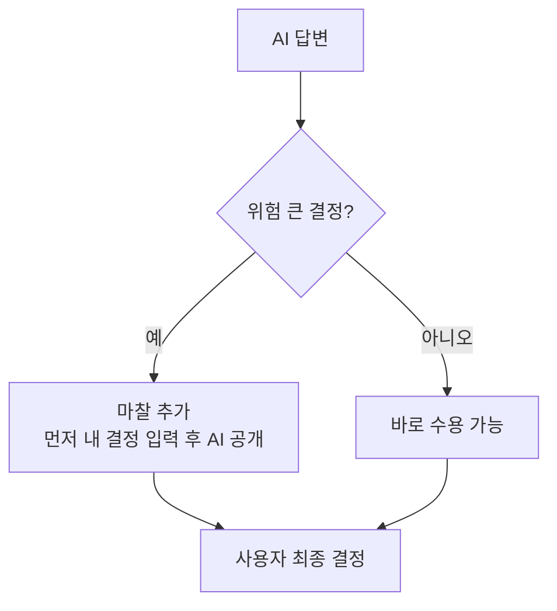
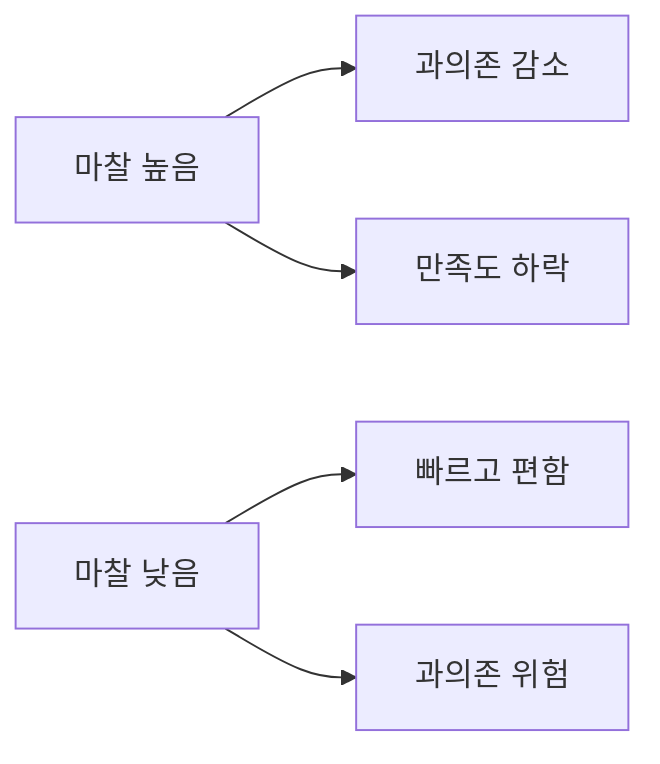

# 의도적 마찰 설계

> 사용자가 AI 답을 그냥 받아들이지 않고 한 번 더 생각하도록, 일부러 확인 단계나 지연을 넣는 UX. 맹신은 줄지만 사용자 만족은 떨어질 수 있는 거래다.

## 쉽게 말하면
수술 전 체크리스트나 "진단 타임아웃"과 같다. 숙련자도 한 박자 멈추고 "다른 가능성은 없나?"를 확인하게 하는 절차다. 번거롭지만 실수를 줄인다.

## 자세히
- **핵심 연구**: Buçinca, Malaya, Gajos의 "To Trust or to Think"(CSCW 2021). 참가자 199명 실험에서 인지 강제(cognitive forcing) 3종은 단순 설명형 XAI 두 종보다 과의존을 유의하게 줄였다(초록·저자 페이지 열람). 기준은 AI 없음 조건이다.
- **대가**: 과의존을 가장 크게 줄인 설계가 주관 평가에서 가장 낮은 점수를 받았다. 더 엄격할수록 더 생각하게 하지만 복잡하고 쓰기 불편하다는 예상과 맞는 결과.
- **불균등**: 평균적으로 Need for Cognition(노력이 드는 사고를 즐기는 성향)이 높은 사람에게 더 도움이 되었다. 인지 동기가 XAI 해법의 효과를 조절한다는 결론.
- **완전한 해결은 아님**: 강제 조건에서도 과의존이 남았다(검색 요약 기준).
- **세 가지 설계의 구체 이름·방식**은 열어 본 초록·저자 페이지에 나오지 않아 여기서 적지 않는다. 의료 의사결정 연구에서 가져왔다는 점만 확인했다. 일반적 예로 검색 요약은 체크리스트, 진단 타임아웃, 대안 배제 요구를 들었다.
- **다른 개입과 비교(Smith 글)**: AI 추천 전에 먼저 결정하게 하거나 추천을 늦추는 방식이 설명형보다 과의존을 더 줄인다는 정리.
- **설계 판단**: 위험이 큰 결정(의료·법률·재무)에는 마찰을 높이고, 단순 반복 업무에는 낮춘다는 것은 이 글의 해석이다. 각 환경에서 직접 시험해야 한다.

## 그림으로 보기

## 예시
- 대출 심사 AI: "당신의 판단을 먼저 입력하세요" 후 AI 추천 공개.
- 교육 실습: 같은 문제를 (a) AI 답 즉시 공개 (b) 내 답 먼저 입력 후 공개로 나눠 푼 뒤, 오류 수용 횟수와 체감 편의를 비교.

## 헷갈리는 것과 비교
| 개념 | 차이 |
|---|---|
| 의도적 마찰 | 확인 단계를 일부러 넣음 |
| [인지 강제 기능](#cognitive-forcing-function) | 마찰의 구체 한 방식 |
| [신뢰 보정](#trust-calibration) | 마찰이 지향하는 목표 |
| [AI 과소의존](#undertrust-ai) | 마찰이 과해지면 생길 수 있는 반대 방향 위험(해석) |

## 더 읽을거리
- [To Trust or to Think (arXiv 2102.09692)](https://arxiv.org/abs/2102.09692v1) — 인지 강제와 과의존(초록 열람)
- [저자 페이지 (Harvard EECS)](https://www.eecs.harvard.edu/~kgajos/papers/2021/bucinca2021trust.shtml) — 요약 및 결과(열람)
