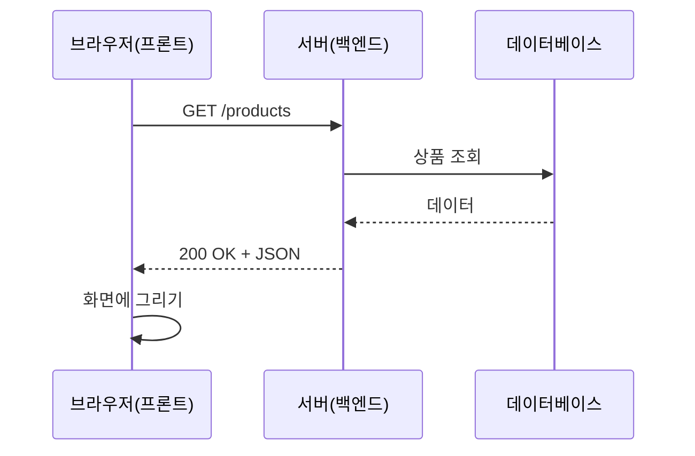

# 프론트엔드와 백엔드

> 프론트엔드는 사용자의 브라우저(클라이언트)에서 보이고 동작하는 쪽, 백엔드는 요청을 받아 데이터를 처리하고 응답하는 서버 쪽이다.

## 쉽게 말하면
식당의 홀과 주방이다. 홀(프론트)은 메뉴판을 보여 주고 주문을 받는다. 주방(백엔드)은 재료 창고(데이터베이스)에서 꺼내 요리해 내보낸다. 손님은 주방을 직접 보지 못하고 홀을 통해서만 주문한다.

## 자세히
MDN "클라이언트-서버 개요" 기준:
- **요청(request)**: 브라우저가 URL, 메서드(GET은 가져오기, POST는 보내기), 헤더, 필요하면 본문을 서버에 보낸다.
- **응답(response)**: 서버가 상태 코드(200 성공, 404 없음, 403 권한 없음 등)와 본문(HTML·JSON)을 돌려준다.
- **프론트엔드**: 응답을 화면으로 그리고 JavaScript를 실행한다. HTML(구조)·CSS(모양)·JS(동작). 페이지 새로고침 없이 JS로 서버에서 데이터를 받아 갱신할 수도 있다.
- **백엔드**: 요청을 핸들러로 연결하고, DB를 조회하고, 메일 발송·로그 같은 일을 하며 응답을 만든다. 정적 사이트는 같은 파일만 내주고, 동적 사이트는 요청마다 응답을 만든다.
- 바이브코딩에서 흔한 막힘: 프론트만 있는 앱은 **API 키를 브라우저에 노출**하기 쉽다. 비밀은 백엔드에 두고 프론트는 [API](#api-basics)로 부탁만 한다.

## 그림으로 보기

## 예시
- AI에게 "할 일 앱 만들어줘"라고 하면 화면(프론트)과 저장 로직(백엔드)을 함께 만든다. 저장이 새로고침 후 사라지면 백엔드/DB가 없는 것이다.
- LLM 호출은 백엔드에서 하고, 프론트는 `/api/chat`만 부른다.

## 헷갈리는 것과 비교
| 개념 | 차이 |
| --- | --- |
| 프론트엔드 | 브라우저에서 실행. 사용자가 코드를 볼 수 있음 |
| 백엔드 | 서버에서 실행. 비밀·DB 접근 담당 |
| [API](#api-basics) | 둘이 대화하는 약속 |

## 더 읽을거리
- [Client-Server overview (MDN)](https://developer.mozilla.org/en-US/docs/Learn_web_development/Extensions/Server-side/First_steps/Client-Server_overview) — 요청·응답과 서버 역할
