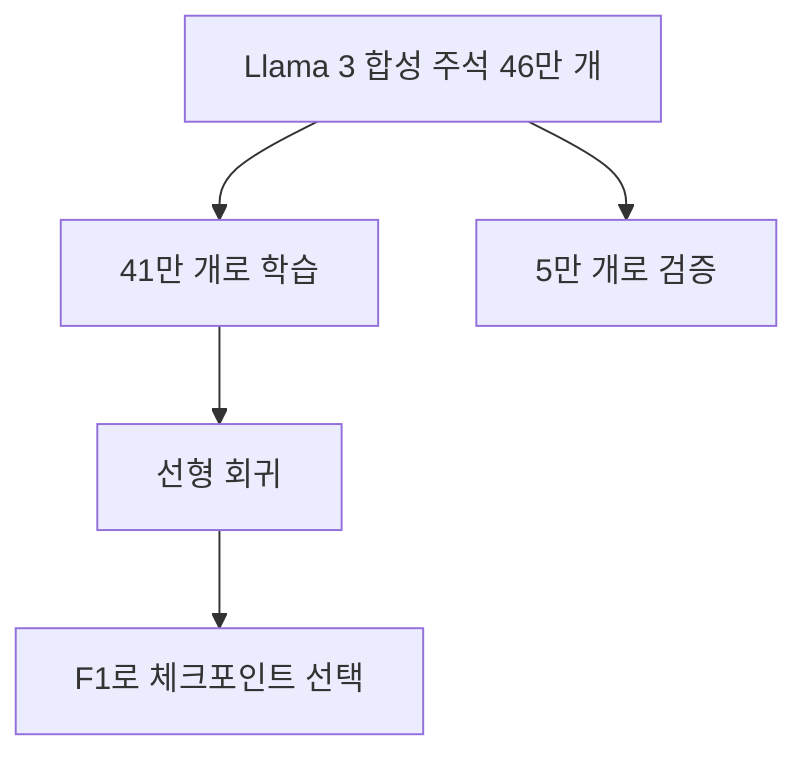

# 동결 임베딩 + 선형 회귀

> 이미 학습된 **임베딩 모델은 고정(freeze)해 두고, 그 출력 벡터 위에 선형 회귀 층 하나만 학습**해 점수를 예측하는 가벼운 방식이다. 큰 LLM 대신 싼 모델로 수십억 문서를 채점할 때 쓴다.

## 쉽게 말하면
번역을 이미 잘하는 전문가(임베딩 모델)에게 글을 숫자 좌표로 바꾸게 하고, 그 좌표를 보고 "몇 점"인지 알려 주는 간단한 채점 공식(선형 회귀)만 새로 배우는 것이다. 전문가를 다시 훈련하지 않으므로 빠르고 싸다.

## 자세히
- FineWeb-Edu의 사례(arXiv 2406.17557 PDF 본문 직접 읽음): **Snowflake-arctic-embed-m** 임베딩 모델 위에 **선형 회귀** 하나를 올렸다. Llama-3-70B-Instruct 합성 주석 **410,000개**로 **20 에폭, 학습률 3e-4**로 학습하고 **임베딩·인코더 층은 동결**했다. 검증은 나머지 **50,000개**(Llama 3 주석을 정답으로 취급), F1이 가장 높은 체크포인트를 선택했다. 출력 점수는 0~5 정수로 반올림해 [임계값](#classifier-threshold-tradeoff)으로 이진 분류했다.
- 장점: 학습할 파라미터가 적어 빠르고, 추론은 임베딩 계산이 주 비용이다([추론 비용](#classifier-inference-cost)). 큰 LLM을 수십억 문서에 직접 돌리는 것보다 훨씬 싸다.
- 한계: 임베딩이 담지 못한 정보는 선형층이 복원할 수 없다. 점수는 LLM 주석(스승)의 판단을 흉내 낸 것이라 **스승의 편향도 따라온다**.
- 직접 실행(장난감 실험): 768차원 무작위 "임베딩" 40,000개와 그것의 선형 함수로 만든 0~5점 라벨(잡음 포함)에 scikit-learn `Ridge`를 학습(35,000개). 학습에 **약 0.6초**, 반올림 정수 점수의 정확 일치율 **63%**, 1점 이내 **99%**, 임계값 3 이진 분류 정확도 94%·F1 0.94. 데이터가 선형 구조로 만들어진 합성이라 실제 성능과 무관하며, "선형 헤드는 매우 가볍다"는 점만 보여 준다.
- 변형(제안): 선형 대신 작은 MLP, 임베딩 모델 마지막 층만 미세조정, 라벨을 확률 분포로 학습.

## 그림으로 보기



## 예시
```python
from sklearn.linear_model import Ridge
X = embed(texts)            # 고정된 임베딩 모델
reg = Ridge().fit(X, scores)  # 점수는 LLM 주석
```
- 사내 문서 수백만 건의 품질 점수를 LLM 호출 없이 선형 헤드로 계산.
- 교육: "큰 모델 지식은 빌리고 작은 헤드만 학습한다"는 전이학습 개념.

## 헷갈리는 것과 비교
| 개념 | 차이 |
|---|---|
| 동결 + 선형 헤드 | 임베딩 고정, 헤드만 학습, 싸고 빠름 |
| 전체 미세조정 | 모든 가중치 학습, 비싸지만 표현력↑ |
| 증류 | 큰 모델의 출력을 작은 모델이 모방(여기서는 선형 헤드가 모방) |
| [가산식 프롬프트](#additive-scoring-prompt) | 스승 LLM이 점수를 만드는 방법 |

## 더 읽을거리
- [The FineWeb Datasets (arXiv 2406.17557)](https://arxiv.org/abs/2406.17557) — 동결 임베딩+선형 회귀 학습 설정(PDF 본문 읽음).
