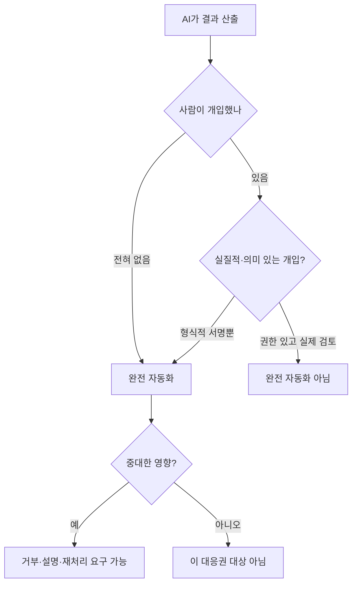

# 완전 자동화 결정

> 개인정보 보호법 제37조의2의 대응권(거부·설명·재처리)이 적용되는 출발 조건. 결정이 사람 개입 없이 "완전히 자동화된 시스템"으로 이루어졌는지를 따진다. (법률 자문 아님)

## 쉽게 말하면
자판기는 돈을 넣으면 사람 없이 결과가 나온다. 반면 직원이 서류를 훑어보고 도장을 찍으면 그 결정은 사람이 한 것이다. 법은 앞의 경우, 즉 사람이 끼지 않은 결정에만 "거부할 수 있다"는 권리를 준다. 직원이 AI 추천에 무심코 도장만 찍는 경우가 문제다. 그런 도장이 '진짜 개입'인지가 쟁점이다.

## 자세히
출처: 법률신문 해설 기사(본문 확인)와 검색 요약(법무법인 지평 뉴스레터는 시행일만 확인). 조문 원문과 고시 본문은 직접 열지 못했다.
- **법 구조**: 제37조의2는 완전히 자동화된 시스템으로 개인정보를 처리해 이루어진 결정이 권리·의무에 중대한 영향을 미칠 때 거부권을 준다. 설명 요구는 별도 항이다. 2024-03-15 시행.
- **핵심 단어 "완전히"**: 기사에 따르면 결정 과정에 일부라도 사람이 개입하면 거부권 주장이 어렵다.
- **개입의 질(검색 요약, 주장 수준)**: 개인정보보호위원회 고시 제정안(2024-05 행정예고) 설명 자료는 "정당한 권한을 가진 사람의 실질적이고 의미 있는 개입"이 없었는지를 기준으로 본다고 전해진다. 형식적 절차뿐인 개입은 자동화로 본다는 해설도 있다. 고시 최종본은 확인하지 못했다.
- **판단 요소(해석, 확정 아님)**: 담당자가 AI 결과를 바꿀 권한이 있는가, 실제로 입력 근거를 검토하는가, 번복 사례가 있는가.
- **운영 시사점**: 처리자는 "최종 서명이 있으니 자동화가 아니다"라고 단정하기 어렵다. 사람 개입을 형식으로만 두면 위험하다.

## 그림으로 보기

## 예시
- 온라인 대출 한도가 심사 담당자 없이 즉시 산정되어 거절 → 완전 자동화 가능성이 높다.
- AI 면접 점수가 컷오프를 넘으면 자동 탈락하고 인사팀은 합격자만 확인 → 탈락 건은 사람이 보지 않으므로 자동화로 다툴 수 있다.
- 인사 담당자가 AI 점수를 보고 직접 재검토하며 번복 권한이 있다 → 자동화가 아닐 수 있다.

## 헷갈리는 것과 비교
| 개념 | 차이 |
|---|---|
| 완전 자동화 결정 | 사람 개입 여부(적용 문턱) |
| [중대한 영향](#significant-impact) | 결정의 파급력(또 하나의 문턱) |
| [인적 개입 재처리](#human-reprocessing) | 거부 뒤 사후 구제 조치 |
| [개인정보 보호법 자동화 결정 대응권](#pipa-automated-decision) | 이 조건들을 담은 상위 권리 |

## 더 읽을거리
- [법률신문 해설 기사](https://www.lawtimes.co.kr/news/articleView.html?idxno=194236) — "완전히" 요건과 예외, GDPR 22조와의 비교
- [법무법인 지평 뉴스레터](https://www.jipyong.com/newsletter_alert/240329_2/index.html) — 시행일(2024-03-15)과 도입 배경만 확인
