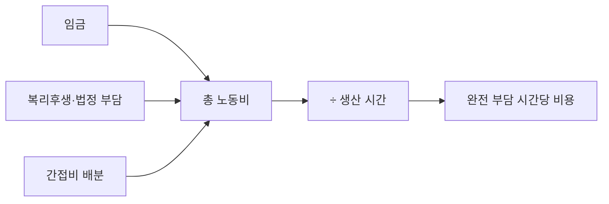
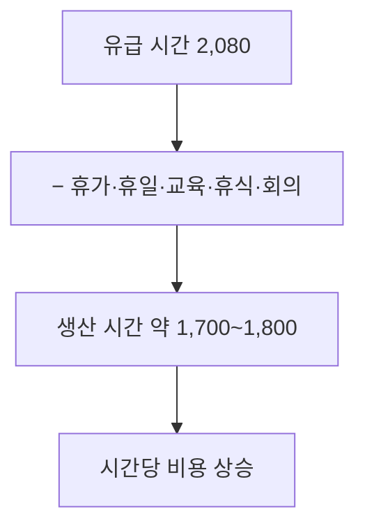

# 완전 부담 시간당 비용

> 완전 부담(fully loaded) 시간당 비용은 직원 한 시간의 실제 가격으로, 급여에 사업주 부담 세금·복리후생·간접비를 더한 총 노동비를 "일한 시간(생산 시간)"으로 나눈 값이다. 시급이나 월급 환산액보다 크며, AI가 아낀 시간을 돈으로 바꿀 때 기준이 된다.

## 쉽게 말하면
월급이 300만 원인 직원의 한 시간은 300만 원을 근무 시간으로 나눈 값이 아니다. 회사는 4대 보험·복지·교육·자리 비용도 내고, 직원은 휴가·회의·휴식으로 일부 시간을 쓴다. 이 모두를 더하고 "진짜 일한 시간"으로 나누면 시간당 비용이 훨씬 커진다.

## 자세히
- **공식(Hyperbots 용어집, 열람)**: 시간당 노동비 = 총 노동비 ÷ 생산 시간. 총 노동비에는 직접 임금, 사업주 급여세 같은 법정 고용 비용, 건강보험·퇴직연금 같은 복리후생, 배분된 노동 간접비가 들어간다. 임금만 쓰면 직접 요율, 모두 더하면 완전 부담 요율이며 한 정의를 일관되게 쓰라고 한다. 예: 임금 62,400달러 + 세금·복리후생 13,600 = 76,000달러를 생산 시간 1,800으로 나누면 시간당 42.22달러. 생산 활용도가 떨어지면 임금이 그대로여도 생산 시간당 비용이 오른다.
- **다른 계산 예(QuickBooks 안내, 열람)**: (연 노동비 + 인당 간접비 + 인당 급여세) ÷ 연간 근로 시간. 시급 15달러, 연 2,080시간 중 휴가 15일을 빼면 약 1,960시간, 총 39,200달러로 약 20달러/시간이다. 그 글은 복리후생을 급여의 약 30%로 잡고 2017년 무렵의 자료라고 주의한다.
- **미국 평균 구성(BLS ECEC, 2026-06 발표 2026-09-09, 열람)**: 민간인(civilian) 근로자의 시간당 총 보상 49.46달러 중 임금·급여 33.85달러(약 68.4%), 복리후생 15.61달러(약 31.6%)다(비율은 발표 수치로 계산). 임금 대비 총 보상은 약 1.46배다. 이 비율은 미국 평균이므로 다른 나라·업종에서는 다르다. 한국은 4대 보험·퇴직금 구조가 달라 자기 회사 값으로 대체한다(해석).
- **분모가 중요(해석 + 검색 결과 요약)**: 유급 2,080시간이 아니라 휴가·휴일·병가·휴식·교육을 뺀 생산 시간을 쓴다. 검색 결과에서 한 계산기는 유급 2,080시간이어도 실제 생산 시간은 1,700~1,800시간이라고 한다. 같은 총 노동비라도 분모가 작으면 시간당 비용이 크다.
- **가상 계산(직접)**: 연봉 6,000만 원, 복리후생·세금 포함 배수 1.4(가정), 생산 시간 1,700시간이면 총 8,400만 원 ÷ 1,700 ≈ 49,412원/시간이다. 단순히 6,000만 원 ÷ 2,080시간으로 보면 28,846원/시간이어서 1.71배 차이다. 이 수치는 설명용 가정이다.
- **AI ROI에 쓰는 법**: 월 3시간 절감×12개월 = 36시간이면 이 가정에서 약 178만 원(36×49,412)의 가치다. 단, 절감 시간이 실제 생산 활동이나 인력 감축으로 이어져야 현금 가치가 생긴다(해석).

## 그림으로 보기

## 예시
- 상담 요약 AI 도입: 상담원 평균 연봉에 배수와 생산 시간을 적용해 시간당 단가를 정하고, 월 절감 시간×단가로 연 효익을 추정한다.
- 교육 활용: 같은 직원의 임금 시급과 완전 부담 시급을 비교해 "시간을 돈으로 바꾸는 과정에서 흔한 과소평가"를 토론한다.

## 헷갈리는 것과 비교
| 개념 | 차이 |
| --- | --- |
| 임금 시급 | 급여만 시간으로 나눈 값 |
| 완전 부담 시급 | 부담금·복지·간접비를 더하고 생산 시간으로 나눔 |
| [건당 처리 비용](#handling-time-cost) | 상위 주제. 처리 시간 × 이 값 |
| [비생산 시간 비율](#shrinkage-rate) | 분모(생산 시간)를 줄이는 요인 |

## 더 읽을거리
- [BLS: Employer Costs for Employee Compensation](https://www.bls.gov/news.release/ecec.nr0.htm) — 임금·복리후생 구성
- [Hyperbots: Labor Cost per Hour](https://www.hyperbots.com/glossary/labor-cost-per-hour) — 공식과 예
- [QuickBooks: True cost of an employee](https://quickbooks.intuit.com/time-tracking/resources/determine-the-true-cost-of-an-employee/) — 요소별 계산 예
