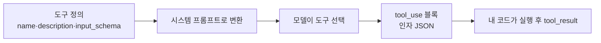
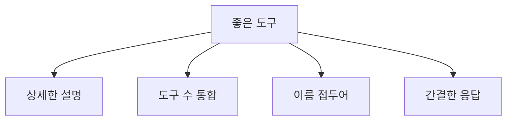

# 도구 스키마 설계

> 도구 스키마는 LLM에게 "이 도구는 무엇이고, 언제 쓰고, 어떤 인자를 받는지"를 알려 주는 정의서다. Claude API에서는 `name`·`description`·`input_schema`(JSON Schema)로 쓰며, 도구 성능은 설명의 품질이 좌우한다.

## 쉽게 말하면
새 직원에게 사내 시스템 사용 설명서를 주는 일과 같다. "조회 버튼 있음"이라고만 적으면 헤매고, 언제 쓰는지·무엇을 돌려주는지·넣는 값의 형식까지 적으면 정확히 쓴다. 모델은 이 설명서만 보고 도구를 고른다.

## 자세히
Anthropic 문서(2026-11 확인)의 도구 정의 필드:
- `name`: 정규식 `^[a-zA-Z0-9_-]{1,128}$`.
- `description`: 도구가 하는 일, 언제 써야/쓰지 말아야 하는지, 각 파라미터 의미, 한계(반환하지 않는 정보). **문서가 꼽는 가장 중요한 요소**이며 도구당 최소 3~4문장을 권한다.
- `input_schema`: JSON Schema 객체(type, properties, enum, required).
- `input_examples`(선택): 스키마에 맞는 예시 입력. 중첩·형식 민감 도구에 유용. 토큰 비용은 단순 예시 약 20~50, 복잡한 객체 약 100~200.
- 기타 선택 속성: `cache_control`, `strict`, `defer_loading` 등.

설계 요령(문서 권고):
- 관련 동작은 `action` 파라미터로 **묶어 도구 수를 줄인다**(create_pr/review_pr/merge_pr → 하나).
- 서비스 접두어로 이름 공간을 나눈다(`github_list_prs`, `slack_send_message`).
- 응답에는 **다음 판단에 필요한 정보만**, 슬러그·UUID 같은 안정적 식별자로 돌려준다.
- 이유를 묻는 파라미터는 "추론 과정"이 아니라 짧은 설명·근거를 요구한다.
API는 도구 정의를 내부 시스템 프롬프트로 바꿔 모델에 넣는다.

## 그림으로 보기

## 예시
나쁜 설명: "Gets the stock price for a ticker." 좋은 설명: 유효한 티커 범위(NYSE·NASDAQ), 반환값(최신 체결가 USD), 쓸 때(현재가 질문), 못 주는 것(회사 정보)을 적는다.

## 헷갈리는 것과 비교
| 개념 | 차이 |
| --- | --- |
| description | 모델이 *고르는 기준*. 가장 중요 |
| input_schema | 인자 *형식*. 검증용 |
| input_examples | 형식이 까다로울 때 보조 |
| [tool_choice와 strict](#tool-choice-strict) | 호출 강제·스키마 준수 옵션 |

## 더 읽을거리
- [Define tools — Claude 문서](https://platform.claude.com/docs/en/agents-and-tools/tool-use/define-tools) — 필드와 모범 사례
- [Writing tools for agents — Anthropic Engineering](https://www.anthropic.com/engineering/writing-tools-for-agents) — 위 문서가 권하는 심화 글(이 실행에서는 열어 보지 않음)
