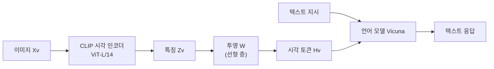
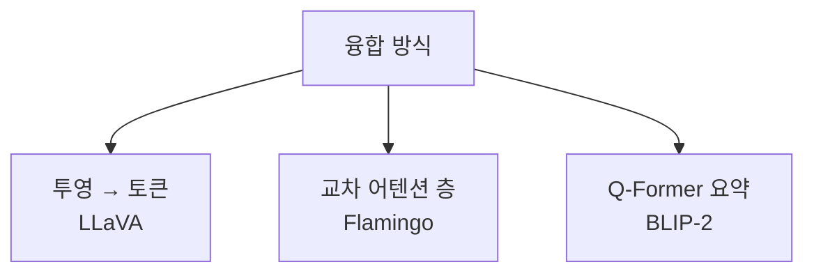

# 융합 아키텍처

> 이미지와 텍스트처럼 **서로 다른 형태의 데이터를 한 모델이 함께 다루게 연결하는 설계 방식**. 대표 방식은 ① 이미지 특징을 **언어 토큰으로 바꿔 LLM 입력에 끼워 넣기(투영, LLaVA)**, ② LLM 층 사이에 **교차 어텐션(cross-attention)** 층을 끼워 이미지를 참조하게 하기(Flamingo), ③ **Q-Former** 같은 중간 모듈로 요약해 전달하기(BLIP-2)다.

## 쉽게 말하면
통역사(투영 행렬)가 그림을 "글 단어"로 번역해 글 전문가(LLM)에게 건네는 방식, 글 전문가가 일하는 중간중간 그림을 슬쩍 들여다보게 하는 방식(교차 어텐션), 그림 요점만 뽑아 주는 비서(Q-Former)를 두는 방식이 있다.

## 자세히
- **LLaVA의 투영 방식**(Liu et al., 2023, 논문 본문 확인): 이미지 `Xv`를 사전 학습된 **CLIP 시각 인코더 ViT-L/14**에 넣어 특징 `Zv`를 얻고, **학습 가능한 투영 행렬 `W`(단순 선형 층)** 로 `Hv = W · Zv`를 만들어 **언어 모델의 단어 임베딩과 같은 차원의 "시각 토큰"** 으로 바꾼다. LLM은 **Vicuna**를 쓴다. 이 단순한 투영 방식이 가벼워 데이터 중심 실험을 빠르게 돌릴 수 있다고 저자들이 설명한다. 같은 글에서 "Flamingo의 **gated cross-attention**, BLIP-2의 **Q-former**" 같은 더 정교한 연결 방식도 가능하며 이를 후속 과제로 남긴다고 밝힌다. 학습 데이터는 **언어 전용 GPT-4로 만든 멀티모달 지시 따르기 데이터**이고(초록 확인), 합성 데이터셋에서 GPT-4 상대 점수 85.1%, ScienceQA에서 LLaVA+GPT-4 조합 92.53% 정확도라고 보고한다(저자 보고).
- **Flamingo**(Alayrac et al., 2022, 초록 확인): "사전 학습된 시각 전용 모델과 언어 전용 모델을 **연결**"하고 **이미지와 텍스트가 섞여 입력**되는 데이터를 다루도록 설계. 작업 예시를 프롬프트로 주는 **퓨샷**만으로 여러 벤치마크에서 최고 성능을 냈고 수천 배 많은 과제 데이터로 미세조정한 모델을 능가했다고 보고한다(세부 구조는 이번에 본문을 열어 보지 못했다).
- **세 방식 비교**:

| 방식 | 대표 | 아이디어 | 특징 |
|---|---|---|---|
| 투영해서 토큰으로 입력 | LLaVA | 이미지 특징 → 선형 투영 → LLM 입력 토큰 | 단순·가벼움, 이미지 토큰이 컨텍스트를 차지 |
| 교차 어텐션 삽입 | Flamingo | LLM 중간에 시각 정보를 참조하는 층 추가 | 이미지·텍스트 교차 입력에 유연 |
| 중간 모듈 요약 | BLIP-2 (Q-Former) | 질문 벡터로 이미지 요점만 추출해 전달 | 전달량 압축 |

- **초기 융합 vs 후기 융합**(일반 개념): 처음부터 모든 모달리티를 한 모델이 함께 학습(초기)하는 방식과, 각자 처리한 뒤 나중에 합치는(후기) 방식의 구분이다. 위 세 방식은 사전 학습된 인코더와 LLM을 **이어 붙이는** 계열이다.
- 한계: 모델마다 구조가 계속 바뀌며, 위 논문들은 2022~2023년 기준이다. 최신 모델의 구조는 공개되지 않은 경우가 많다.

## 그림으로 보기

## 예시
- 사내 문서 스캔 이미지를 AI에 넣고 "이 표의 합계를 알려 줘"라고 묻는 기능은 보통 위와 같이 이미지가 **토큰으로 변환되어 텍스트와 함께** 모델에 들어가는 구조 위에서 동작한다(상용 모델의 정확한 구조는 비공개일 수 있음).
- 교육 포인트: "이미지 한 장도 모델에게는 수백 개의 토큰이다"를 보여 주고 비용·한도와 연결([토큰 예산](#token-budget)).

## 헷갈리는 것과 비교
| 개념 | 차이 |
|---|---|
| 융합 아키텍처 | 서로 다른 모달리티를 한 모델에 연결하는 구조 |
| 공동 임베딩(CLIP 등) | 이미지·텍스트를 같은 벡터 공간에 매핑해 비교·검색 |
| [토큰과 토큰화](#token-tokenization) | 텍스트가 모델 입력이 되는 방식(이미지도 토큰으로 변환) |
| [멀티모달](#multimodal) | 상위 개념 |

## 더 읽을거리
- [LLaVA: Visual Instruction Tuning (arXiv 2304.08485)](https://arxiv.org/abs/2304.08485) — 투영 방식과 합성 지시 데이터.
- [Flamingo (arXiv 2204.14198)](https://arxiv.org/abs/2204.14198) — 시각-언어 퓨샷 모델.
