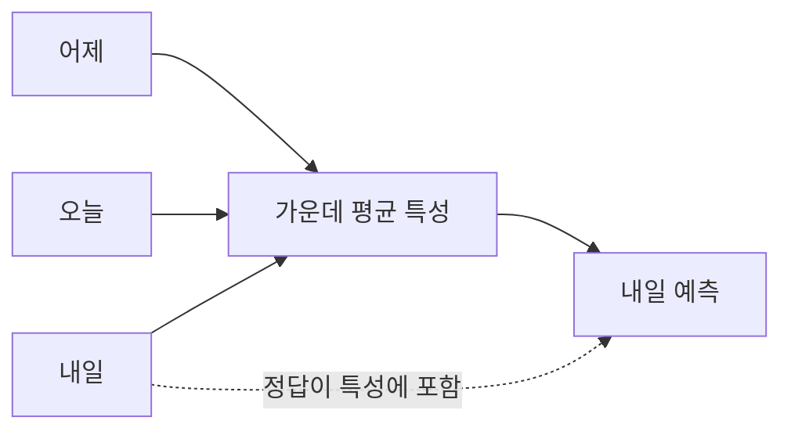
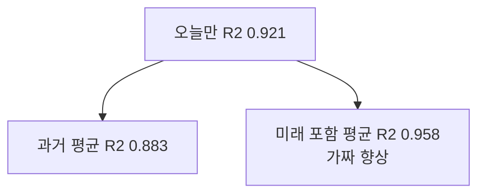

# 미래 정보 누수

> 예측하려는 시점에는 아직 알 수 없는 미래의 값이 특성에 섞여 들어가는 누수다. 대표적으로 가운데 정렬(centered) 이동평균처럼 앞뒤 값을 모두 쓰는 계산이 있다. 학습·검증에서는 점수가 좋지만 실제 서비스에서는 그 값이 없어 성능이 급락한다.

## 쉽게 말하면
내일 주가를 맞히는 문제인데 "어제·오늘·내일 평균"이라는 힌트를 받았다면, 내일 값이 이미 힌트에 들어 있다. 실제로는 내일이 되기 전에는 그 평균을 계산할 수 없다. 실전에서 쓸 수 없는 힌트로 연습한 점수는 가짜다.

## 자세히
- **직접 해 본 실험(랜덤워크 시계열 800개, 다음 날 값을 선형 회귀로 예측, `TimeSeriesSplit(5)`로 시간 순서를 지킨 평가)**:

| 특성 | R² | MAE |
| --- | --- | --- |
| 오늘 값만 | 0.9210 | 0.823 |
| 최근 3일 평균(오늘 포함 과거) | 0.8829 | 1.012 |
| 가운데 3일 평균(내일 값 포함) | 0.9583 | 0.601 |

  가운데 3일 평균은 내일 값의 3분의 1을 담고 있어 R²가 0.958, MAE가 0.601로 가장 좋아 보이지만 실제로는 쓸 수 없는 값이다. 과거만 쓰는 두 방식이 현실적인 성능이다. 시간 순서를 지킨 평가를 써도, 특성 자체에 미래가 들어 있으면 누수가 사라지지 않는다는 점이 핵심이다.
- **흔한 형태(해석)**: ① 가운데 정렬 이동평균·스무딩 ② 전체 기간으로 계산한 정규화·결측 보간(앞뒤 값으로 채움) ③ 나중에 확정되는 값(수정된 통계, 최종 승인 상태, 사후 라벨) ④ 예측 이후에 생기는 사건에서 만든 특성(예: 환불 여부로 구매 의사 예측) ⑤ 전체 기간 통계로 만든 그룹 평균.
- **점검법(해석)**: 각 특성에 "이 값은 예측 시점에 이미 알 수 있는가?"를 묻는다. 특성마다 생성 시각과 예측 시각을 표로 적는다. 파이프라인은 시점별로 그때까지의 데이터만으로 특성을 만들게 한다(`rolling(window, closed="left")`처럼 미래를 막는 옵션 사용). 점수가 비정상적으로 좋으면 특성 중요도 상위부터 의심한다.
- **관련**: 타깃에서 파생된 특성 누수와 겹친다([분할 단위 테스트](#split-assertion-test)가 못 잡는 누수). 시간 분할은 [자기상관](#autocorrelation)과 [시간을 그룹으로 쓰기](#time-as-group)를 함께 본다.

## 그림으로 보기

## 예시
- 코드: `df["x"].rolling(3, center=True).mean()`은 미래를 포함하므로 `df["x"].rolling(3).mean()`(과거만)으로 바꾼다.
- 교육 활용: 특성 목록 각각에 "생성 시각 vs 예측 시각" 열을 붙여 미래 정보가 있는 특성을 찾는 실습.

## 헷갈리는 것과 비교
| 개념 | 차이 |
| --- | --- |
| 미래 정보 누수 | 예측 시점에 없는 미래 값이 특성에 포함 |
| [자기상관](#autocorrelation) | 이웃 표본이 닮아 분할이 새는 문제 |
| [Pipeline으로 누수 막기](#sklearn-pipeline-leakage-guard) | 전처리 누수 방지 |
| [시간을 그룹으로 쓰기](#time-as-group) | 시간 기반 분할 방법 |

## 더 읽을거리
- [scikit-learn: Cross-validation of time series data](https://scikit-learn.org/stable/modules/cross_validation.html) — 시간 순서를 지키는 분할
