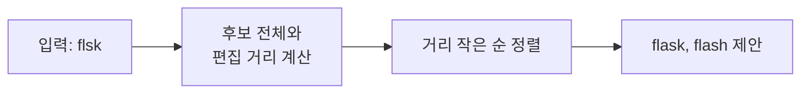
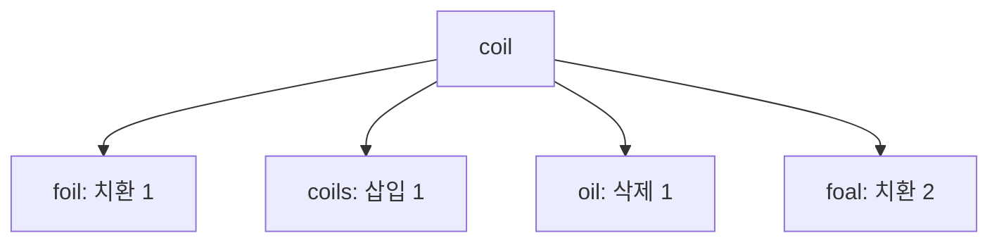

# 퍼지 매칭

> 글자가 정확히 같지 않아도 "거의 같다"고 판단해 후보를 찾는 방식으로, 오타·부분 입력을 견딘다. 근사 문자열 매칭(approximate string matching)이라고도 한다.

## 쉽게 말하면
친구 이름이 "김민수"인데 연락처 검색창에 "김만수"라고 쳐도 "혹시 김민수?"라고 알려 주는 기능이다. 정확히 일치하는 것만 찾는 대신 비슷한 정도를 점수로 매긴다.

## 자세히
- **편집 거리(edit distance, Levenshtein)**: 한 문자열을 다른 문자열로 바꾸는 데 필요한 최소 작업 수. 기본 작업은 삽입·삭제·치환이고, 인접 글자 교환(transposition)까지 세는 변형도 있다. 예: coil→foil 1(치환), coil→coils 1(삽입), coil→foal 2.
- 계산은 동적 계획법(Wagner–Fischer, Sellers)으로 O(mn). 허용 오차 k가 작으면 Landau–Vishkin 같은 O(nk) 알고리즘이 빠르다.
- **비트 연산 방식**: bitap(shift-or)이 유닉스 도구 agrep의 바탕이다.
- **색인 방식**: 큰 데이터는 n-gram, 접미사 트리, 메트릭 트리로 후보를 먼저 줄인다.
- 응용: 맞춤법 검사, DNA 서열 비교, 스팸 필터, 레코드 연결. 명령행 도구 fzf도 대표 예다.
- MCP 자동완성에서는 서버가 입력값과 후보 사이를 퍼지 점수로 정렬하는 것이 권장된다([MCP 인자 자동완성](#mcp-completion)).

## 그림으로 보기



## 예시
Python 표준 라이브러리로 해 볼 수 있다.
```python
import difflib
difflib.get_close_matches("flsk", ["flask","django","fastapi"])  # ['flask']
```
업무 장면: 고객 DB에서 "삼성전자(주)"와 "삼성 전자"를 같은 회사로 묶을 때.

## 헷갈리는 것과 비교
| 개념 | 차이 |
|---|---|
| 정확 일치 | 한 글자라도 다르면 실패 |
| 퍼지 매칭 | 글자 모양의 유사도. 뜻은 모름 |
| 의미 검색(임베딩) | 뜻이 비슷하면 찾음. "자동차"≈"차량". [임베딩](#text-embedding)과 함께 쓰기도 한다 |

## 더 읽을거리
- [Approximate string matching (Wikipedia)](https://en.wikipedia.org/wiki/Approximate_string_matching) — 편집 거리·알고리즘 분류
