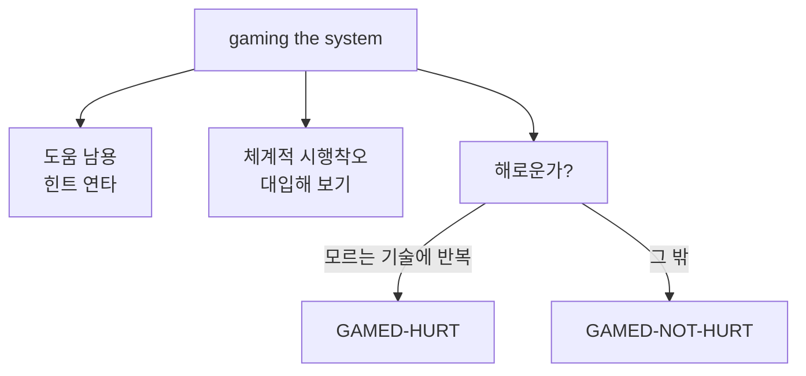

# 시스템 속이기(gaming the system)

> 내용을 생각하지 않고 **시스템의 규칙성(힌트·피드백)을 이용해 정답과 진도를 얻는 행동**. 학습 소프트웨어에서 흔히 학습 저하와 연결되지만, 모든 gaming이 해롭지는 않다는 연구가 함께 있다.

## 쉽게 말하면
시험 대신 문제 풀이 앱에서 "정답이 나올 때까지 아무 보기나 눌러 보기"나 "힌트를 끝까지 연타해 답 보기"를 하는 것이다. 문제를 푼 것처럼 진도는 나가지만 머리에는 남지 않는다.

## 자세히
(Baker·Corbett·Koedinger, "Detecting Student Misuse of Intelligent Tutoring Systems"(ITS 2004) PDF와 Ryan Baker의 gaming 연구 소개 페이지를 직접 읽었다. 이후 연구에 대한 내용은 검색 요약 수준이다.)
- **정의(논문)**: 과제를 *내용을 생각하는 대신* 시스템의 속성·규칙성을 체계적으로 이용해 해내려는 행동. 논문의 연구에서는 두 유형 — **도움 남용(help abuse)**(답이 나올 때까지 빠르게 반복해 도움 요청)과 **체계적 시행착오(systematic trial-and-error)**.
- **학습과의 관계(논문)**: 자주 gaming하는 학생은 그렇지 않은 비슷한 학생보다 **약 2/3만큼만** 배운다(관찰 연구, 상관). 다른 딴짓(off-task) 빈도는 학습과 상관이 없었다. gaming 자체가 해로운지, 학습 의욕 부족의 증상인지는 *미결*이라고 논문이 적는다.
- **두 부류(논문)**: 70명 중 관찰된 gaming 학생은 17명 — 사후 점수가 낮아 해를 입은 **GAMED-HURT 8명**과 해를 입지 않은 **GAMED-NOT-HURT 9명**, gaming이 안 보인 53명. 데이터 분석에서 해로운 쪽은 **자신이 잘 모르는 기술에 반복해** gaming했다(Baker 소개 페이지).
- **탐지기(논문)**: 로그에서 학습한 잠재 반응 모델. 두 부류를 함께 학습시킨 모델이 GAMED-HURT 학생을 **A′=0.82**로 구분했고, 한 문턱값에서 GAMED-HURT의 **88%를 gaming으로 잡고 정상 학생의 15%를 오탐**했다. 반면 GAMED-NOT-HURT는 우연 수준(A′=0.57, p=0.58)이고, 단순히 학습 부진 학생을 잡는 모델도 아니다(A′ 0.56~0.60).
- **원인 설명(Baker 페이지)**: 안정적 학생 특성은 gaming 변동의 최대 16~18%, 수업(lesson) 차이가 18~55%를 설명한다고 두 데이터마이닝 연구가 보고. 지루함·혼란을 느끼면 **60초 안에** gaming을 시작할 가능성이 2배라는 한 연구도 있다.
- **반론(검색 요약, 미열람)**: 2023년 *UMUAI* 논문이 일부 탐지된 gaming은 해롭지 않고 오히려 학습과 연관됐다고 주장한다. 본문은 열지 못했다.

## 그림으로 보기

## 예시
- LLM 튜터 로그에서 "힌트를 5초 이내 연속 요청", "같은 문제에 빠르게 보기 바꿔 가며 제출"을 찾는다(제안).
- 교육 소재: 동기 문제(지루함·혼란)가 우회를 부른다는 점으로 학습 설계 토론.

## 헷갈리는 것과 비교
| 개념 | 차이 |
|---|---|
| gaming | 시스템의 허점을 이용해 진도 확보 |
| [도움 남용 탐지](#hint-abuse-detection) | gaming의 한 유형을 알아내는 방법 |
| [바텀아웃 힌트](#bottom-out-hint) | 읽고 생각하면 학습에 도움이 될 수도 있음 |
| 딴짓(off-task) | 학습과 상관없는 행동, 학습과 상관이 약했음 |

## 더 읽을거리
- [Baker, Corbett, Koedinger (2004) — Detecting Student Misuse of Intelligent Tutoring Systems](https://www.cs.cmu.edu/~rsbaker/BCK2004MLFinal.pdf) — 직접 읽음.
- [Ryan Baker — Gaming the System 연구 페이지](https://www.cs.cmu.edu/~rsbaker/gaming.html) — 정의·수치(직접 읽음).
