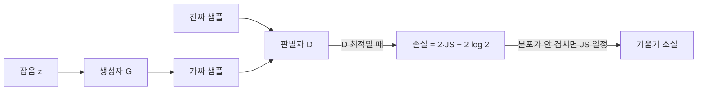

# GAN과 JS 발산

> 원조 GAN에서 판별자를 최적으로 두면 생성자의 손실이 진짜·가짜 분포 사이의 JS 발산(Jensen-Shannon divergence)과 같아진다. 즉 GAN 학습은 "JS 발산 줄이기"이며, 이 성질이 학습 불안정의 뿌리이기도 하다.

## 쉽게 말하면
위조지폐범(생성자)과 감별사(판별자)의 게임이다. 감별사가 완벽해지면 "진짜 0, 가짜 1"로 완전히 갈라서 말해 줄 뿐, 위조범에게 "어느 방향으로 고치면 가까워지는지"는 알려 주지 않는다. 평가는 정확한데 조언은 없는 상태라 위조범이 배울 게 없다.

## 자세히
- 손실: `min_G max_D E_{x~p_r}[log D(x)] + E_{z}[log(1−D(G(z)))]`.
- 최적 판별자: `D*(x) = p_r(x) / (p_r(x) + p_g(x))`. 두 분포가 같으면 1/2.
- 그때 손실 `L(G, D*) = 2·JS(p_r ‖ p_g) − 2·log 2`. 전역 최솟값은 −2 log 2(Lilian Weng 정리).
- **기울기 소실**: 판별자가 너무 좋아지면 D=1(진짜)·D=0(가짜)이 되어 생성자가 받는 기울기가 거의 0이 된다. 실제 데이터와 생성 데이터는 고차원 공간의 저차원 매니폴드 위에 있어 서로 겹치지 않기 쉬운데, 겹치지 않으면 JS는 상수(log 2)라 기울기가 없다.
- 판별자가 약하면 피드백이 부정확하고 강하면 학습이 멈추는 딜레마가 생긴다.
- **모드 붕괴**: 생성자가 판별자를 속이는 몇 가지 출력만 반복한다.
- 비정확한 점: 흔히 쓰는 "비포화(non-saturating) 손실 −log D(G(z))"는 위 식과 다른 목적이라 JS 최소화와 정확히 일치하지 않는다(일반적 지식, 이번 조사에서 원문 미확인).
- 해결의 한 갈래가 JS 대신 [바서슈타인 거리](#wasserstein-distance)를 쓰는 WGAN이다.

## 그림으로 보기

## 예시
두 분포가 한 점씩(P는 0, Q는 θ) 있을 때 θ≠0이면 JS는 항상 log 2, θ=0일 때만 0으로 뚝 떨어진다. θ를 0쪽으로 옮겨야 하는 방향 정보가 JS에는 없다.

## 헷갈리는 것과 비교
| 개념 | 차이 |
| --- | --- |
| [JS 발산](#jensen-shannon) | 대칭·유계, 안 겹치면 일정 |
| [KL 발산](#kl-divergence) | 비대칭, 안 겹치면 무한대 |
| [바서슈타인 거리](#wasserstein-distance) | 안 겹쳐도 거리 정보를 줌 |
| [GAN](#gan) | 이 노드는 GAN 손실의 이론적 해석 |

## 더 읽을거리
- [From GAN to WGAN (Lilian Weng)](https://lilianweng.github.io/posts/2017-08-20-gan/) — D*·JS 유도, 기울기 소실, 모드 붕괴
