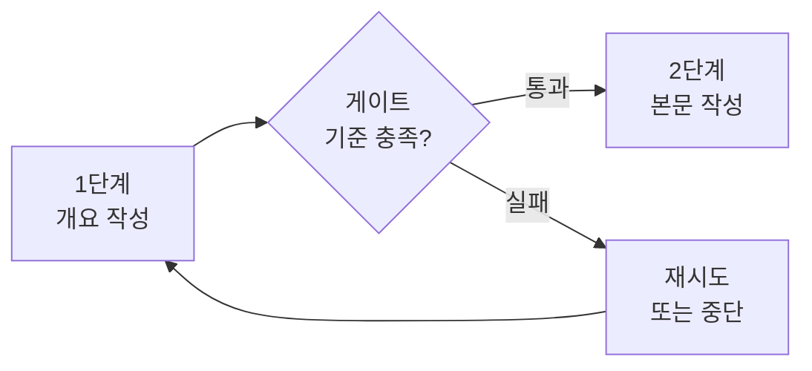

# 게이트 검사

> 프롬프트 체인의 중간 단계 출력을 다음 단계로 넘기기 전에 코드로 확인하는 통과 검사.

## 쉽게 말하면
공장 라인 중간의 검수대다. 부품이 규격에 맞으면 다음 공정으로, 아니면 되돌리거나 버린다. 끝에서 한 번에 검사하면 이미 낭비한 공정이 많다.

## 자세히
- Anthropic "Building effective agents"는 [프롬프트 체이닝](#prompt-chaining)에서 중간에 **프로그램적 검사(gate)** 를 두어 과정이 궤도에 있는지 확인하라고 한다. 예: 문서 개요를 쓴 뒤 기준 충족을 검사하고, 통과해야 본문을 쓴다. 원문은 구체적 검사법까지는 다루지 않는다.
- 검사 종류(실무적 정리, 원문 아님):
  - **형식 검사**: JSON 스키마, 필수 필드, 길이.
  - **규칙 검사**: 금칙어, 숫자 범위, 링크 유효성.
  - **실행 검사**: 코드를 돌려 테스트 통과 여부.
  - **LLM 검사**: 다른 모델이 기준에 맞는지 판정(편향 주의, [심사위원 편향](#judge-bias)).
- 실패 처리: 재시도(최대 횟수 제한), 이전 단계로 되돌리기, 사람에게 넘기기([휴먼 인 더 루프](#human-in-the-loop)).
- 코드로 하는 검사는 결정적이고 싸다. 가능하면 LLM보다 코드 검사를 먼저 쓴다.

## 그림으로 보기


## 예시
```python
outline = llm("개요를 JSON으로")
data = json.loads(outline)           # 파싱 실패 → 재시도
assert 3 <= len(data["sections"]) <= 8   # 게이트
body = llm(f"다음 개요로 본문: {outline}")
```

## 헷갈리는 것과 비교
| 개념 | 차이 |
|---|---|
| 게이트 검사 | 체인 중간의 통과/실패 문턱 |
| [평가 세트](#eval-set) | 시스템 전체 품질을 사전에 측정 |
| [에이전트 검증](#agent-verification) | 에이전트 결과가 맞는지 확인하는 더 넓은 개념 |

## 더 읽을거리
- [Building effective agents(Anthropic)](https://www.anthropic.com/engineering/building-effective-agents) — 프롬프트 체이닝과 gate 설명.
