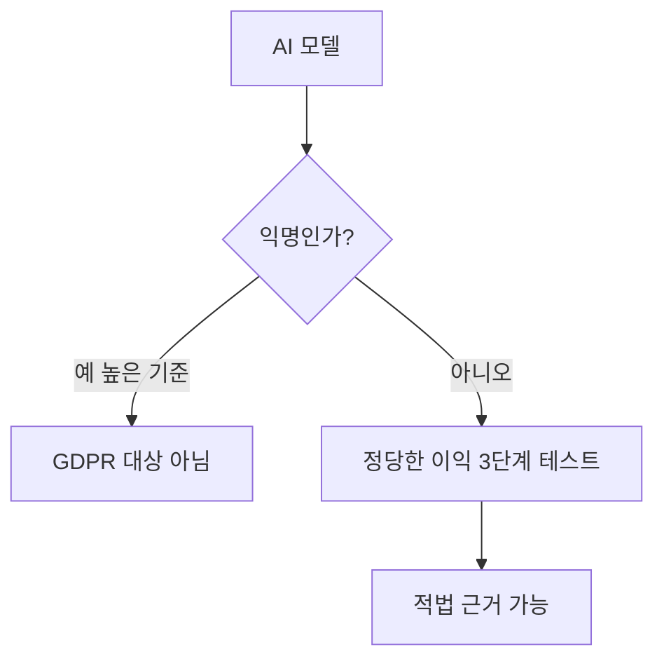

# GDPR과 AI

> **GDPR과 AI**는 EU 개인정보 보호법이 AI 모델의 학습·배포에 어떻게 적용되는지를 다룬다. 2024년 12월 EDPB 의견 28/2024가 핵심 기준을 제시했다.

## 쉽게 말하면
개인 정보를 재료로 만든 AI는 "재료 출처가 합법인가, 결과물에 재료가 남아 있나"를 따져야 한다. 요리에서 알레르기 재료가 완전히 빠졌는지 증명해야 하는 것과 비슷하다.

## 자세히
(EDPB Opinion 28/2024, 2024-12-17 채택 — 요약 기사 기반, 원문 전체는 열지 않음)
- **익명성**: 개인정보로 학습한 모델이라고 자동으로 익명은 아니다. 감독기관이 **사례별**로 판단하며 익명 인정 기준은 높다. 익명성을 입증하는 방법의 비배타적 목록을 제시한다.
- **정당한 이익**: AI 모델 개발·배포의 법적 근거가 될 수 있다. 3단계 테스트: ① 정당한 이익(실재·적법·명확·비추측적) ② 필요성(더 적은 데이터로 가능한가) ③ 정보주체 권리와의 균형. 예로 대화형 에이전트, 사이버보안 개선이 든다.
- **불법 데이터로 개발한 모델**: 최초 처리에 시정 조치가 가능하고, 이후 정당한 이익 평가에서 불법성이 고려될 수 있다.
- 한국 PIPA 등 다른 법은 이 글에서 다루지 않았다.

## 그림으로 보기

## 예시
- 사내 챗봇을 고객 상담 로그로 미세조정하려 할 때: 정당한 이익 평가서를 쓰고 개인정보 최소화·비식별화를 검토한다.

## 헷갈리는 것과 비교
| 개념 | 차이 |
|---|---|
| GDPR | 개인정보 처리 전반 |
| [GPAI 의무](#gpai-obligations) | 범용 모델 제공자의 AI Act 의무 |
| 익명화 | 식별 불가 상태, 모델에선 입증 기준이 높음 |

## 더 읽을거리
- [EDPB 의견 28/2024 원문 PDF](https://edpb.europa.eu/system/files/2024-12/edpb_opinion_202428_ai-models_en.pdf)
- [CMS 요약: 핵심 시사점](https://cms.law/en/int/legal-updates/edpb-opinion-28-2024-key-takeaways-on-processing-personal-data-in-the-context-of-ai-models)
