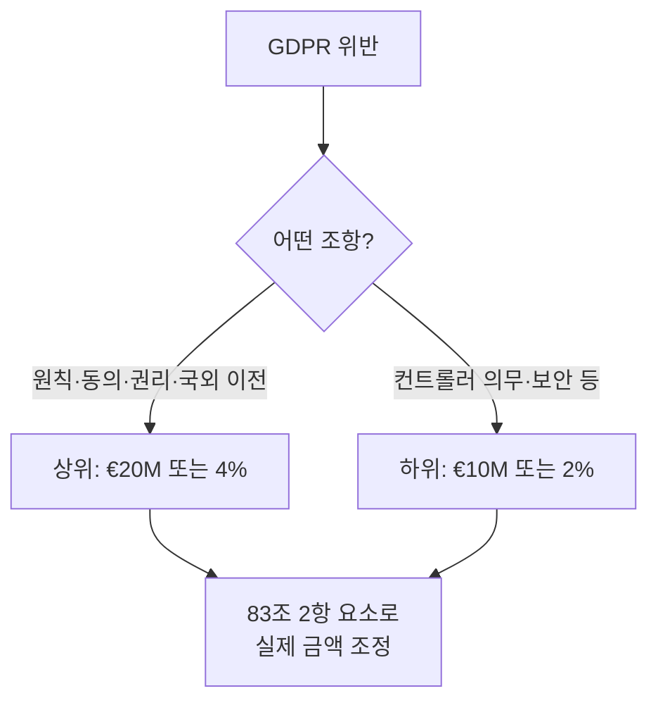

# GDPR 과징금

> EU 개인정보보호법(GDPR)의 과징금은 위반 유형에 따라 최대 2천만 유로 또는 전 세계 연 매출의 4% 중 큰 금액이다. EU AI Act 과징금과 구조가 닮았지만 상한 숫자가 다르다.

## 쉽게 말하면
교통 위반 범칙금처럼 "가벼운 위반 / 무거운 위반" 두 단계 요금표가 있고, 대기업에는 정액이 아니라 매출 비율이 적용돼 부담이 커진다.

## 자세히
GDPR 제83조(조문 직접 확인):
- **상위 구간(83조 5·6항)**: 최대 **€20M 또는 전 세계 직전 회계연도 매출의 4%, 둘 중 큰 쪽**. 대상: 처리 원칙·동의 조건(5·6·7·9조), 정보주체 권리(12~22조), 제3국 이전(44~49조), 감독기관 명령 불이행.
- **하위 구간(83조 4항)**: 최대 **€10M 또는 매출의 2%, 큰 쪽**. 대상: 컨트롤러·프로세서 의무(25~39조 등: 설계 단계 보호, 보안, 영향평가, DPO 등), 인증·모니터링 기관 의무.
- **금액 결정 요소(83조 2항)**: 위반의 성격·중대성·기간, 피해자 수와 피해, 고의·과실, 피해 완화 조치, 이전 위반, 감독기관 협조, 영향받은 정보 유형, 인지 경위(자진 신고 여부), 행동강령·인증 준수, 이익 취득 여부.
- 과징금은 "효과적·비례적·억지력 있어야" 한다(83조 1항). 같은 처리에 대한 복수 위반은 가장 무거운 위반의 상한을 넘을 수 없다(83조 3항).
- **AI Act 비교**: AI Act 99조는 금지 행위 €35M/7%, 의무 위반 €15M/3%, 허위 정보 €7.5M/1%([과징금](#eu-ai-act-penalties)). 둘 다 "큰 쪽" 방식이고 AI Act가 상한이 더 높다. 한 AI 시스템이 개인정보도 처리하면 두 법이 모두 적용될 수 있다([GDPR와 AI](#gdpr-ai)).

## 그림으로 보기

## 예시
- 매출 100억 유로 기업이 동의 없는 처리로 상위 구간 위반: 4% = 4억 유로가 €20M보다 크므로 상한은 4억 유로.
- 매출 2천만 유로 소기업: 4% = 80만 유로 < €20M이지만 "큰 쪽"이므로 상한은 €20M(실제 부과액은 비례 원칙으로 훨씬 낮을 수 있다).

## 헷갈리는 것과 비교
| 개념 | 상한 |
|---|---|
| GDPR 하위 | €10M / 2% |
| GDPR 상위 | €20M / 4% |
| AI Act 금지 행위 | €35M / 7% |
| 중소기업 | AI Act는 낮은 쪽([SME 규칙](#sme-fine-rule)), GDPR은 해당 규칙 없음 |

## 더 읽을거리
- [GDPR Article 83](https://gdpr-info.eu/art-83-gdpr/) — 과징금 조건 조문
- [AI Act Article 99](https://artificialintelligenceact.eu/article/99/) — 비교용 AI Act 과징금 조문
