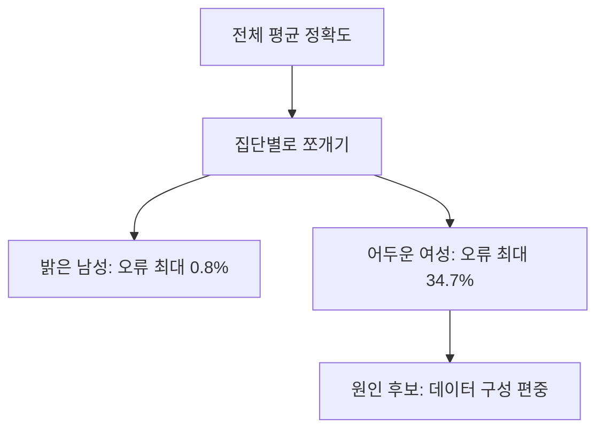

# Gender Shades

> 2018년 Buolamwini와 Gebru가 상용 얼굴 성별 분류 시스템 3종의 오류율을 성별×피부색의 교차 집단별로 쟀더니, 어두운 피부 여성의 오류율이 최대 34.7%, 밝은 피부 남성은 최대 0.8%로 격차가 컸다는 알고리즘 감사 연구다.

## 쉽게 말하면
학교 전체 평균 점수가 높다는 말만 믿고 있다가, 반별·성별로 쪼개 보니 한 집단만 점수가 크게 낮은 것을 발견한 일이다. 평균 정확도는 약한 집단을 가린다. 이 연구는 "누구에게 얼마나 틀리는가"를 집단별로 봐야 한다는 대표 사례다.

## 자세히
(논문 「Gender Shades: Intersectional Accuracy Disparities in Commercial Gender Classification」(PMLR 81, 2018) PDF 본문과 초록을 직접 내려받아 확인.)
- **방법**: 피부과 의사가 인정한 **Fitzpatrick 피부 유형** 분류로 두 기존 벤치마크 IJB-A와 Adience의 성별·피부색 분포를 분석. 두 데이터셋은 **밝은 피부 피험자가 압도적**(IJB-A 79.6%, Adience 86.2%)이었다. 어두운 피부 여성이 가장 적게 대표(Adience 6.4% 등).
- **새 데이터셋(PPB, Pilot Parliaments Benchmark)**: 성별·피부 유형이 더 균형 잡힌 **1,270명**. 국회의원 사진이라 공인이고 정부 웹사이트의 비제한 라이선스 사진이다. 여러 나라 국회에서 모았다(본문).
- **평가 대상**: 상용 성별 분류 시스템 3종 — IBM, Microsoft, Face++(본문 확인).
- **결과(초록)**: **어두운 피부 여성이 가장 많이 오분류**되는 집단(오류율 최대 **34.7%**), **밝은 피부 남성의 최대 오류율은 0.8%**. 어두운 여성·밝은 여성·어두운 남성·밝은 남성 사이 정확도 격차가 "시급한 주의가 필요"하다고 결론. 본문에는 남아공 부분집합에서 Microsoft의 모든 오류가 어두운 여성의 오분류에서 나왔다는 사례도 있다.
- **핵심 교훈**
  1. **전체 정확도는 집단 격차를 숨긴다** → 하위 집단별(그리고 교차) 평가가 필요.
  2. **교차(intersectional) 분석**: 성별 단독, 피부색 단독으로 보면 안 드러나던 격차가 성별×피부색 조합에서 가장 크게 나타났다.
  3. **학습·평가 데이터의 구성**이 원인 후보 — 데이터 구성 표로 점검([데이터 구성 표](#dataset-composition-table), [데이터 분포 편향](#data-distribution-bias)).
- **주의**: 이 연구는 2018년 시점의 상용 시스템 평가이고, 성별 이분법 분류를 다룬 점과 피부색 분류 방식에 대한 비판 논의가 있다(제안). 오늘날 시스템에는 그대로 적용되지 않으며, 후속 감사 결과는 이번 자료에서 확인하지 못했다.
- 교육 활용(제안): "평균 정확도 95%"라는 말을 들었을 때 "누구에게?"를 묻는 습관.

## 그림으로 보기



## 예시
```python
# 집단별 오류율 표
import pandas as pd
df["error"] = (df.pred != df.label)
print(df.groupby(["skin_type", "gender"])["error"].mean().unstack())
```
- 사내 얼굴 인식·음성 인식·채용 스크리닝 모델 도입 전: 연령·성별·지역별 오류율 표를 벤더에게 요구.

## 헷갈리는 것과 비교
| 개념 | 차이 |
|---|---|
| 전체 정확도 | 평균. 집단 격차를 숨김 |
| 집단별 오류율 | 하위 집단 각각의 정확도 |
| 교차 분석 | 둘 이상의 속성 조합(성별×피부색) |
| [데이터 구성 표](#dataset-composition-table) | 데이터의 속성별 비율 점검 도구 |

## 더 읽을거리
- [Gender Shades (PMLR 81, 2018) PDF](http://proceedings.mlr.press/v81/buolamwini18a/buolamwini18a.pdf) — 초록·PPB·평가 결과(PDF 본문 확인).
- [논문 페이지 (PMLR)](https://proceedings.mlr.press/v81/buolamwini18a.html) — 요약(열어 확인).
