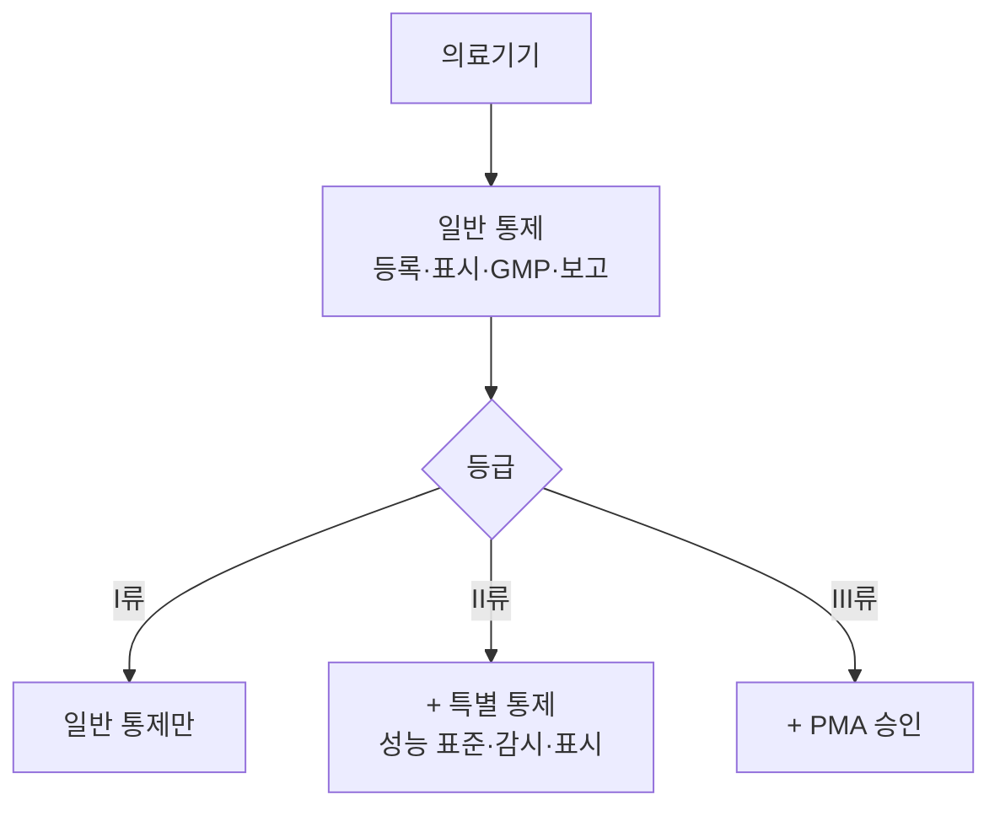

# 일반 통제 vs 특별 통제

> FDA 의료기기 규제의 두 겹. **일반 통제**는 거의 모든 기기에 적용되는 기본 요건이고, **특별 통제**는 일반 통제만으로 부족한 Class II 기기에 기기별로 더하는 추가 요건이다.

## 쉽게 말하면
모든 운전자는 면허와 보험(일반 통제)이 필요하다. 그런데 대형 트럭은 추가로 차량 검사와 운행 기록(특별 통제)이 붙는다. 위험이 크면 기본 규칙 위에 맞춤 규칙을 얹는다.

## 자세히
출처: FDA "Regulatory Controls" 페이지(열어서 읽음).
- **일반 통제**: 규정이 면제하지 않는 한 모든 기기(I·II·III류)에 적용.
  - 등록·목록 등재, 시판 전 신고(510(k))
  - 표시·오표시 규정(section 502)
  - 제조 관리 기준(GMP, section 520). 페이지는 "QMS"라는 용어를 쓰지 않았다.
  - 변질·판매금지·리콜(501, 516, 518)
  - 기록과 보고: 이상 사례 보고, 추적, 고유 기기 식별(UDI), 제거·시정 보고(519)
  - 맞춤·제한 기기, 임상 시험 면제 등 특례(520)
- **특별 통제**: **Class II 기기에만** 적용. 일반 통제만으로 안전·효과를 합리적으로 보증할 수 없지만, 그것을 정할 정보가 충분할 때 쓴다. 예: 성능 표준, 시판 후 감시, 환자 등록부, 특별 표시, 시판 전 데이터 요건, 지침.
- **III류**는 특별 통제가 아니라 **시판 전 승인(PMA)**이 일반 통제에 더해진다.
- **AI 기기에서(해설, 페이지 내용 아님)**: AI 소프트웨어 기기도 용도와 위험으로 분류되고, 해당 분류 규정에 특별 통제가 적혀 있으면 그 요건(예: 성능 시험, 표시)을 충족해야 허가에 쓸 수 있다. 개별 제품의 특별 통제는 분류 규정에서 확인해야 한다.

## 그림으로 보기

## 예시
- 영상 AI 보조 소프트웨어(Class II)가 분류 규정의 특별 통제에 따라 성능 시험 결과와 표시 문구를 제출.
- 낮은 위험의 체온계류(Class I): 일반 통제 안에서 등록·표시·이상 사례 보고.

## 헷갈리는 것과 비교
| 개념 | 차이 |
|---|---|
| 일반 통제 | 모든 등급 공통의 기본 요건 |
| 특별 통제 | Class II 전용, 기기별 맞춤 |
| PMA | III류 시판 전 승인, 특별 통제와 별개의 가장 엄격한 경로 |
| [의료기기 등급](#device-risk-classes) | 위험 등급 분류 자체 |
| [용도 기반 분류](#intended-use-classification) | 같은 기술도 용도에 따라 등급이 바뀜 |

## 더 읽을거리
- [Regulatory Controls (FDA)](https://www.fda.gov/medical-devices/overview-device-regulation/regulatory-controls) — 일반·특별 통제 정의와 항목(열어서 확인)
