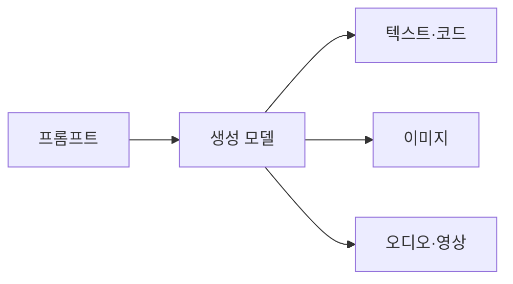
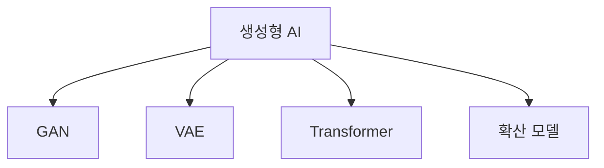

# 생성형 AI

> 글·이미지·오디오·영상·코드 같은 새 콘텐츠를 학습한 패턴으로 만들어 내는 AI 계열.

## 쉽게 말하면
수많은 문장을 읽고 문체를 익힌 작가 지망생이, 주제를 던지면 새 글을 쓰는 것과 비슷하다. 기존 분류·예측 AI가 "이게 고양이인가?"를 답한다면 생성형 AI는 "고양이 그림을 그려 줘"를 수행한다.

## 자세히
위키피디아 정리 기준(2026-11 확인):
- 주요 모델 계열: **GAN**(2014, 생성기와 판별기가 경쟁), **VAE**(2014, 잠재 공간 인코더·디코더), **Transformer**(2017, 자기 어텐션, GPT와 LLM의 기반), **확산 모델**(Stable Diffusion 등 이미지 도구의 바탕).
- 양식: 텍스트·코드(ChatGPT, Claude), 이미지(DALL-E 2021, Midjourney와 Stable Diffusion 2022), 오디오(WaveNet 2016), 영상(Runway, Veo, Sora), 그 밖에 3D·재료과학(GNoME 2023).
- 위험: 환각, 저작권 소송(Getty 대 Stability AI 등), 딥페이크·허위정보, 일자리, 편향, 데이터센터의 에너지·물 사용.
- 규제: EU AI Act의 범용 AI 의무는 2025-08-02부터 적용, 투명성 의무는 2026-08-02부터.

## 그림으로 보기

## 예시
- 회의록 초안을 쓰게 하고 사람이 검수한다.
- 교육 자료 삽화를 텍스트 설명으로 생성한다. 저작권·출처 표기는 직접 확인해야 한다.

## 헷갈리는 것과 비교
| 개념 | 차이 |
| --- | --- |
| 생성형 AI | 새 콘텐츠 생성 |
| 판별형 AI | 분류·예측 중심 |
| [파운데이션 모델](#foundation-model) | 범용 기반 모델. 생성형 AI의 토대인 경우가 많음 |

## 더 읽을거리
- [Generative artificial intelligence (Wikipedia)](https://en.wikipedia.org/wiki/Generative_artificial_intelligence) — 모델 계열·위험·규제 개관
- [On the Opportunities and Risks of Foundation Models](https://arxiv.org/abs/2108.07258) — 기반 모델 관점
