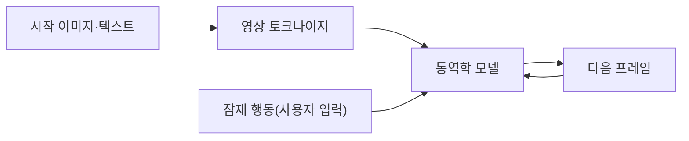
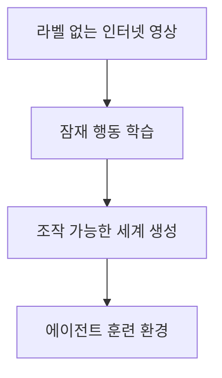

# 생성형 월드 모델(Genie·Cosmos)

> **생성형 월드 모델**은 영상으로 학습해 "다음 장면"을 만들어 내며, 사용자가 행동을 넣으면 반응하는 **탐험 가능한 가상 세계**를 생성하는 모델이다. Genie가 대표 사례다.

## 쉽게 말하면
그림 한 장을 주면 그 안에 들어가 조이스틱으로 걸어 다닐 수 있는 게임 화면이 만들어지는 것이다. 게임 엔진이 규칙을 코딩해 두는 대신, 영상에서 "이렇게 하면 이렇게 변한다"를 배웠다.

## 자세히
(Genie, Bruce 외, arXiv 2402.15391, 2024-02 초록 확인)
- **11B 파라미터**의 "파운데이션 월드 모델". 라벨 없는 **인터넷 영상**으로 비지도 학습했고 행동 라벨이나 도메인 데이터가 필요 없었다.
- **세 부분**: 시공간 영상 토크나이저, 자기회귀 동역학 모델, **잠재 행동 모델**(영상에서 스스로 행동 공간을 학습).
- 이 잠재 행동 덕에 사용자가 프레임 단위로 세계를 조작한다. 텍스트·합성 이미지·사진·스케치로 시작 장면을 줄 수 있다.
- 초록은 학습한 잠재 행동 공간으로 처음 보는 영상의 행동을 모방하는 에이전트를 학습시킬 수 있다고 하며, 범용 에이전트로 가는 길로 본다. 정량 벤치마크는 초록에 없다.
- Cosmos 등 다른 모델은 이 글에서 확인하지 않았다.
- 한계(일반 지식): 긴 시간 일관성, 물리 정확도. [예측 오차 누적](#compounding-error) 문제가 있다.

## 그림으로 보기

## 예시
- 스케치 한 장으로 플랫폼 게임 같은 탐험 환경을 만들어 에이전트를 훈련.
- 교육 활용: "영상에서 세계의 규칙을 배운 모델"이라는 월드 모델 개념 소개.

## 헷갈리는 것과 비교
| 개념 | 차이 |
|---|---|
| 생성형 월드 모델 | 행동에 반응하는 영상 생성 |
| 일반 영상 생성 | 입력 후 재생만, 조작 불가 |
| 게임 엔진 | 사람이 규칙을 코딩 |
| [JEPA](#jepa) | 픽셀 생성 없이 잠재 공간 예측 |

## 더 읽을거리
- [Genie: Generative Interactive Environments](https://arxiv.org/abs/2402.15391) — 논문 초록.
