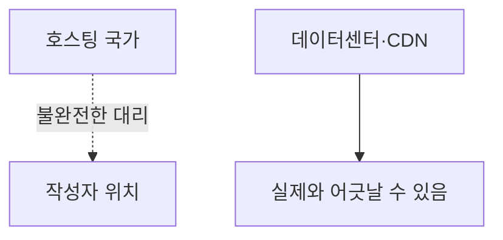

# 지리 대리 지표

> 웹 글이 **어느 나라 사람들의 목소리인지**는 알 수 없어서, 그 사이트의 **서버(IP)가 호스팅된 국가**를 대신 센다. 대략적인 단서일 뿐 작성자의 위치는 아니다.

## 쉽게 말하면
편지 소인(우체국 도장)으로 보낸 사람이 사는 곳을 짐작하는 것과 같다. 서울에서 쓴 편지가 부산 우체국에서 찍혔을 수도 있다. 도장은 힌트일 뿐 주소가 아니다.

## 자세히
(Dodge 외, arXiv 2104.08758 §3.3·부록 A.2를 ar5iv로 직접 읽음)
- **방법**: 코퍼스의 URL마다 서버 IP의 국가를 조회한다. 논문은 IP2Location의 무료 IP-국가 데이터베이스를 썼고, 정제된 C4에서 **무작위 17.5만 URL**의 국가별 빈도를 셌다(데이터베이스 버전은 논문에 없다).
- **결과**: 페이지의 약 **51.3%가 미국에서 호스팅**됐다. 인도·파키스탄·나이지리아·필리핀의 URL 수는 미국 대비 각각 **3.4%, 0.06%, 0.03%, 0.1%**였다(전체 비중이 아니라 미국 수에 대한 비율). 영어 사용 인구가 큰 나라인데도 코퍼스에서는 크게 적게 대표된다.
- **한계(논문)**: 많은 사이트가 데이터센터에 호스팅돼 실제 운영 국가와 다르고, ISP가 가까운 곳의 사본을 제공할 수도 있다. 그래서 호스팅 위치는 제작자 위치의 **불완전한 대리 지표**다. CDN(예: CloudFront)을 쓰는 사이트도 IP가 다른 나라에 있을 수 있다(일반 설명).
- **윤리적 선**: 논문은 글쓴이의 (소수) 정체성을 추정하는 것은 실행 불가능하고 윤리적으로도 문제라고 적고, 대신 텍스트의 방언 분포를 측정했다. 이 분석으로 글쓴이의 지역·인구 특성을 추론할 수 없다.
- **쓰임**: 코퍼스가 특정 국가에 쏠렸는지 점검하고, 쏠림이 크면 지역별 데이터를 보강한다. 모델의 지역별 성능 격차를 설명하는 단서로 쓴다(제안).
- **개인정보 주의(제안)**: 국가 단위 집계만 사용하고 개별 IP는 저장하지 않는다.

## 그림으로 보기

## 예시
| 국가 | 미국 대비 URL 수(Dodge 외) |
|---|---|
| 인도 | 3.4% |
| 필리핀 | 0.1% |
| 파키스탄 | 0.06% |
| 나이지리아 | 0.03% |
- 업무 장면: 다국어·다지역 서비스 AI를 평가할 때 학습 데이터의 호스팅 국가 분포표를 만들어 특정 지역 사용자 응답 품질이 낮은 이유의 후보로 점검한다.

## 헷갈리는 것과 비교
| 개념 | 차이 |
|---|---|
| 지리 대리 지표 | 서버 위치로 짐작 |
| 작성자 위치 | 알 수 없음 |
| [작성 시기 대리 지표](#utterance-date-proxy) | 글이 언제 쓰였는지의 대리 지표 |
| [웹 출처 분포 분석](#web-source-distribution) | 도메인·TLD로 보는 출처 분포 |

## 더 읽을거리
- [Documenting Large Webtext Corpora (arXiv 2104.08758)](https://arxiv.org/abs/2104.08758) — IP 국가 분석과 한계(ar5iv 본문 직접 읽음).
