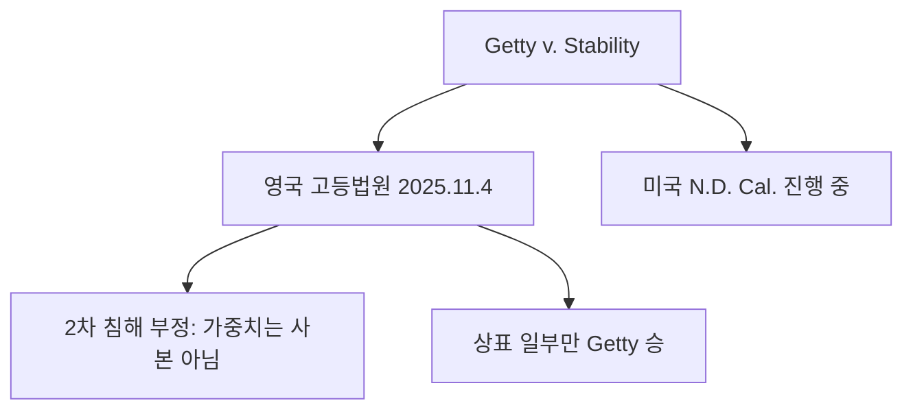
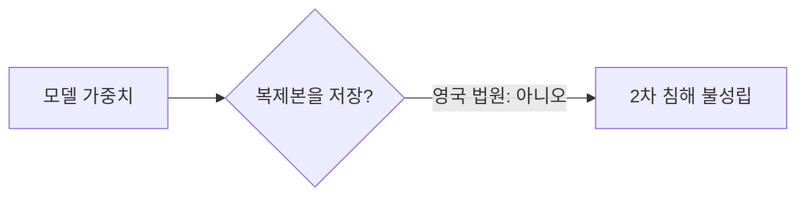

# Getty v. Stability AI

> Getty Images가 Stable Diffusion 개발사 Stability AI를 상대로 영국과 미국에서 낸 소송이다. 2025년 11월 영국 고등법원은 대부분 Stability 쪽 손을 들었고, 모델 가중치가 복제본을 저장하지 않는다는 점이 핵심이었다. (교육용 요약, 법률 자문 아님.)

## 쉽게 말하면
사진을 학습한 AI의 "뇌(가중치)" 안에 사진 파일 사본이 들어 있느냐를 다룬 사건이다. 영국 법원은 사본이 아니라고 보아 2차 저작권 침해를 인정하지 않았다.

## 자세히
(하위 에이전트가 CMS 추적 페이지, Bloomberg Law 등 검색 결과로 확인한 노트 기준. 판결문 PDF는 읽지 못해 **원문 미확인**.)
- **영국 고등법원(2025.11.4)**: 대부분 Stability 승. **2차 저작권 침해 부정** — 모델 가중치는 사본을 저장하지 않는다는 이유. Getty는 좁은 **상표** 쟁점(iStock v1.x, Getty 워터마크 v2.1)에서만 승소. 사칭(passing off)은 판단되지 않았다.
- **항소**: 2025.12.17 Stability가 항소 허가를 얻었다고 보도(트래커 기준).
- **미국**: Getty가 델라웨어 사건을 취하하고 N.D. Cal.에 다시 제기(3:25-cv-06891, Thompson 판사). 본안 판단은 찾지 못했고 진행 중으로 보인다.
- **의미(제안)**: 영국 판단은 "학습 장소·방식(영국 내 학습 여부)"과 "모델이 사본을 저장하는가"에 크게 의존해 다른 관할·모델에 그대로 확장하기 어렵다([학습 장소와 관할](#territorial-training-location)).

## 그림으로 보기

## 예시
- 생성 이미지에 워터마크가 나오는 사례는 저작권이 아닌 상표 쟁점으로 이어질 수 있다.
- 교육 활용: "AI 모델 = 데이터의 압축본인가?" 토론.

## 헷갈리는 것과 비교
| 개념 | 차이 |
|---|---|
| Getty v. Stability(영국) | 가중치와 2차 침해, 상표 |
| [Kadrey v. Meta](#kadrey-v-meta) | 미국 공정 이용 |
| 사칭(passing off) | 상표 외 부정경쟁 계열 청구 |

## 더 읽을거리
- [Getty Images v. Stability AI 추적(CMS)](https://cms.law/en/gbr/publication/getty-images-v-stability-ai) — 판결 요약(검색 결과로 확인, 주소는 제안).
