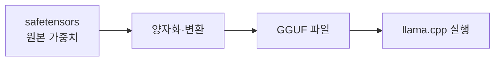

# GGUF와 모델 파일 형식

> llama.cpp 계열이 쓰는, 가중치와 메타데이터를 한 파일에 담은 모델 파일 형식.

## 쉽게 말하면
이삿짐 상자에 내용물과 포장 설명서를 함께 넣은 것이다. 파일 하나만 있으면 모델과 설정을 모두 알 수 있다.

## 자세히
- llama.cpp 저장소는 GGUF를 따로 정의하지 않고 변환 스크립트(`gguf-py`, HF 모델·LoRA 변환)와 허깅페이스의 `-GGUF` 저장소를 언급한다(2026-11 확인). 아래 이름 규칙은 일반 관행이다.
- 파일명 예: `모델명-7B-Q4_K_M.gguf` → 7B는 파라미터 수, Q4는 약 4비트 양자화, K_M은 변형(보통 품질·크기 균형).
- 비트가 낮을수록 작고 빠르지만 품질 손실이 커진다. 일반적으로 Q4~Q5가 타협점으로 쓰인다.
- 다른 형식: safetensors(허깅페이스 표준 가중치, 안전한 텐서 저장). 모델을 로컬로 돌릴 땐 GGUF로 변환·양자화된 파일을 받는 경우가 많다.
- 파일 크기 ≈ 파라미터 수 × 비트 ÷ 8. 실행엔 [KV 캐시](#kv-cache) 메모리가 추가로 든다.

## 그림으로 보기

## 예시
7B 모델을 4비트로 쓰면 약 3.5~4.5GB 파일이 되어 8GB VRAM에서 돌릴 만하다는 식으로 가늠한다.

## 헷갈리는 것과 비교
| 개념 | 차이 |
| --- | --- |
| GGUF | 로컬 추론용 단일 파일 형식 |
| safetensors | 학습·배포용 표준 가중치 |
| Q4_K_M 같은 이름 | 양자화 방식 표기 |

## 더 읽을거리
- [ggml-org/llama.cpp](https://github.com/ggml-org/llama.cpp) — 변환 도구와 GGUF 모델 사용
- 관련: [llama.cpp](#llama-cpp), [증류](#distillation)
