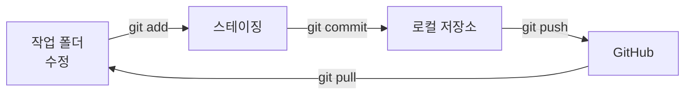

# Git 기초

> 파일의 변경 이력을 시점별 스냅샷으로 저장해, 언제든 되돌리고 여러 갈래로 작업하게 해 주는 버전 관리 도구.

## 쉽게 말하면
게임의 세이브 파일이다. 보스 전 직전에 저장해 두면 망쳐도 거기서 다시 시작한다. AI가 코드를 대량으로 고칠 때 세이브 없이 맡기면 되돌릴 방법이 없다.

## 자세히
Pro Git 기준:
- Git은 차이(delta) 목록이 아니라 **스냅샷의 흐름**을 저장한다. 안 바뀐 파일은 이전 것을 가리킨다.
- 파일 상태 3가지: **modified**(수정됨) → **staged**(다음 커밋에 담기로 표시) → **committed**(로컬 DB에 안전하게 저장).
- 3영역: 작업 폴더(working tree), 스테이징 영역(index), Git 디렉터리(.git).
- 기본 흐름: 수정 → `git add` → `git commit -m "메시지"`.
- **브랜치**: 원본을 건드리지 않고 실험하는 갈래. 마음에 들면 병합(merge), 아니면 버린다.
- **원격(GitHub)**: `git push`로 올리고 `git pull`로 받는다.
- AI와 일할 때: 작업 전 커밋 → AI 수정 → `git diff`로 변경 확인 → 맘에 안 들면 `git restore .`. 작은 단위로 자주 커밋한다.

## 그림으로 보기


## 예시
```
git switch -c ai-experiment   # 새 브랜치에서 실험
git diff                      # AI가 바꾼 내용 확인
git add -A && git commit -m "feat: 로그인 수정"
```

## 헷갈리는 것과 비교
| 개념 | 차이 |
| --- | --- |
| Git | 내 컴퓨터의 버전 관리 도구 |
| GitHub | Git 저장소를 올려 두고 협업하는 웹 서비스 |
| commit vs push | 로컬에 저장 vs 원격에 업로드 |

## 더 읽을거리
- [Pro Git: What is Git?](https://git-scm.com/book/en/v2/Getting-Started-What-is-Git%3F) — 스냅샷·3상태·3영역
