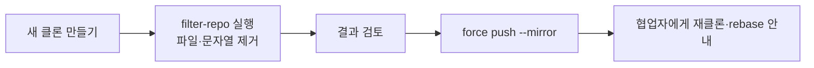

# git-filter-repo

> git-filter-repo는 저장소 전체 기록을 다시 쓰는 도구로, 실수로 올린 파일·비밀값을 모든 커밋에서 지울 때 쓰며 Git 프로젝트가 `filter-branch` 대신 권장한다.

## 쉽게 말하면
책의 모든 판본에서 특정 쪽을 오려내고 다시 제본하는 일이다. 낱권 하나만 고치는 게 아니라 과거 판본까지 모두 바꾸므로 제본 번호(커밋 해시)가 전부 달라진다.

## 자세히
GitHub 저장소 README와 GitHub Docs(2026-11 확인):
- `git filter-branch`보다 훨씬 빠르고 조용한 손상 위험이 적다. 새로 클론한 저장소에서만 실행하도록 막고(`--force`로 우회), 끝나면 옛 객체를 정리한다. 요구: git 2.36+, Python 3.6+. 단일 스크립트라 PATH에 두면 된다.
- 비밀값 제거(GitHub Docs): 버전 **2.47 이상**(`--sensitive-data-removal` 플래그), 파일 삭제는 `--invert-paths --path <경로>`(이동·이름 변경 이력의 경로도 포함), 문자열 치환은 `--replace-text <파일>`.
- README의 예: `git filter-repo --path src/ --to-subdirectory-filter my-module --tag-rename '':'my-module-'`(하위 폴더만 추출).
- 주의: 해시가 바뀌고 서명이 사라지며, 다른 클론·포크에는 옛 기록이 남는다. 먼저 [키 교체](#secret-rotation)부터 한다.

## 그림으로 보기

## 예시
`git filter-repo --invert-paths --path .env` — 모든 커밋에서 `.env`를 삭제한 새 기록 생성(실행 전 백업·새 클론 필수).

## 헷갈리는 것과 비교
| 개념 | 차이 |
|---|---|
| git-filter-repo | 전체 기록 재작성, 권장 도구 |
| filter-branch | 느리고 함정 많은 구형 |
| `git rm` | 최신 커밋에서만 삭제 — 기록엔 남음 |
| [force push 위험](#force-push-risks) | 재작성 결과를 올릴 때의 부작용 |

## 더 읽을거리
- [newren/git-filter-repo](https://github.com/newren/git-filter-repo) — 소개·설치.
- [Removing sensitive data (GitHub Docs)](https://docs.github.com/en/authentication/keeping-your-account-and-data-secure/removing-sensitive-data-from-a-repository) — 2.47+ 절차와 주의.
