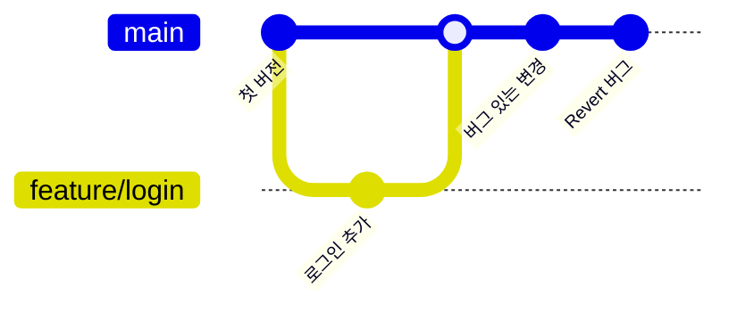
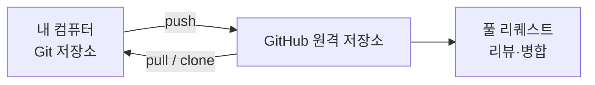

# Git과 GitHub

> **Git**은 파일의 변경 이력을 기록하고 되돌릴 수 있게 하는 버전 관리 도구, **GitHub**는 Git 프로젝트를 올려 두고 함께 작업(검토·토론)하게 해 주는 클라우드 서비스다. AI에게 코드를 맡길 때 Git은 **"AI가 망쳐 놓은 것을 되돌릴 수 있는 안전망"** 이다.

## 쉽게 말하면
Git은 문서 편집기의 "버전 기록"을 훨씬 정교하게 만든 것이고, GitHub는 그 기록을 인터넷 공유 폴더에 올려 여러 사람이 함께 보고 의견을 다는 곳이다. 게임의 세이브 파일처럼, AI가 일을 크게 벌이기 전에 저장해 두면 언제든 돌아올 수 있다.

## 자세히
- **GitHub 문서 기준 구분**: Git은 오픈소스 버전 관리 시스템으로 파일 변경을 추적하고 내 복사본에서 작업한 뒤 다른 사람의 변경과 합치게 해 준다. GitHub는 Git 위에 만든 클라우드 플랫폼으로, Git 프로젝트를 호스팅하고 계획·협업 도구를 더한다. **풀 리퀘스트(PR)** 는 제안한 코드 변경을 리뷰어가 논의하고 수정한 뒤 병합하게 하는 단위다.
- **핵심 용어**(일반 설명): 저장소(repository, 프로젝트와 이력), **커밋**(변경을 이름 붙여 저장한 한 시점), **브랜치**(본 줄기와 분리해 실험하는 가지), **병합(merge)**, **clone**(복제해 내려받기), **fork**(내 계정으로 복사), `push`/`pull`(GitHub와 동기화).
- **직접 실행**(임시 폴더에서): `git init` → 파일 만들고 커밋 "첫 버전" → `git switch -c feature/login`으로 브랜치에서 "로그인 추가" 커밋 → `main`에 병합 → 일부러 "버그 있는 변경" 커밋 → `git revert HEAD`로 **되돌림 커밋**을 만들자 이력이 `Revert "버그 있는 변경"`까지 4개로 남고, 파일은 `v1`, `login` 두 줄로 돌아왔다. **이력을 지우지 않고** 되돌린 것이다.
- **바이브코딩에서의 습관**:
  1. AI에게 큰 변경을 맡기기 **전에 커밋**(되돌릴 지점 만들기).
  2. 기능 하나당 **브랜치** 하나, 커밋 메시지는 "무엇을/왜".
  3. 잘못되면 `git revert`(안전, 이력 유지)나 `git restore`로 복구. `git reset --hard`는 변경을 **잃을 수 있으니** 조심.
  4. **비밀 키는 절대 커밋하지 않는다**([환경 변수와 API 키](#env-secrets)).
  5. GitHub에 PR로 올려 AI·사람이 변경을 리뷰한다.
- 한계: Git은 텍스트 중심 이력에 강하고 큰 바이너리 파일에는 약하다. 이 글의 명령은 일반적인 Git 2.x 기준이며 세부 옵션은 `git help <명령>`으로 확인한다.

## 그림으로 보기



## 예시
```bash
git init
git add .
git commit -m "첫 버전"
git switch -c feature/login        # 새 브랜치에서 작업
git commit -am "로그인 추가"
git switch main && git merge feature/login
git revert HEAD                    # 마지막 변경을 되돌리는 새 커밋
```
- AI 프롬프트: "작업 전에 현재 상태를 커밋하고, 새 브랜치 `feature/xxx`에서만 수정해 줘. 끝나면 변경 요약을 알려 줘."

## 헷갈리는 것과 비교
| 개념 | 차이 |
|---|---|
| Git | 내 컴퓨터에서 도는 버전 관리 도구 |
| GitHub | Git 저장소를 호스팅하는 서비스(비슷한 서비스: GitLab 등) |
| `git revert` | 되돌림 커밋을 추가(이력 보존) |
| `git reset --hard` | 이력·변경을 되돌려 버림(위험) |
| [환경 변수와 API 키](#env-secrets) | 커밋하면 안 되는 것 |

## 더 읽을거리
- [GitHub Docs: About GitHub and Git](https://docs.github.com/en/get-started/start-your-journey/about-github-and-git) — Git과 GitHub의 차이.
- [Pro Git (공식 책)](https://git-scm.com/book/ko/v2) — 한국어판 무료 교재.
