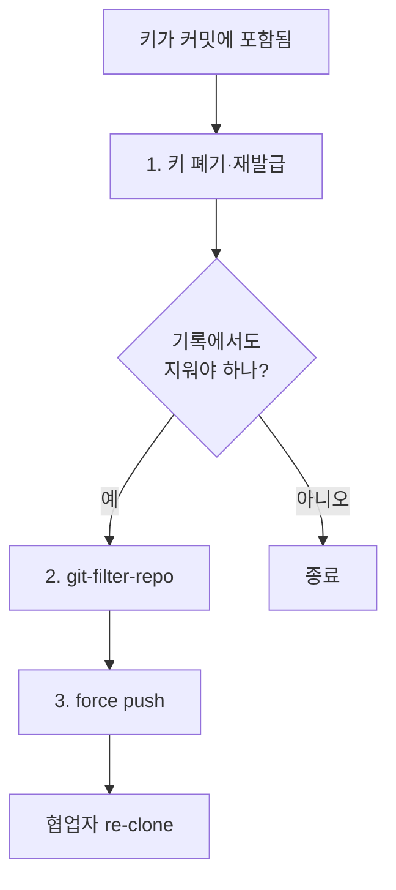
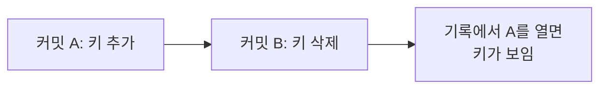

# git 기록 속 비밀값

> 비밀값을 커밋했다가 다음 커밋에서 지워도, git은 모든 과거 커밋을 보관하므로 키는 기록 속에 그대로 남아 있다.

## 쉽게 말하면
일기장에서 비밀번호를 지우개로 지웠는데, 일기장 복사본이 이미 여러 사람에게 돌아간 상황이다. 원본을 고쳐도 복사본은 그대로다. 그래서 "숨기기"보다 "그 비밀번호를 바꾸기"가 먼저다.

## 자세히
GitHub 문서(Removing sensitive data from a repository) 기준:
1. **먼저 폐기·교체(rotate/revoke)**. 키가 무효가 되면 노출돼도 접근할 수 없어 이것만으로 충분할 수 있다.
2. 필요하면 **기록 재작성**: git-filter-repo 2.47 이상의 `--sensitive-data-removal` 플래그. 파일 통째 제거는 `git-filter-repo --sensitive-data-removal --invert-paths --path <파일>`, 특정 문자열은 `--replace-text`. 되돌릴 수 없으니 force push 전에 `.git/filter-repo/changed-refs`로 영향받는 PR을 확인.
3. **강제 푸시**: `git push --force --mirror origin`. `refs/pull/`은 읽기 전용이라 실패하며, 브랜치 보호를 잠시 풀어야 할 수 있다.
- **한계**: 기존 clone·fork·캐시된 화면·PR 참조에는 남는다. 옛 clone을 가진 협업자가 다시 밀어 넣을 수 있다. 커밋 해시가 바뀌고 서명이 사라진다. GitHub Support가 캐시 뷰·PR 참조 삭제를 도울 수 있으나 키 교체로 해결 안 되는 민감 데이터에 한한다.
- 그러므로 [커밋 전 스캔](#pre-commit-secret-scan)으로 애초에 막는 편이 훨씬 싸다.

## 그림으로 보기



## 예시
```bash
git filter-repo --sensitive-data-removal --invert-paths --path .env
git push --force --mirror origin
```
이 명령 전에 해당 서비스 콘솔에서 키부터 재발급한다. 공개 저장소라면 이미 크롤러가 가져갔다고 가정한다(주장이 아닌 일반 보안 원칙).

## 헷갈리는 것과 비교
| 개념 | 차이 |
|---|---|
| 파일 삭제 후 커밋 | 최신 상태에서만 사라짐, 기록엔 남음 |
| 기록 재작성 | 저장소에서 지우지만 복사본엔 영향 없음 |
| 키 폐기 | 노출된 값을 무효로 만드는 근본 해결 |
| [커밋 전 스캔](#pre-commit-secret-scan) | 예방 단계 |

## 더 읽을거리
- [Removing sensitive data from a repository (GitHub Docs)](https://docs.github.com/en/authentication/keeping-your-account-and-data-secure/removing-sensitive-data-from-a-repository) — 절차와 한계.
