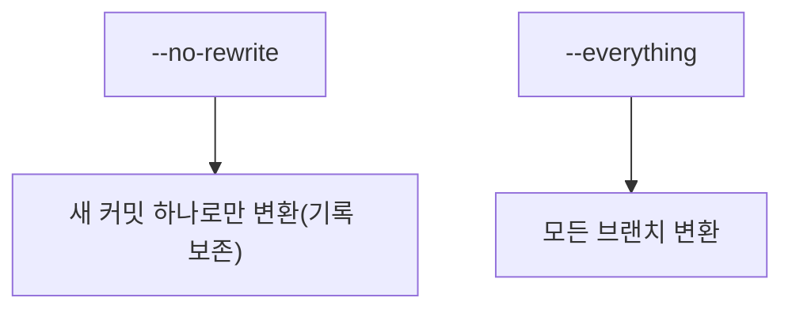

# git lfs migrate

> 이미 Git 기록에 들어간 큰 파일을 Git LFS 포인터로 바꾸는 명령이다. 과거 기록을 다시 쓰므로 새 커밋 ID가 생기고 강제 푸시가 필요하다.

## 쉽게 말하면
이미 책장에 꽂혀 있는 무거운 책들을 보관증으로 교체하면서 책장 배열의 이력 전체를 새로 쓰는 작업이다. 팀원 모두의 사본과 어긋나므로 신중해야 한다.

## 자세히
(Git LFS 문서 원문을 하위 에이전트가 읽은 노트 기준.)
- **기본**: `git lfs migrate import --include="*.mp3,*.psd"` — 지정한 패턴의 파일을 과거 기록까지 포함해 LFS로 변환.
- **기록 재작성**: 새 SHA가 만들어지고 로컬에만 반영되며 이후 강제 푸시가 필요하다. 실행 전 변경 사항을 커밋하거나 스태시하라고 안내하고 `info` 하위 명령으로 먼저 점검할 수 있다.
- **범위**: 기본은 현재 브랜치와 아직 푸시하지 않은 커밋. `--everything`(모든 참조), `--include-ref`, `--above=100Kb`(크기 기준), `--fixup`, `--object-map`, `--skip-fetch`.
- **`--no-rewrite`**: 기록을 쓰지 않고 새 커밋 하나로 변환.
- **`export`**: 반대로 LFS 포인터를 일반 Git 객체로 되돌린다.
- **절차(제안)**: ① 백업·팀 공지 ② `info`로 영향 파악 ③ 변환 ④ 강제 푸시 ⑤ 팀원은 저장소 재클론.

## 그림으로 보기



## 예시
```bash
git lfs migrate info --above=100Kb
git lfs migrate import --include="*.psd"
```
- 교육 활용: 기록 재작성이 협업에 주는 영향을 토론.

## 헷갈리는 것과 비교
| 개념 | 차이 |
|---|---|
| migrate import | 기록의 큰 파일을 LFS로 |
| migrate export | LFS를 일반 객체로 |
| git lfs track | 앞으로의 추적 규칙 |

## 더 읽을거리
- [Git LFS 문서](https://github.com/git-lfs/git-lfs/tree/main/docs) — migrate 문서(원문 확인).
