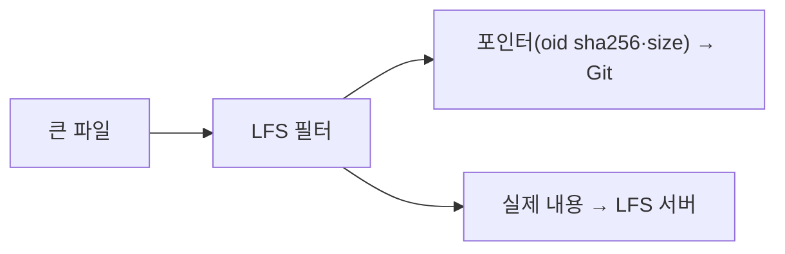
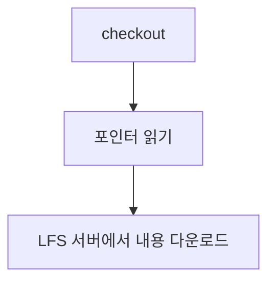

# Git LFS 포인터 파일

> Git LFS는 큰 파일 대신 파일의 SHA-256 해시와 크기를 적은 1024바이트 미만의 작은 텍스트 포인터를 Git에 저장하고, 실제 내용은 LFS 서버에 둔다.

## 쉽게 말하면
무거운 가구는 창고에 두고 보관증(포인터)만 집에 들고 있는 것이다. 보관증에는 물건의 고유 번호와 크기가 적혀 있다.

## 자세히
(Git LFS 문서 원문을 하위 에이전트가 읽은 노트 기준. `.gitattributes` 줄의 정확한 문구는 미확인.)
- **형식**: 1024바이트 미만 텍스트.
```
version https://git-lfs.github.com/spec/v1
oid sha256:<64자리 16진 해시>
size <바이트>
```
키는 정렬되며 `version`이 첫 줄이다.
- **`git lfs track "<패턴>"`**: 추적 패턴을 `.gitattributes`에 기록(인자 없이 실행하면 목록 출력, 옵션 `-v`, `-d`, `-j`, `--filename`, `-l`).
- **의미(제안)**: Git 저장소가 가벼워지고 필요한 파일만 내려받는다. 반면 이미 기록된 큰 파일은 `git lfs migrate`로 변환해야 한다([git lfs migrate](#git-lfs-migrate)). DVC 포인터와 달리 파이프라인 기능은 없다.

## 그림으로 보기



## 예시
```bash
git lfs track "*.psd"
git add .gitattributes
```
- 교육 활용: 포인터 파일 3줄을 열어 보며 실제 내용이 없다는 점을 확인.

## 헷갈리는 것과 비교
| 개념 | 차이 |
|---|---|
| LFS 포인터 | 3줄 텍스트(sha256·size) |
| [DVC 포인터](#dvc-pointer-files) | YAML, md5, 파이프라인과 연결 |
| 일반 Git 객체 | 파일 전체 저장 |

## 더 읽을거리
- [Git LFS 문서](https://github.com/git-lfs/git-lfs/tree/main/docs) — 포인터 형식·track.
