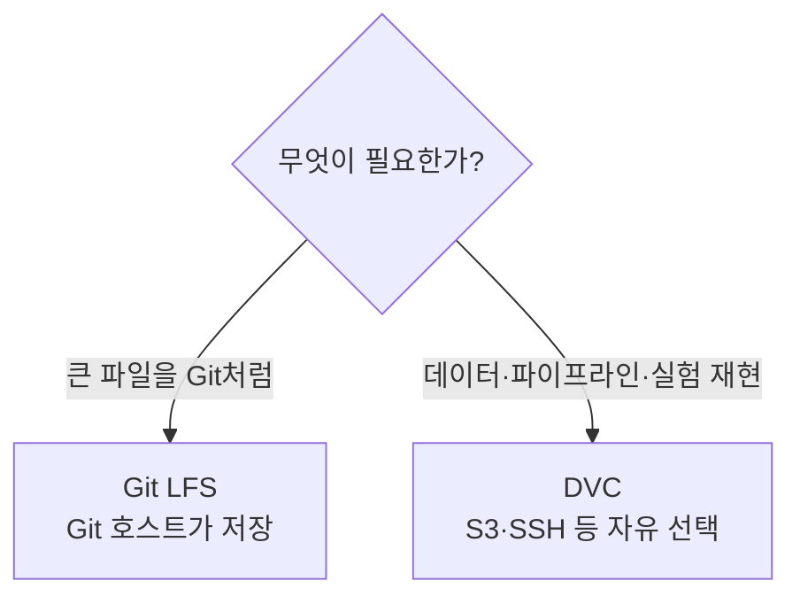
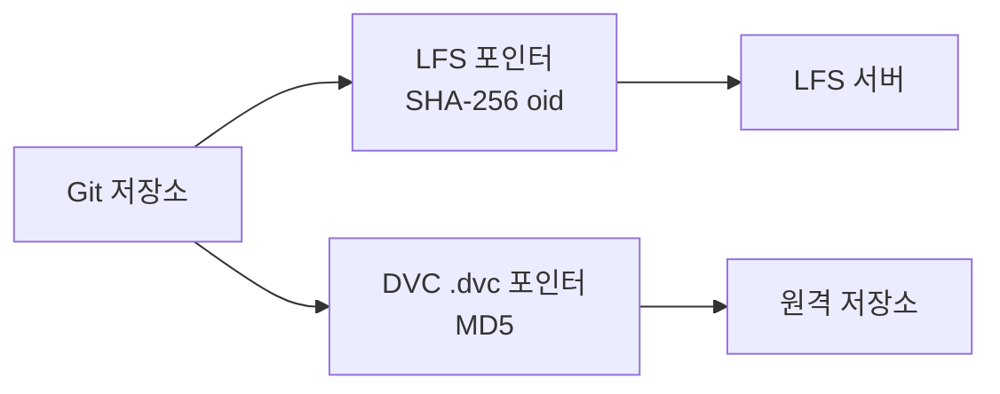

# Git LFS와 DVC 비교

> 둘 다 대용량 파일을 Git 저장소 밖에 두고 **작은 포인터만 Git에 남기는** 방식이다. Git LFS는 "큰 파일을 Git처럼 쓰게 해 주는 확장"이고, DVC는 "데이터·모델·파이프라인까지 ML 실험을 재현하게 해 주는 도구"에 가깝다.

## 쉽게 말하면
둘 다 무거운 짐을 창고에 두고 보관증만 수첩에 끼운다. LFS는 지정된 택배 창고(Git 호스트)에 맡기는 서비스이고, DVC는 어느 창고(S3·SSH 서버 등)에든 맡길 수 있으며 "이 짐으로 어떤 요리를 만들었는지" 순서도까지 기록해 준다.

## 자세히
- **Git LFS(공식 사이트 git-lfs.com, GitHub 문서 직접 확인)**: 큰 파일을 텍스트 **포인터**로 바꾸고 실제 내용은 원격 서버(GitHub.com 등)에 저장한다. 기본 흐름은 `git lfs install`(계정당 1회) → `git lfs track "*.psd"` → `.gitattributes` 커밋 → 평소처럼 add·commit·push. 이미 기록된 파일은 `git lfs migrate`로 옮긴다. 포인터에는 spec 버전, SHA-256 `oid`, 크기가 들어간다.
- **GitHub의 한도(문서, 확인 시점)**: LFS 파일당 최대 Free·Pro 2GB, Team 4GB, Enterprise Cloud 5GB, 5GB 초과는 거부. LFS는 GitHub Pages 사이트나 템플릿 저장소에서는 쓸 수 없다. 저장 용량·대역폭 과금은 별도 문서라 이번에 확인하지 못했다. 사이트는 보안 업데이트로 3.8.1 이상 업그레이드를 권고했다.
- **DVC(공식 사용자 가이드 비교 절, 직접 확인)**: 특별한 서버가 필요 없고 S3·Google Cloud Storage·SSH 서버 같은 어떤 저장소든 원격으로 쓸 수 있다. 기본적으로 Git 훅을 추가하지 않는다(`dvc install`로 선택). 문서는 Git LFS가 "데이터 과학을 염두에 두고 만들어지지 않아" ML 파이프라인·지표 같은 기능이 없다고 설명한다. 이 설명은 DVC 쪽 문서의 시각이며 중립 비교가 아니다.
- **선택 기준(해석)**: 이미 GitHub에서 몇 GB 이하 파일(디자인·모델 가중치 일부)만 Git 흐름으로 관리하면 LFS가 간단하다. 데이터셋 버전과 실험·파이프라인 재현이 목적이고 저장소를 직접 고르고 싶다면 DVC가 맞다.

## 그림으로 보기

## 예시
- 디자인팀이 2GB 이하 PSD를 Git으로 공유: LFS.
- ML팀이 100GB 이미지 데이터를 S3에 두고 학습 코드 커밋과 묶어 버전 관리: DVC.
- 교육 소재: 같은 폴더에 두 도구를 각각 적용해 보고 만들어지는 포인터 파일을 비교.

## 헷갈리는 것과 비교
| 개념 | Git LFS | DVC |
|---|---|---|
| 저장 위치 | Git 호스트(LFS 서버) | S3·GCS·SSH 등 선택 |
| 파이프라인·지표 | 없음 | 있음 |
| 포인터 해시 | SHA-256 | MD5 |
| 서버 요구 | LFS 지원 서버 | 특별 서버 불필요 |
| 관련 | [DVC](#dvc) | [실험 재현성](#experiment-reproducibility) |

## 더 읽을거리
- [Git LFS 공식 사이트](https://git-lfs.com/) — 동작·명령(직접 확인).
- [GitHub Docs: About Git LFS](https://docs.github.com/en/repositories/working-with-files/managing-large-files/about-git-large-file-storage) — 포인터·파일 크기 한도(직접 확인).
- [DVC 사용자 가이드](https://doc.dvc.org/user-guide) — Git LFS와의 비교 절(직접 확인, DVC 측 관점).
