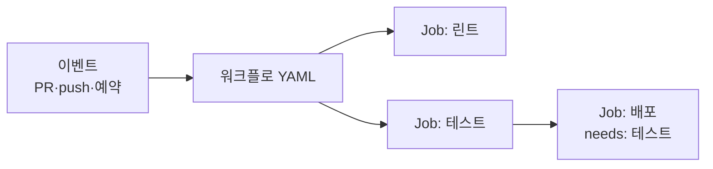
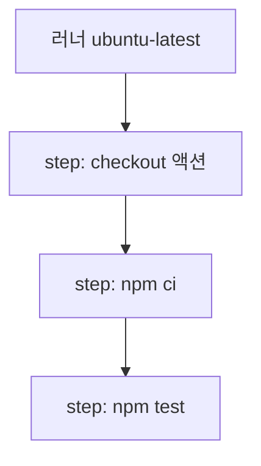

# GitHub Actions

> GitHub 저장소 안에서 **이벤트(push, PR 등)가 일어나면 자동으로 스크립트를 실행**하게 해 주는 자동화 서비스다. 테스트·빌드·배포를 코드 옆의 YAML 파일 하나로 정의한다.

## 쉽게 말하면
**자동문 센서 + 작업 지시서**다. 누군가 문 앞에 오면(이벤트) 정해 둔 지시서(워크플로)대로 로봇(러너)이 청소하고 검사하고 문을 연다. 사람이 매번 버튼을 누르지 않아도 같은 절차가 같은 순서로 돌아간다.

## 자세히
GitHub 문서의 핵심 구성 요소:
- **Workflow**: 하나 이상의 job을 실행하는 자동화 프로세스. `.github/workflows/` 폴더의 YAML 파일이며 저장소당 여러 개 가능.
- **Event**: 실행을 일으키는 활동. PR 생성, push, 예약(`schedule`), 수동 실행(`workflow_dispatch`) 등.
- **Job**: 같은 러너에서 도는 step 묶음. 기본은 **병렬** 실행, `needs:`로 순서를 지정.
- **Step**: job 안의 개별 작업. 셸 명령(`run`)이거나 액션 호출(`uses`). 순서대로 실행하며 같은 러너를 공유.
- **Action**: 재사용 가능한 묶음(예: `actions/checkout`). Marketplace에서 가져오거나 직접 만든다.
- **Runner**: 워크플로를 실행하는 서버. GitHub 제공 Linux·Windows·macOS 또는 자체 호스팅.
- **보안 습관**: 비밀값은 Settings의 Secrets에 넣고 `${{ secrets.NAME }}`으로 쓴다([환경변수와 비밀키 관리](#env-variables-secrets)). 서드파티 액션은 태그 대신 커밋 해시로 고정하는 것이 공급망 위험을 줄인다. 권한은 `permissions:`로 최소화한다.
- **AI 활용**: PR마다 AI 리뷰·테스트 생성·문서 갱신을 돌리는 데도 쓰이며, 이 지도 같은 사이트의 정기 배포에도 쓰인다.

## 그림으로 보기



## 예시
```yaml
# .github/workflows/ci.yml
name: CI
on:
  pull_request:
    branches: [main]
jobs:
  build:
    runs-on: ubuntu-latest
    steps:
      - uses: actions/checkout@v4
      - name: Build and test
        run: |
          npm ci
          npm test
```
프롬프트 예: "이 Node 프로젝트에 PR마다 린트와 테스트를 돌리는 GitHub Actions 워크플로를 만들어 줘. 권한은 contents: read만."

## 헷갈리는 것과 비교
| 개념 | 차이 |
|---|---|
| Workflow vs Job | 파일 전체 자동화 vs 그 안의 실행 단위(러너 1개) |
| Job vs Step | 서로 다른 러너에서 병렬 vs 같은 러너에서 순차 |
| Action vs run | 재사용 컴포넌트 vs 직접 쓴 셸 명령 |
| CI vs CD | 변경 자동 검증 vs 자동 배포. Actions는 둘 다 가능 |

## 더 읽을거리
- [Understanding GitHub Actions](https://docs.github.com/en/actions/get-started/understand-github-actions) — 구성 요소와 예시 워크플로 공식 문서.
