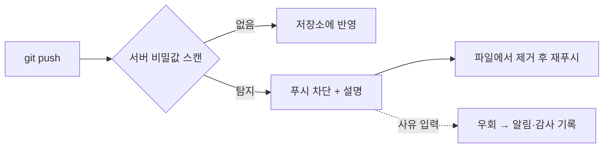

# GitHub 푸시 보호 (Push Protection)

> 푸시 보호는 키·토큰 같은 비밀값이 든 커밋이 GitHub 저장소에 올라가는 순간 서버에서 막고, 이유를 알려 주는 secret scanning 기능이다.

## 쉽게 말하면
편지를 우체통에 넣는 순간 우체국이 "봉투 안에 신용카드 번호가 있는데 정말 보낼까요?" 하고 되돌려주는 것이다. 사고가 난 뒤 알림을 주는 게 아니라 올라가기 전에 막는다.

## 자세히
GitHub Docs(2026-11 확인):
- 검사 대상 4종: **파트너 패턴**(제공사별 자격 증명), **일반 패턴**(개인 키·DB 연결 문자열 등, 조직 설정 필요), **커스텀 패턴**(정규식), **AI 탐지**(비정형 비밀번호 등, 공개 프리뷰). 명령줄 푸시·UI 커밋·파일 업로드에 적용된다.
- **저장소 수준**: GitHub Secret Protection 필요, 기본 꺼짐. **사용자 수준**: 기본 켜짐, github.com 한정, 공개 저장소로의 푸시를 막는다.
- **우회**: 기본은 쓰기 권한자가 사유를 적고 우회 가능(테스트용·오탐 → 닫힌 알림, "나중에 고침" → 열린 알림). 우회는 알림·감사 로그·메일을 남긴다. 위임 우회(delegated bypass)로 우회 권한자를 제한할 수 있다.
- 한계: 이미 푸시된 과거 비밀은 못 막는다(그건 [키 교체](#secret-rotation)와 기록 정리). 로컬에서 먼저 막는 건 [pre-commit 비밀 스캔](#pre-commit-secret-scan).

## 그림으로 보기

## 예시
AI가 만든 코드에 키를 박아 푸시했는데 차단됨 → 키를 환경 변수로 빼고 `git commit --amend` 후 다시 푸시. 이미 커밋 기록에 남았다면 키부터 폐기한다.

## 헷갈리는 것과 비교
| 개념 | 차이 |
|---|---|
| 푸시 보호 | 서버에서 푸시 시점에 차단 |
| [pre-commit 스캔](#pre-commit-secret-scan) | 내 PC에서 커밋 시점에 차단 |
| secret scanning 알림 | 이미 올라간 것을 사후 탐지 |

## 더 읽을거리
- [About push protection (GitHub Docs)](https://docs.github.com/en/code-security/secret-scanning/introduction/about-push-protection) — 지원 패턴·우회·범위.
