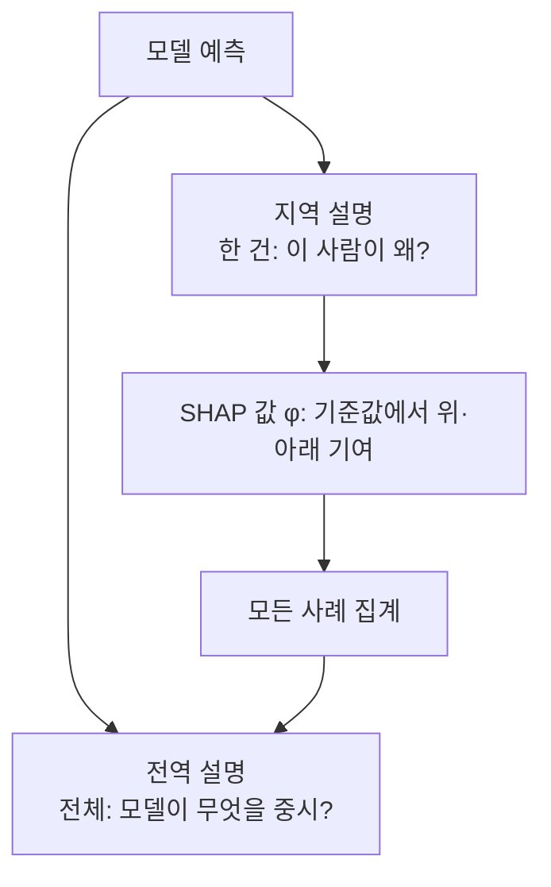

# 전역 vs 지역 설명

> **지역(local) 설명**은 모델이 **한 건**의 예측을 왜 그렇게 냈는지, **전역(global) 설명**은 모델이 **전체적으로** 어떤 특성에 의존하는지를 설명한다. SHAP는 지역 설명을 모아 전역 설명을 만드는 대표적 예다.

## 쉽게 말하면
지역 설명은 "이 학생이 불합격한 이유", 전역 설명은 "이 학교가 일반적으로 중시하는 항목"이다. 대출 거절 통지서에는 지역 설명이 필요하고, 모델 감사에는 전역 설명이 필요하다.

## 자세히
출처: Lundberg·Lee, "A Unified Approach to Interpreting Model Predictions"(arXiv 1705.07874, 2017, NIPS 2017, 초록 확인), Molnar "Interpretable Machine Learning" SHAP 장(열어서 읽음).
- **SHAP 정의**: Shapley 값(게임 이론)에 기반해 특정 예측에 대한 각 특성의 중요도 값을 준다. 논문은 기존 6개 방법을 포괄하는 가법적(additive) 특성 중요도 부류를 제시하고 그중 바람직한 성질을 가진 해가 하나라고 보인다.
- **지역 설명(Molnar)**: 한 사례에서 각 특성이 예측을 위·아래로 미는 값 φⱼ를 준다. 기준값 φ₀(평균 예측)에 특성 기여가 더해져 그 사례의 예측이 된다(가법 모델). 힘 그림(force plot)이 화살표로 보여 준다.
- **전역 해석(Molnar)**: 모든 사례에 SHAP를 돌려 사례×특성 행렬을 만들고 집계한다.
  - **특성 중요도**: 특성별 SHAP 절댓값의 평균. 성능 하락량을 보는 순열 중요도와 달리 기여 크기를 본다.
  - **요약 그림(summary plot)**: 점 하나가 한 사례의 한 특성 값, 색은 특성 값. 중요도와 방향·퍼짐을 함께 본다.
  - **의존 그림(dependence plot)**: 특성 값 대 SHAP 값으로 효과의 모양을 본다.
- **일관성**: 전역 뷰가 같은 Shapley 값으로 만들어지므로 지역 설명과 일관된다고 책은 설명한다.
- **주의(책)**: KernelSHAP은 느리다. 특성이 상관되면 주변 표집이 비현실적 데이터에 가중을 줄 수 있다. 경로 의존 TreeSHAP은 모델이 쓰지 않는 특성에 0이 아닌 값을 줄 수 있다. SHAP 값은 오해하기 쉽고, 설명이 조작돼 편향을 숨길 수 있다. 설명이 곧 인과를 뜻하지 않는다.

## 그림으로 보기

## 예시
- 대출 거절 사례: "소득 대비 부채 비율이 예측을 크게 낮춤" → 지역 설명(거절 사유 통지에 활용).
- 모델 감사: 특성 중요도와 요약 그림에서 보호 속성과 상관된 변수가 상위인지 확인 → 전역 설명.

## 헷갈리는 것과 비교
| 개념 | 차이 |
|---|---|
| 지역 설명 | 한 예측의 이유 |
| 전역 설명 | 모델 전체의 경향 |
| [Shapley 값](#shapley-values) | 둘을 모두 만드는 기반 개념 |
| [반사실 설명](#counterfactual-explanation) | "무엇을 바꾸면 결과가 달라지나"를 말하는 지역 설명 |
| 순열 중요도 | 성능 하락량 기반 전역 중요도 |

## 더 읽을거리
- [A Unified Approach to Interpreting Model Predictions (arXiv 1705.07874)](https://arxiv.org/abs/1705.07874) — SHAP 원논문 초록(열어서 확인)
- [Interpretable Machine Learning — SHAP (Molnar)](https://christophm.github.io/interpretable-ml-book/shap.html) — 지역·전역 해석과 주의점(열어서 확인)
