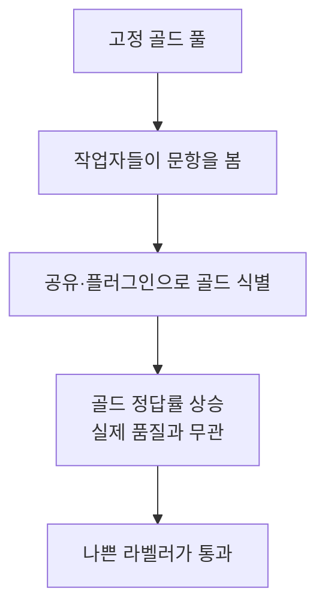
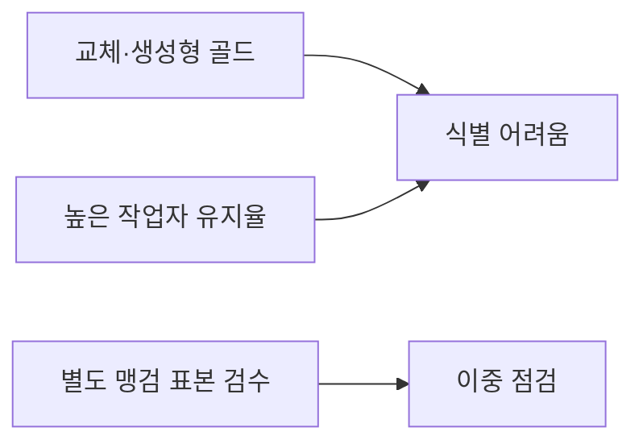

# 골드 문항 노출과 교체

> 라벨러 품질 검사에 쓰는 정답 문항(골드 문항)은 수가 한정돼 있어서, **여러 작업자가 겹쳐 보면서 어떤 문항이 골드인지 알아내거나 서로 공유**할 수 있다. 그러면 검사가 무력해지므로 문항을 주기적으로 바꾸고 노출을 제한해야 한다.

## 쉽게 말하면
같은 시험지를 몇 달째 쓰면 선배들이 후배에게 "3번은 이렇게 풀면 돼" 하고 알려 준다. 시험 점수가 높아도 실력이 아니라 정답을 외웠기 때문이다. 골드 문항도 같아서, 점수가 좋은 라벨러가 실제로는 문항을 알아채고 맞힌 것일 수 있다.

## 자세히
(Checco·Bates·Demartini, HCOMP 2018 논문의 저자 제공 PDF를 직접 읽어 확인하고, 노출 확률은 직접 계산.)
- **공격 방식(논문)**: 골드 집합의 크기가 한정된 점을 이용해, 협력하는 작업자들이 **브라우저 플러그인과 외부 서버**로 본 문항을 공유하고 "이 문항은 골드일 가능성이 높다"를 추정한다. 논문은 이 공격이 문항의 무작위화와 프로그램 생성에도 견딘다고 주장한다. 실제 플랫폼 로그로 검증했다.
- **설정 예(논문)**: 2,000개 작업에 골드 5%(100개). CrowdFlower 기본 동작을 가정: 첫 퀴즈에 골드 10개, 이후 10문항 페이지마다 골드 1개, **같은 작업자에게 같은 골드는 두 번 안 보임**, 신뢰 판정은 골드 최소 4개 이상 + 정확도 70%, 일반 작업은 서로 다른 3명에게 배정. 이 경우 작업자 1명이 최대 100개의 서로 다른 골드를 보게 된다.
- **노출 속도(논문 모델)**: 작업자가 평균 10개씩만 풀어도(가장 보수적 가정) **작업자 50명이 들어오면 골드 문항을 정확히 가려낼 확률이 99.9%를 넘는다**. 반대로 골드 비율이 높고(16% 초과) 작업자 1인당 30문항을 풀면 작업 25%를 마쳤을 때 식별 확률이 20% 미만이다. 즉 **골드를 늘릴수록 공격이 어려워진다**. 다만 이것은 단순화한 모델이다.
- **직접 계산(내 가정)**: 한 작업자가 골드 100개 중 10개를 본다고 하면, 작업자 w명이 모였을 때 최소 한 번 노출된 골드의 비율은 1−0.9^w. w=5이면 41%, 10이면 65%, 22이면 90%, 50이면 99.5%다. 어느 정도 이상 작업자가 지나가면 고정 골드 풀은 사실상 다 알려진다는 뜻이다.
- **대응책(논문)**: ① 골드 집합을 키운다 — 그러나 골드 제작비가 비싸다(논문이 인용한 연구는 골드 문항 제작비를 최저임금의 4배 이상으로 추정, 예시에서 골드 비율 4.4%→12.4%로 올리면 기존 크라우드 비용의 54% 추가) ② 문항당 판단 수를 늘린다 — 효과는 제한적 ③ **작업자 유지율을 높인다** — 소수의 열성 작업자는 서로 다른 골드를 보게 되어 공격이 약해지고 품질도 오를 수 있다 ④ 골드를 **균등 추출하지 않고** 노출 이력을 고려해 선택 ⑤ **프로그램으로 매번 다른 골드를 생성**하고 simhash 거리가 충분한 문항을 쓰는 방식(저자들은 이상적이라고 평가하되 실제 구현은 어렵다).
- **운영 팁(제안)**: 골드 풀을 정기적으로 교체하고 폐기한 문항은 일반 작업에 재투입, 골드와 일반 문항의 표시 형식을 같게, 골드 정답률 급상승·처리 시간 단축 같은 이상 징후를 모니터링, 골드 정답률과 별개로 **숨기지 않은 표본 검수**(맹검 전문가 재검토)를 병행.

## 그림으로 보기

## 예시
- 한 달째 같은 골드 100개로 라벨러를 평가하는 프로젝트: 신규 라벨러의 골드 정답률이 갑자기 98%가 되고 처리 속도는 2배라면 노출을 의심하고 새 골드로 교체·표본 검수.
- 교육 소재: "AI 데이터 품질 검사도 시험처럼 문제 유출을 걱정해야 한다"를 위 계산(작업자 50명이면 99.5% 노출)으로 설명.

## 헷갈리는 것과 비교
| 개념 | 차이 |
|---|---|
| 골드 문항 노출 | 검사 문항이 알려져 검사가 무력화됨 |
| [작업자 품질 골드 문항](#worker-quality-gold-questions) | 골드 문항으로 품질을 재는 방법 자체 |
| [사전 라벨 자동화 편향](#automation-bias-prelabel) | 검토자가 모델에 끌리는 문제(문항 유출과 다름) |
| [합친 라벨 검증](#label-model-validation) | 결과를 사람 라벨 세트로 점검 |

## 더 읽을거리
- [All That Glitters Is Gold — An Attack Scheme on Gold Questions in Crowdsourcing (HCOMP 2018)](https://ojs.aaai.org/index.php/HCOMP/article/view/13332) — 골드 식별 공격과 대응책(PDF 직접 확인).
