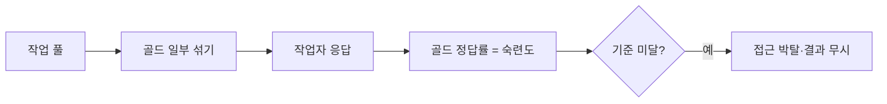
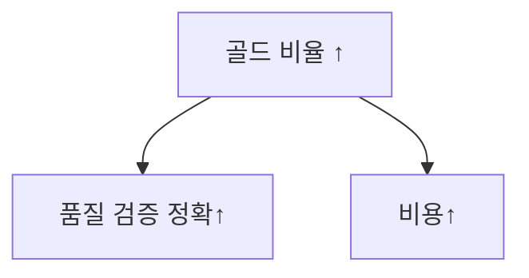

# 골드 문항 비율과 난이도

> 크라우드 라벨링에서 정답을 아는 문항(골드·컨트롤)을 섞어 넣어 작업자 품질을 재는 방식이다. 몇 %를 섞을지는 플랫폼마다 지침이 다르고 공식 단일 정답은 없다.

## 쉽게 말하면
시험 감독이 무작위로 정답을 아는 문제를 끼워 넣고 응시자가 성실한지 확인하는 것이다. 너무 많이 넣으면 비용이 늘고, 너무 적으면 부정행위자를 못 가려낸다.

## 자세히
(Toloka 문서 goldenset.md를 직접 읽고 확인. Appen·Toloka 효율 지표는 검색 요약만 확인해 **미확인**.)
- **Toloka 컨트롤 과제**: 정답을 아는 과제. 작업자 숙련도는 컨트롤 과제 정답률(%)로 계산. 규칙 예: 컨트롤 응답이 3개 이상이고 정답률이 60% 미만이면 접근 박탈(최근 응답 최대 10개 사용), 다른 예로 40% 미만이면 차단. 주관적·자유 형식·전사 과제에는 쓰지 말라고 안내.
- **비율에 대한 단일 권고는 없음**: Toloka에는 "컨트롤 과제 비중" 모니터링 지표(좋은 수준 약 30%라는 검색 스니펫, 페이지 로드 실패로 미확인)가 있지만 이는 감시 기준이지 삽입 비율 규정이 아니다. Appen은 (스니펫, 페이지 404로 미확인) 테스트 문항 최소 50개 또는 데이터의 0.5% 중 큰 쪽, 최소 정확도 70%를 권고한다고 한다.
- **설계 원칙(제안)**: 골드는 실제 과제와 같은 분포·난이도로, 너무 쉬운 문제만 넣으면 모두 통과해 변별력이 없다. 일부는 어려운 경계 사례로. 같은 골드 반복 노출은 외우기 위험이 있다([골드 문항 노출](#gold-question-leak)).
- MTurk·Prolific 문서는 확인하지 않았다.

## 그림으로 보기

## 예시
- 라벨 1,000건에 골드 50건(5%)을 섞고 최근 10개 골드 정답률 60% 미만이면 자동 중단.
- 교육 활용: 감독 문항의 비율과 난이도를 놓고 "신뢰와 비용" 토론.

## 헷갈리는 것과 비교
| 개념 | 차이 |
|---|---|
| 골드 문항 | 정답을 알고 숨겨 넣은 문항 |
| 다수결 합의 | 정답 없이 서로 비교 |
| 보정(Dawid-Skene) | 골드 없이도 혼동 행렬 추정 |

## 더 읽을거리
- [Toloka: 컨트롤 과제 문서(GitHub 원문)](https://raw.githubusercontent.com/Toloka/docs/main/en/guide/concepts/goldenset.md) — 규칙 예시.
