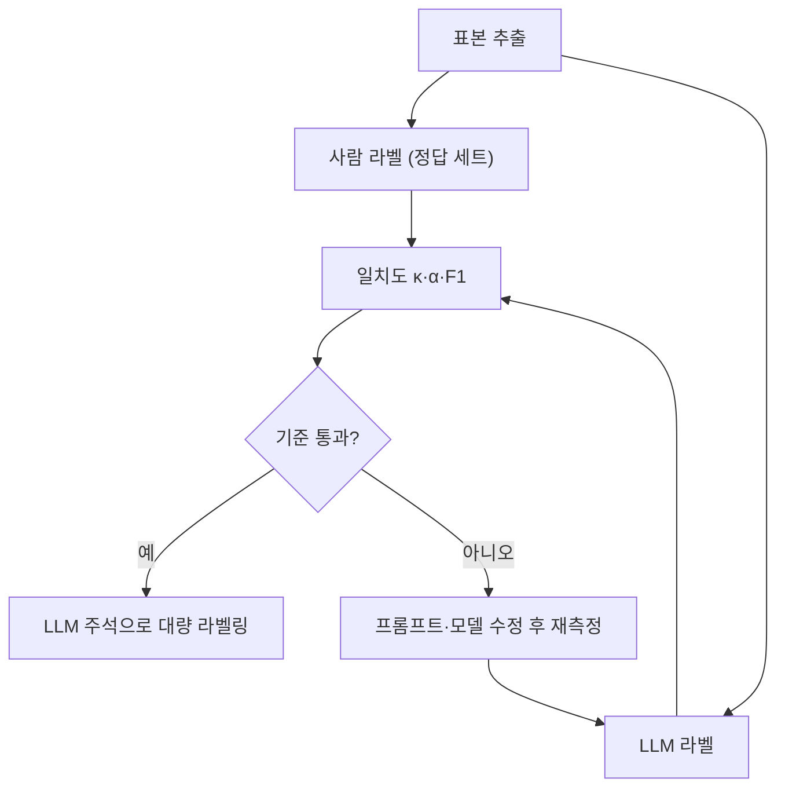
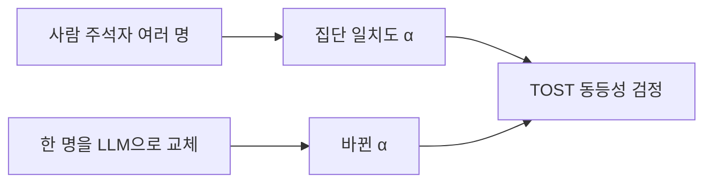

# 사람 정답 세트 점검

> LLM이 단 라벨을 믿기 전에 **소량의 사람 라벨(정답 세트, gold set)과 비교해 얼마나 맞는지** 재 보는 단계. "주석 후 증류"에서 학습 전에 반드시 넣는 안전장치다.

## 쉽게 말하면
신입 채점 보조(LLM)에게 시험지 10만 장을 맡기기 전에, 선생님이 직접 채점한 50장과 비교해 보는 것이다. 많이 어긋나면 채점 기준(프롬프트)을 고치고, 잘 맞으면 맡긴다. 사람이 다 채점하지 않으므로 싸다.

## 자세히
- 절차: ① 전체에서 대표적인 표본을 뽑아 사람이 라벨 ② 같은 표본에 LLM 라벨 ③ 일치도 계산 ④ 기준 미달이면 프롬프트·모델을 바꿔 반복. 정답 세트는 프롬프트를 고치는 검증 세트로도 쓴다.
- 일치도 지표: 정확도·F1 외에 Cohen's κ, Krippendorff's α가 흔히 쓰인다. 라벨 분포가 한쪽으로 쏠리면 κ가 낮게 나오므로 PABAK(유병률·편향 보정 κ) 같은 보정 지표를 함께 보고한 연구도 있다(검색에서 확인한 사례).
- 몇 개가 필요한가: 정해진 숫자는 없다. 한 접근(arXiv 2510.06658, SIGIR-AP 2025)은 LLM을 "사람 한 명 대체" 가능한지 α, 짝지은 부트스트랩, TOST 동등성 검정으로 보는 "통계적 튜링 테스트"를 제안한다. 이 방법의 지침은 **최소 80개 항목, 사람 주석자 4명 이상**이다(항목 80개 중 약 40%를 부트스트랩마다 쓰는 계산). 이는 이 검정을 쓰기 위한 하한이지 모든 과제의 정답이 아니다.
- 그 논문의 결과: MovieLens 100K(선호 평점)에서는 사람 α 0.199, LLM α 0.199로 LLM이 동등성 검정을 통과(p=0.004), PolitiFact(사실 확인)에서는 사람 0.098, LLM 0.100이었으나 검정 실패(p=0.155). 저자들은 선호 평점이 사실 확인보다 대체가 쉽다고 결론짓지만 GPT-4o mini와 단일 프롬프트 결과라서 일반화는 제한된다.
- 실무 요령: 희귀 클래스는 따로 더 뽑고, 일치도에 신뢰구간을 붙이고, 클래스별 오차를 본다. 한 번 통과했다고 영구히 믿지 말고 모델·프롬프트가 바뀌면 다시 잰다.

## 그림으로 보기

## 예시
| 상황 | 점검 |
|---|---|
| 고객 문의 긴급도 라벨 | 사람 200건 vs LLM, 클래스별 F1과 κ |
| 사실 확인 라벨 | 사람과 LLM 일치가 낮을 수 있어 대체 전 별도 검증 |
- 프롬프트 예: "각 문의를 긴급/보통/낮음으로 분류하고 이유를 한 줄로 쓰라" → 사람 라벨과 어긋난 20건을 골라 기준 문장을 고친다.

## 헷갈리는 것과 비교
| 개념 | 차이 |
|---|---|
| 사람 정답 세트 점검 | LLM 라벨을 사람 소량과 비교 |
| [주석 후 증류 패턴](#annotate-then-distill) | 점검을 포함하는 전체 절차 |
| [증류 분류기 평가](#distilled-classifier-eval) | 학습된 소형 모델이 LLM과 얼마나 같은가 |
| [신뢰성과 타당성](#reliability-vs-validity) | 반복 일치(신뢰성)와 정답 일치(타당성)의 구분 |

## 더 읽을거리
- [Can We Hide Machines in the Crowd? (arXiv 2510.06658)](https://arxiv.org/abs/2510.06658) — LLM 주석자 동등성 검정과 80개·4명 지침(직접 읽음).
