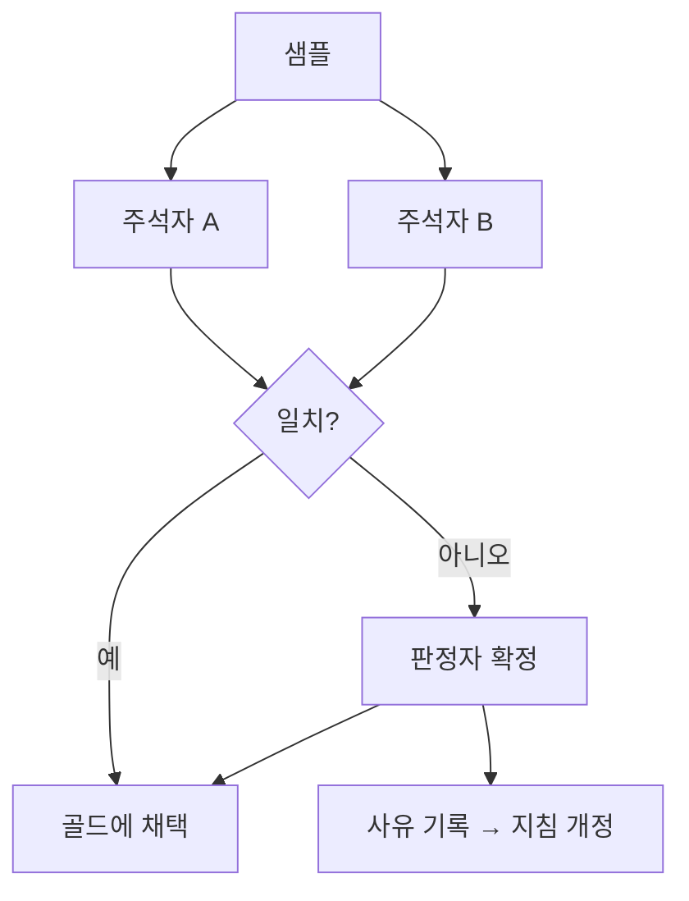
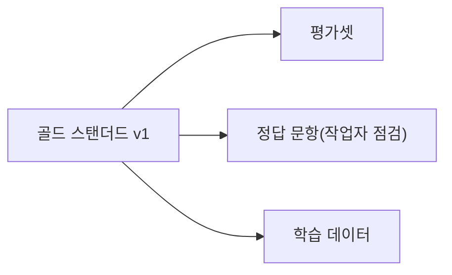

# 골드 스탠더드 만들기

> 골드 스탠더드(gold standard)는 평가·학습의 기준으로 삼는 "최종 정답 세트"다. 보통 여러 주석자가 독립적으로 단 라벨을 판정자가 불일치만 병합해 확정해서 만든다.

## 쉽게 말하면
논술 답안을 두 채점자가 따로 채점하고, 점수가 갈린 답안만 수석 채점자가 최종 점수를 정해 "공식 정답표"를 만드는 과정이다.

## 자세히
- **절차(Finlayson & Erjavec, arXiv 1602.05753의 Annotate 단계 항목에서)**: 주석자 모집·훈련(허용 가능한 IAA에 이를 때까지) → 계획된 순서로 문서를 배포 → 진행 감시 → 주석 수집 → IAA 추적 → 흔한 오류 점검·수정 → 주석자·판정자 회의 일정 → **여러 주석을 판정해 골드 스탠더드로 병합** → 노동 시간·예산 추적.
- **판정 도구의 영향(같은 논문)**: 판정 인터페이스의 효율이 판정자 생산성에 크게 영향을 준다([판정 인터페이스](#adjudication-interface)).
- **실무 순서(해석)**: ① 지침 확정 후 시범 라운드로 일치도 확인([MATTER·MAMA 순환](#matter-mama-cycle)) ② 샘플마다 2명 이상이 독립 주석([이중 검수](#double-annotation-review)) ③ 일치 샘플은 채택, 불일치는 판정자가 확정 ④ 판정 사유를 기록해 지침에 반영 ⑤ 골드 일부를 숨겨 두고 작업자 점검용 정답 문항으로 사용([작업자 품질 관리](#worker-quality-control)) ⑥ 버전을 붙여 고정([평가셋 고정](#evaluation-set-freeze)).
- **한계(해석)**: 골드 스탠더드도 사람이 만든 것이라 오류가 남는다. "금(gold)"이라는 이름 때문에 오류가 없다고 믿지 말고, 주기적으로 감사한다([시험 세트 라벨 오류율](#test-set-label-error-rate)).

## 그림으로 보기

## 예시
- 의료 문서 개체명 주석: 2명이 독립 주석 → 일치율 88% → 불일치 12%를 수석 판정자가 확정 → 버전 v1 고정.
- 교육 활용: 학습자 2명이 같은 문장 20개를 주석하고 3번째 학습자가 불일치만 판정해 골드를 만든다.

## 헷갈리는 것과 비교
| 개념 | 차이 |
| --- | --- |
| 골드 스탠더드 | 판정을 거친 최종 정답 세트 |
| 합의 라벨(CROWDLAB) | 통계·모델로 추정한 합의 |
| [판정 인터페이스](#adjudication-interface) | 병합 도구 |
| [CROWDLAB](#crowdlab) | 자동 합의 추정 |

## 더 읽을거리
- [Overview of Annotation Creation: Processes & Tools (arXiv 1602.05753)](https://arxiv.org/abs/1602.05753) — Annotate 단계의 판정·골드 병합
