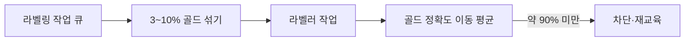

# 골드 문제(gold tasks)

> 정답이 확실한 문제를 **평가자 작업 속에 몰래 섞어** 라벨러의 정확도를 상시 점검하는 방법이다. honeypot이라고도 한다.

## 쉽게 말하면
시험 감독관이 응시자 몰래 정답을 아는 문제를 몇 개 섞어 두고 성실히 푸는지 확인하는 것이다. 성실도가 떨어지면 알아챈다.

## 자세히
(Koji의 데이터 주석 품질 가이드와 Kili의 평가자 일치도 글을 직접 읽었다. 두 곳 모두 업체 문서이며 수치는 업계 관행 수준이다.)
- **섞는 비율(Koji)**: 항목의 **3~10%**. 3% 미만이면 드리프트를 늦게 발견하고, 10% 초과면 처리량 비용이 크고 신호 이득이 줄어든다.
- **차단 기준(Koji)**: 골드 항목 정확도 약 **90%**, **이동 창**(rolling window)으로 측정하고 평생 평균은 쓰지 않는다.
- **순환(Koji)**: 정적 골드는 새어 나가 라벨러가 알아보므로 **교체**한다.
- **한계(Koji)**: 골드는 확신 있게 판정 가능한 쉬운 사례에서 뽑아 **모호한 항목의 품질은 과대평가**한다. 의견이 갈리는 항목에 대한 층화 감사를 병행한다.
- **Kili**: 개인별 정확도를 신뢰할 수 있는 기준에 대해 잰다. Snow 외(2008)는 감정 인식에서 비전문가 라벨 약 4개가 전문가 1명과 일치도가 비슷했다고 인용한다. 단일 정답을 강요하면 유효한 답이 여러 개인 항목에서 판정자가 **최대 31% 나빠진다**는 연구(Guerdan 외)를 소개한다.

## 그림으로 보기

## 예시
- 고객 문의 분류 라벨링에서 정답이 확실한 문의 30개를 1,000건 중에 섞어 일주일 단위로 정확도를 본다(제안).

## 헷갈리는 것과 비교
| 개념 | 차이 |
|---|---|
| 골드 문제 | 정답을 알고 몰래 섞음 |
| [adjudication](#adjudication) | 불일치를 선임이 결정 |
| [라벨러 간 신뢰도](#inter-labeler-reliability) | 라벨러끼리 일치도 |

## 더 읽을거리
- [Koji — Data annotation quality guide](https://www.koji.so/docs/data-annotation-quality-guide) — 직접 읽음.
- [Kili — Inter-rater reliability](https://kili-technology.com/blog/inter-rater-reliability) — 직접 읽음.
