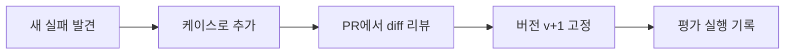

# 골든 데이터셋 버전 관리

> 회귀 평가용 시험 문제 세트(골든 데이터셋)를 **코드처럼 버전 관리**해서, 언제 어떤 문항이 바뀌었는지와 어느 버전으로 시험했는지 추적하는 방법이다.

## 쉽게 말하면
시험 문제지를 매번 몰래 바꾸면 "이번 점수가 오른 건 학생이 잘해서인가, 문제가 쉬워져서인가?"를 알 수 없다. 문제지에 판본 번호를 붙이고 수정 내역을 남겨 두는 것과 같다.

## 자세히
(Stack Overflow Blog의 2026-10-07 글과 Langfuse의 LLM 회귀 테스트 가이드를 직접 읽었다. 변경 이력 형식은 두 글 모두 "버전 관리 기록" 이상으로 정하지 않았다.)
- **저장소에 둔다(SO)**: 케이스를 코드와 같은 버전 관리에 두면 "세트의 변경은 리뷰 가능한 diff"가 된다.
- **회귀 케이스는 삭제하지 않는다(SO)**: 한 번 고친 과거 실패를 모두 케이스로 남긴다. 케이스에는 `slice`, `tags`(예: edge-case, previously-broke), `expect`, `must_not` 필드를 둔다.
- **버전 고정(Langfuse)**: 데이터셋을 Langfuse dataset으로 저장하고 `dataset_version` 타임스탬프(예: 2026-07-01T00:00:00Z)로 고정해 실행을 재현 가능하게 한다. 게이트 실행마다 dataset run으로 기록되어 이력이 쌓인다.
- **크기(Langfuse)**: 20개 미만이면 불안정 출력 하나가 평균을 5%p 이상 흔든다. PR 게이트는 수십~수백 개, 전체 세트는 릴리스·야간용.
- 튜터 평가에서는 [우회 프롬프트 세트](#bypass-prompt-set) 항목이 늘 때마다 같은 방식으로 판본을 올린다(제안).

## 그림으로 보기

## 예시
- 튜터가 학생에게 정답을 말한 대화가 발견되면 그 입력을 `previously-broke` 태그로 골든 세트에 추가하고 PR로 올린다.

## 헷갈리는 것과 비교
| 개념 | 차이 |
|---|---|
| 데이터셋 버전 | 시험 문항 세트의 판본 |
| [조각별 게이트](#slice-level-gating) | 조각별 합격선 |
| [기준선 재설정](#eval-baseline-rebaselining) | 합격 기준 점수의 갱신 |

## 더 읽을거리
- [Stack Overflow Blog — Evals as a deployment gate](https://stackoverflow.blog/2026/10/07/evals-as-a-deployment-gate-and-how-to-know-when-they-drift/) — 직접 읽음.
- [Langfuse — LLM regression testing](https://langfuse.com/resources/engineering/llm-regression-testing.md) — 직접 읽음.
