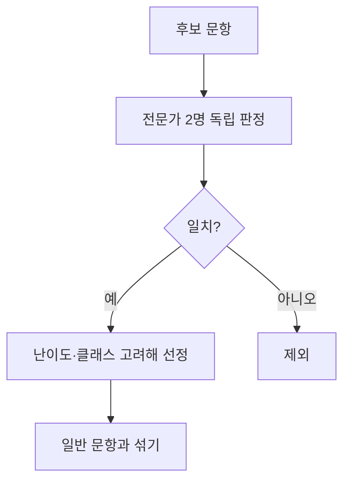
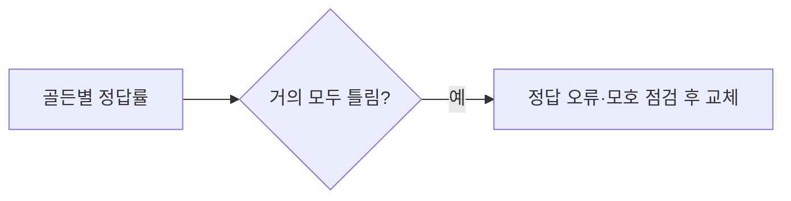

# 골든 문항 선정

> 골든 문항(golden item)은 정답을 이미 알고 작업 중에 몰래 섞어 넣어 작업자의 정확도를 점검하는 문항이다. 모호하지 않고 난이도가 적절하며 전체 작업을 대표하는 문항을 골라야 점검이 공정하다.

## 쉽게 말하면
수업 중 확인 퀴즈를 낼 때, 정답이 애매한 문제를 내면 성실한 학생도 틀리고, 너무 쉬운 문제만 내면 모두 통과해서 쓸모가 없다. 문제 선택이 곧 점검의 품질이다.

## 자세히
- **근거(검색 결과 요약, 논문 본문 미정독)**: 정답 문항 수집은 전문가가 필요해 비싸고, 표본이 작으면 작업자 특성 추정이 부정확하다는 지적이 있다. 단순 주의력 확인은 일반 문항과 구분하기 쉬워 통과해도 실제 작업은 부실할 수 있다. 작은 골드를 크라우드로 키우는 방식도 제안된다([작업자 품질 관리](#worker-quality-control)). Snow 외(2008)는 소량 전문가 골드로 작업자 성향을 추정해 보정에 쓴다([라벨러 편향 보정](#labeler-bias-correction)).
- **선정 기준(해석)**:
  1. **모호하지 않음**: 전문가 2명 이상이 독립적으로 같은 답을 낸 항목만([이중 검수](#double-annotation-review)).
  2. **난이도 분포**: 쉬움~중간 위주에 일부 어려운 항목. 너무 어려우면 성실한 작업자도 탈락하고 너무 쉬우면 스패머도 통과한다([스패머 탐지](#spammer-detection)).
  3. **대표성**: 실제 작업의 클래스 분포와 유형을 반영하되, 희귀 클래스는 따로 확보.
  4. **일반 문항과 구분 불가**: 형식·길이·말투가 실제 문항과 같아야 한다.
  5. **정답 오류 없음**: 골든이 틀리면 성실한 작업자를 억울하게 탈락시킨다. 이의 제기·재검토 절차를 둔다.
- **크기 가이드(해석)**: 작업 중 2~5%를 섞는 것으로 시작해 조정한다. 정확한 수는 [스패머 탐지](#spammer-detection)의 통과율 계산으로 정한다.
- **모니터링(해석)**: 골든마다 작업자들의 평균 정답률을 본다. 거의 모두가 틀리는 골든은 정답 오류 또는 모호 가능성이 높아 점검 후 교체한다.

## 그림으로 보기

## 예시
- 감정 분류 골든 50개: 긍정 15·중립 20·부정 15, 전문가 일치 항목만, 난이도 쉬움 30·중간 15·어려움 5.
- 교육 활용: 학습자가 모호한 문장을 일부러 골든 후보로 골라 보고 왜 부적절한지 토론한다.

## 헷갈리는 것과 비교
| 개념 | 차이 |
| --- | --- |
| 골든 문항 | 작업 중 섞는 점검용 정답 문항 |
| 골드 스탠더드 | 최종 정답 세트(골든의 원천이 될 수 있음) |
| [스패머 탐지](#spammer-detection) | 골든으로 스패머 거르기 |
| [골든 유출과 교체](#golden-leak-rotation) | 문항 유출 방지 |

## 더 읽을거리
- [Cheap and Fast — But is it Good? (Snow 외, EMNLP 2008)](https://aclanthology.org/D08-1027/) — 소량 골드로 작업자 보정
- [A Glimpse Far into the Future (arXiv 1609.04855)](https://arxiv.org/abs/1609.04855) — 작업자 품질 연구
