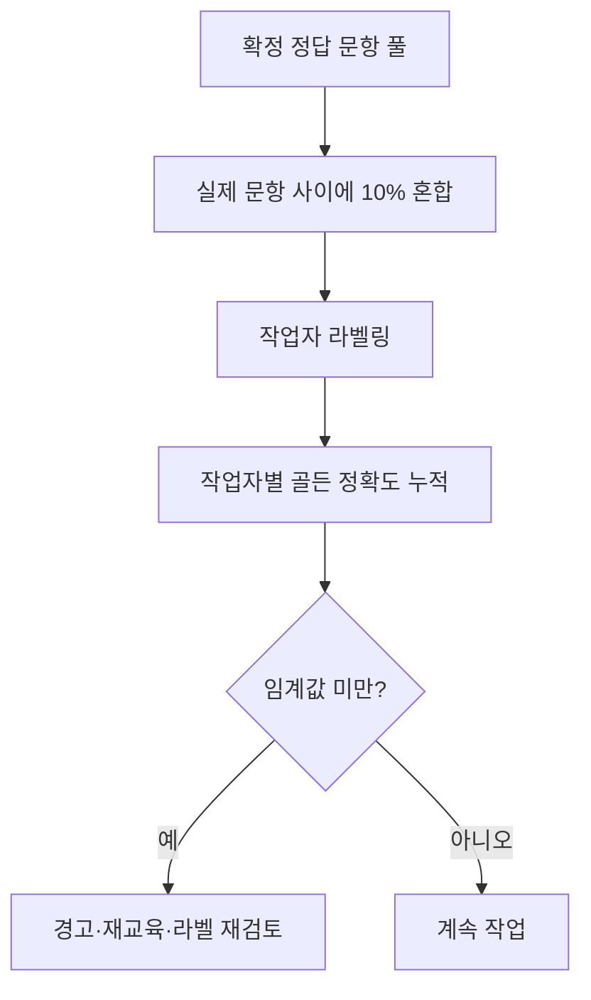
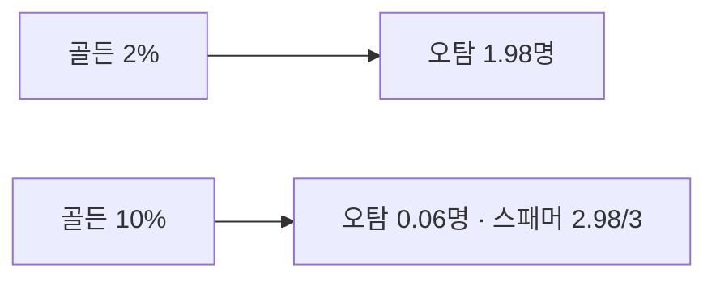

# 골든 문항

> 정답이 이미 확정된 문항을 **라벨링 작업 사이에 몰래 섞어** 라벨러의 정확도를 상시로 재는 방법이다. 크라우드소싱의 불성실한 작업자(스패머)를 걸러 내는 표준적 품질 관리 방식이다.

## 쉽게 말하면
수업 중간중간 정답을 알고 있는 퀴즈를 섞어 내서 학생이 성실히 푸는지 확인하는 것이다. 틀리는 학생에게 실제 과제를 맡기지 않는다.

## 자세히
- **배경**: 크라우드 라벨링에서는 검증 문항이 중요하다는 연구가 있다(Kittur et al. 2008, 위키백과 문서 품질 평가를 전문가와 비교해 검증 테스트가 필수임을 확인. Snow et al. 2008 본문의 관련 연구 서술에서 확인). 이 글에서 "골든 문항"은 그런 검증 문항을 작업에 섞는 일반적 관행을 가리킨다.
- **절차**: ① 전문가가 확정한 정답 문항 풀을 만든다 ② 실제 문항 사이에 일정 비율로 섞는다(작업자에게 구분되지 않게) ③ 작업자별 골든 정확도를 누적 계산한다 ④ 임계값 미만이면 경고·재교육·작업 중단 ⑤ 낮은 작업자의 기존 라벨은 재검토한다.
- **직접 시뮬레이션(작업자 20명: 17명은 정확도 0.85~0.95, 스패머 3명은 0.5(무작위). 실제 문항 300개당 골든을 섞고 정확도 0.7 미만이면 플래그, 400회 반복)**
  | 골든 비율 | 작업자당 골든 수 | 잡은 스패머(3명 중) | 성실한 작업자 오탐(17명 중) | 추가 비용 |
  |---|---|---|---|---|
  | 2% | 약 6 | 2.69 | **1.98** | 2% |
  | 5% | 약 15 | 2.84 | 0.35 | 5% |
  | 10% | 약 33 | 2.98 | 0.06 | 11% |
  | 20% | 약 75 | 3.00 | 0.00 | 25% |
  골든이 적으면(2%, 6문항) 좋은 작업자 2명이 우연히 걸리는 **오탐**이 문제이고, 10%쯤이면 스패머를 거의 다 잡으면서 오탐이 거의 없다. 비용은 대략 골든 비율만큼 늘어난다.
- **설계 요령**
  1. **골든 선정**: 대표성 있는 쉬운~중간 난이도, 모호한 문항은 제외(모호하면 성실한 작업자도 틀림).
  2. **임계값과 최소 표본**: 골든이 10개 미만이면 판정을 보류한다(위 오탐 참고).
  3. **노출 방지**: 골든이 유출·암기되면 효과가 줄어든다. 풀을 주기적으로 교체.
  4. **피드백**: 틀린 골든에 정답과 이유를 알려 주면 교육 효과(가이드 이해 상승).
  5. 골든이 "쉬운 것만"이면 어려운 과제에서의 정확도를 대표하지 못한다.
- 합성 시뮬레이션이며 실제 크라우드 환경(작업자가 골든을 알아채는 경우 등)은 다르다.

## 그림으로 보기

## 예시
- 제품 분류 라벨링 작업자 50명에게 골든 10%를 섞어 정확도 70% 미만 작업자의 최근 라벨 재검수.
- 교육: 업무 품질 관리를 "숨은 테스트 문항"으로 설계하는 사례.

## 헷갈리는 것과 비교
| 개념 | 차이 |
|---|---|
| 골든 문항 | 정답 확정 문항을 섞음, 작업자 품질 측정 |
| 보정 문항(calibration items) | 라벨러 간 기준을 맞추는 공개 문항 |
| [판정자](#adjudicator-role) | 실제 불일치를 해결 |
| [다중 주석자 합의](#cleanlab-multiannotator) | 정답 없이 통계로 신뢰도 추정 |

## 더 읽을거리
- [Snow et al. 2008: Cheap and Fast—But is it Good?](https://aclanthology.org/D08-1027/) — 비전문가 라벨 품질과 편향 보정, 검증 테스트 언급.
- [McHugh 2012: kappa](https://pmc.ncbi.nlm.nih.gov/articles/PMC3900052/) — 일치도 해석(정답이 없을 때의 대안 지표).
