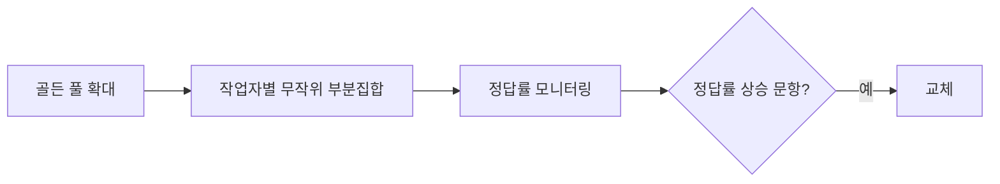
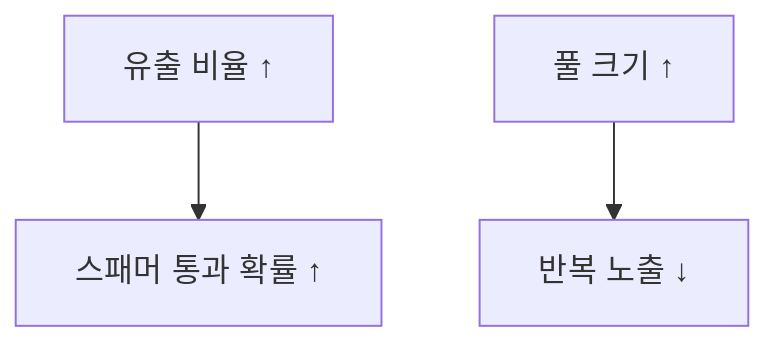

# 골든 유출과 교체

> 골든 유출은 작업자들이 골든 문항의 정답을 외우거나 공유해서 점검이 무력해지는 현상이다. 이를 막으려면 골든 풀을 크게 두고 문항을 주기적으로 교체하며 문항별 정답률을 감시한다.

## 쉽게 말하면
같은 퀴즈를 매주 내면 학생들이 답을 돌려 보고 모두 만점이 된다. 퀴즈 문제은행을 크게 하고 가끔 새 문제로 갈아야 퀴즈가 실력을 재 준다.

## 자세히
- **유출의 영향(직접 계산, 한 번에 10개 골든을 점검하고 8개 이상 맞히면 통과, 2지선다 찍는 스패머, 풀 중 유출된 비율 L)**:

| 유출 비율 L | 스패머 통과 확률 |
| --- | --- |
| 0 | 0.055 |
| 0.2 | 0.167 |
| 0.5 | 0.526 |
| 0.8 | 0.930 |

  풀의 절반이 새어 나가면 스패머가 53%나 통과한다. 평소에는 5.5%로 걸러지던 점검이 사실상 열린 문이 된다. (유출된 문항은 전부 맞히고 나머지는 찍는다는 가정)
- **풀 크기와 반복 노출(직접 시뮬레이션, 10회 점검에서 매번 10개를 무작위로 뽑을 때 이미 본 문항의 비율)**: 풀 20개면 80%, 50개면 52%, 200개면 20%가 반복이다. 풀이 작을수록 같은 작업자가 같은 문항을 다시 만나 외우기 쉽다.
- **교체 방법(해석)**: ① 풀을 점검 횟수보다 충분히 크게(작업자가 볼 총 문항의 몇 배) ② 작업자마다 다른 무작위 부분집합 ③ 주기적으로 일정 비율 교체, 새 문항은 전문가 2명 확인 후 투입([골든 문항 선정](#golden-item-selection)) ④ 문항별 정답률 모니터링: 시간이 갈수록 정답률이 올라가는 문항은 유출 의심 ⑤ 골든과 일반 문항이 구분되지 않게([작업자 품질 관리](#worker-quality-control)).
- **한계(해석)**: 풀 교체 비용(전문가 판정)이 든다. 유출을 완전히 막기는 어렵다고 보고, 골든은 다른 신호(응답 시간·교차 일치도)와 함께 쓴다([스패머 탐지](#spammer-detection)).

## 그림으로 보기

## 예시
- 풀 200개에서 매번 10개씩 뽑고, 분기마다 20%를 새 문항으로 교체한다. 문항별 정답률이 3주 연속 올라가면 우선 교체한다.
- 교육 활용: 풀 크기를 바꿔 반복 노출 비율을 시뮬레이션하고 적정 크기를 정한다.

## 헷갈리는 것과 비교
| 개념 | 차이 |
| --- | --- |
| 골든 유출 | 정답이 퍼져 점검이 무력해짐 |
| 골든 문항 선정 | 처음 좋은 문항을 고르기 |
| [스패머 탐지](#spammer-detection) | 골든으로 거르는 방법 |
| [골든 문항 선정](#golden-item-selection) | 문항 설계 |

## 더 읽을거리
- [A Glimpse Far into the Future (arXiv 1609.04855)](https://arxiv.org/abs/1609.04855) — 크라우드 작업자 품질 연구
